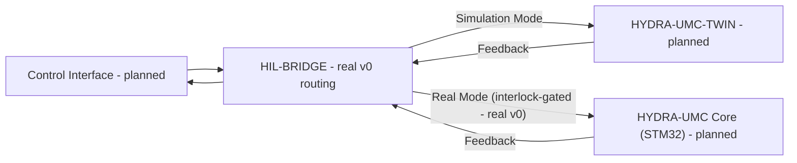

<!-- =============================================================================
HYDRA-UMC-HIL-BRIDGE - Hardware-in-the-loop bridge
Copyright (C) JuanenRac (Electro Hobby 3D) <electrohobby3d@gmail.com>
GPL-3.0-or-later - see LICENSE
============================================================================= -->

<p align="center">
  
</p>

# 🔁 HYDRA-UMC-HIL-BRIDGE

<p align="center">🇺🇸 <b>English</b> | <a href="README_spa.md">🇪🇸 Español</a> | <a href="README_fra.md">🇫🇷 Français</a> | <a href="README_ita.md">🇮🇹 Italiano</a> | <a href="README_deu.md">🇩🇪 Deutsch</a> | <a href="README_zho.md">🇨🇳 简体中文</a> | <a href="README_jpn.md">🇯🇵 日本語</a> | <a href="README_por.md">🇵🇹 Português</a></p>

### ⚡ Hardware-in-the-Loop Interface for Real-vs-Virtual Sync

<p align="center">
  
  
  
  
  
  
</p>

---

> **Safety and security status:** this ecosystem is not a certified safety system. There is no hardware E-STOP path, no firmware-enforced limits or interlocks and no verified motion command yet; firmware images are checked with CRC-32 and an Ed25519 signature, and a release build refuses the published development keys (the tool heads and expansion boards behind the relay still run URTC bootloaders, which take a shared-key HMAC-SHA256 instead of a signature); TLS and mutual TLS are optional and off by default; no custom board has been populated or tested yet. Read the [security baseline](https://github.com/JuanenRac/HYDRA-UMC-DOCS/blob/main/docs/SECURITY_BASELINE.md) and the [threat model](https://github.com/JuanenRac/HYDRA-UMC-DOCS/blob/main/docs/THREAT_MODEL.md) before relying on any statement here for the safety of a person.

---

## 📋 At a glance

| | |
|---|---|
| Version | `0.1.0` |
| Maturity | Functional |
| Tests | 115 (`cargo test`) |
| Stack | Rust / hardware-in-the-loop I/O |
| Target | The Raspberry Pi CM5 of a HYDRA-UMC cell |
| On real hardware | Simulated only: tested against emulators, fakes or simulators; no run on real hardware is recorded for this version |

**Jump to:** [Overview](#-overview) · [Architecture](#-architecture) · [Features](#-features) · [Security & Safety](#-security--safety) · [Interfaces](#-interfaces) · [Configuration](#-configuration) · [Quick start](#-quick-start) · [Testing](#-testing) · [Troubleshooting](#-troubleshooting) · [Repository Structure](#-repository-structure) · [Related Projects](#-related-projects)

## 🚦 Project status

Each line is one part of this repository and the light says how far it is today. It is written from what the repository can show (tests, builds, runs), not from what is planned.

🟢 Done and verified · 🟡 Works, with known limits · 🟠 Partly done or not verified yet · 🔴 Not done or not working

| Area | State | What it means here |
|---|---|---|
| Software | 🟡 | Works for its main purpose; the honesty check above lists what is still missing |
| Tests | 🟢 | 115 automated tests, run on every change |
| Real hardware | 🟠 | Simulated only: tested against emulators, fakes or simulators; no run on real hardware is recorded for this version |
| Documentation | 🟢 | README in eight languages, checked against the manifest on every change |

## 🎯 Overview

**HYDRA-UMC-HIL-BRIDGE** is the communication artery meant to enable Hardware-in-the-Loop (HIL) functionality. It routes commands between the physical controllers and the Digital Twin engine and mirrors state between them; no real controller has been connected to it yet.

It allows developers to send commands from any interface (App, Suite, Studio) to the simulator as if it were a physical robot, and conversely, it can mirror a physical robot's movements into the virtual world for remote supervision and digital twin shadowing.

## 🧩 Role in HYDRA-UMC

**HYDRA-UMC-HIL-BRIDGE** sits between a control interface and a robot that may be real or simulated. In real mode a command moves a joint only when the digital twin has signed a fresh interlock certificate for it; in simulation mode the bridge mirrors the position instead. It decides; the transports to the real controller and to the twin are still to come.

## 🏛️ Architecture

The mode-based split at `BRIDGE` and the safety interlock gate on the
`Real Mode` path are real today (`bridge.rs`/`interlock.rs`), routing to
an in-memory sink rather than a live process. Everything touching a real
`APP`, `TWIN` or `CORE` process over a real connection remains future
work.

<p align="center">
  
</p>

<details>
<summary>Text version of the diagram (Mermaid)</summary>



</details>

**Why it is built this way**

* **Why this bridge has no `hardware/`/`firmware/`/`os/` folders.** Pure software - it bridges existing hardware (real apps, real HYDRA-UMC firmware) to the digital twin, no board of its own.
* **Why it's a sibling, not a submodule, of HYDRA-UMC-TWIN.** A hardware-in-the-loop bridge needs to keep running (and keep a real device's commands flowing) independent of whatever HYDRA-UMC-TWIN's own render/physics loop is doing at that instant - a separate process means a twin restart doesn't drop an in-flight real command.
* **How this fits the rest of the ecosystem.** Lets HYDRA-UMC-SUITE, HYDRA-UMC-ANDROID-CONTROL and HYDRA-UMC-IOS-CONTROL control HYDRA-UMC-TWIN as if it were a real HYDRA-UMC-SERVER-backed cell - the same control surface, a simulated target.
* **Why the interlock trusts the twin's own `collision_imminent` flag, and still adds a minimum clearance and fails closed.** The twin has already done the real geometric/physics reasoning by the time it reports risk, so the bridge does not re-derive collisions; but a twin that says "no collision" at one millimetre, a NaN distance, or no report at all is not a statement that the path is clear, so those block the command (`MIN_CLEARANCE_M` = 5 cm, a conservative floor and not a certified distance: the firmware owns that). See `interlock.rs`'s own module docs for how this mirrors HYDRA-UMC-SAFETY-ZONES's detect-vs-enforce boundary.
* **Why `Simulation` mode is never gated by the interlock.** The entire point of routing a command to the twin instead of real hardware is to be able to see a predicted collision play out safely - blocking it there would defeat the feature it exists to support.
* **Why `CommandSink` is a trait with only an in-memory `RecordingSink` implementation today.** No real gRPC/WebSocket transport exists yet (see `Cargo.toml`'s own comment) - `RecordingSink` is honest about that: it records what it was asked to send without transmitting anywhere, the same reasoning as `NullEStopRequester` in HYDRA-UMC-SAFETY-ZONES.
* **Why `CommandSink::send()` returns a `Result` instead of `()`.** A real transport can fail to deliver (timeout, disconnect) independently of whether the interlock allowed the command through - if `send()` can't fail, the bridge has no way to avoid claiming success on a command that never actually arrived. `SimulatedTransport` exists specifically so that failure path is real and testable today, without waiting for a real transport to exist.
* **Why `TransportFailure` is a separate `RouteOutcome` from `BlockedByInterlock`.** They are different kinds of "didn't happen": one is a deliberate safety refusal (the interlock decided not to forward it), the other is best-effort delivery that simply didn't complete. Collapsing them into one generic failure would hide which safety layer actually stopped the command - useful for debugging and for any future policy that treats them differently (e.g. retrying a transport failure is reasonable; retrying past an interlock block is not).

## ✨ Features

* 🔑 **Optional Bearer token:** on loopback the API needs no token; away from loopback `serve` refuses to start without one (`--token-file` or `HYDRA_UMC_HIL_BRIDGE_TOKEN`). With a token set, every request must send `Authorization: Bearer <token>` (constant-time comparison); only `GET /stats`, the health path of the manifest, stays open. *(implemented)*
* 🛡️ **Safety Interlock (v0):** the real `route` subcommand blocks a real-hardware-bound command whenever a twin risk report says a collision is imminent - see "Honesty check" below for exactly what runs today.
* 🧯 **The interlock fails closed (v0):** in `real` mode a command is forwarded only with a twin risk report that says the path is clear: no report blocks it (omitting it used to default to "no collision", which was enough to reach the hardware), a NaN distance blocks it, and so does less than 5 cm of clearance even when the twin did not raise `collision_imminent` (`MIN_CLEARANCE_M`). `--clear-distance METERS` supplies a clear report to the CLI; request bodies over 16 KB are refused with `413`. A report that the caller sends in the same request is still the caller's word until the twin transport exists. *(implemented)*
* 🔏 **Real commands are certified by the twin, and every order is accounted for:** in `real` mode the report that gates a command is no longer the one the caller writes. The request carries `certificate`, a risk report signed with the Ed25519 key of HYDRA-UMC-TWIN for exactly that joint and position; the bridge holds only the public key (`--twin-public-key-file`) and refuses a certificate that is forged, for another command, older than 2 s (`--certificate-max-age-ms`) or already used. With no key configured the real mode blocks every command; `--allow-unsigned-risk` (bench use only, announced at every start) believes the report of the caller again. Each real order is recorded (the caller from `X-Hydra-Caller`, the peer address, whether the Bearer token was presented, the certificate and the outcome) before it is decided: with `--audit-log FILE` it is appended to a file and, if the record cannot be written, the order is refused; `GET /audit` lists the last ones. A fixed test vector, checked against an independent RFC 8032 implementation, is verified by both repositories. *(implemented, tried against the real twin binary; never against hardware)*
* ⏱️ **A real command is a lease, and the bridge stops the joint by itself when the lease runs out:** a command carries `issued_at_ms`, `valid_for_ms` (at most 1000 ms, `--max-valid-for-ms`) and a `seq`; one that is expired, from the future, too long or not newer than the last for its joint is blocked before its certificate is used up. When no newer valid command arrives before the lease ends, the watchdog stops the joint, records it in the audit and counts it in `GET /stats`, whether or not the producer is still alive. Real commands without a window are refused unless `--allow-undated-commands` (announced at every start). *(implemented against the recording sink, no transport yet; never against hardware)*
* 📐 **The joints and ranges of the robot come from its URDF, and requests are served by several workers:** `serve --urdf FILE` blocks a real command for a joint the URDF does not have, a fixed one or a position outside its `<limit>` before its certificate is used (`outsideLimits` in `GET /stats`); `serve --workers N` (default 8) means a client that sends half a request holds one worker, not the bridge, while real orders are still decided one at a time. *(implemented; never against hardware)*
* 🌉 **Bidirectional Bridge (v0, no transport yet):** real mode-based routing (Real/Simulation) and real unconditional mirroring exist; there is no real gRPC/WebSocket connection to an actual HYDRA-UMC-TWIN or HYDRA-UMC controller yet.
* ⚡ **Zero-Latency Mirroring (partial):** the real `mirror` subcommand shadows a command into a recording sink today; "zero-latency" over a real network connection is still future work.
* 📡 **Unified Protocol (planned):** uses gRPC for high-speed local sync and WebSockets for remote monitoring - no network transport is wired in yet, on purpose (see `Cargo.toml`).
* 🧪 **Fail-safe transport, testable without hardware (v0):** `CommandSink::send()` returns a real `Result`, and a `SimulatedTransport` can model a timed-out or disconnected link; the bridge reports a distinct `TransportFailure` outcome rather than ever claiming a command was delivered when it wasn't - exercisable via `--transport-latency-ms`/`--transport-timeout-ms`/`--transport-disconnected` on `route`.
* 🌐 **HTTP JSON API (v0):** `serve [--addr ADDR] [--port PORT]` (default `127.0.0.1:8113`) exposes the exact same routing/mirroring logic over `POST /route`, `POST /mirror` and `GET /stats` via a real blocking `tiny_http` server - the same binary a deployed CM5's `systemd/hydra-umc-hil-bridge.service` unit runs loopback-only. See [`docs/CLI_REFERENCE.md`](docs/CLI_REFERENCE.md) for the full request/response contract.

**Honesty check - what actually runs today:** `route --mode real|simulation --joint NAME --position VALUE [--collision-risk] [--distance METERS] [--transport-latency-ms MS] [--transport-timeout-ms MS] [--transport-disconnected]` makes a real routing decision - `simulation` mode always sends, `real` mode is gated by a real safety interlock that blocks the command when there is no twin risk report, when `--collision-risk` is set, when the distance is NaN or when there is less than 5 cm of clearance (`--clear-distance METERS` supplies a clear report). `mirror --joint NAME --position VALUE` shadows a command unconditionally. `serve` exposes both over real HTTP JSON instead of one-shot CLI invocations. All three route to an in-memory sink by default (`RecordingSink`, not a real controller or a real HYDRA-UMC-TWIN instance), or to a `SimulatedTransport` that can genuinely fail (timeout/disconnect) when the transport flags above are passed - there is no gRPC/WebSocket transport yet. See [`CHANGELOG.md`](CHANGELOG.md) for exactly what shipped, [`docs/CLI_REFERENCE.md`](docs/CLI_REFERENCE.md) for every command/endpoint, and the Roadmap below for what's still ahead.

## 🔒 Security & Safety

| Threat | Defence | Where |
|---|---|---|
| Moving a joint into a collision | A real-mode command needs an ed25519 interlock certificate signed by the twin (domain `hydra-umc-interlock-certificate-v1`), at most 2000 ms old (`--certificate-max-age-ms`), at most 1000 ms in the future, never replayed (8192 nonces remembered) and with a clearance of at least 0.05 m | `certificate.rs`, `interlock.rs` |
| A command with no certificate, no date or an enormous validity | Without `--twin-public-key-file` (or `HYDRA_UMC_HIL_BRIDGE_TWIN_KEY_FILE`) in real mode every command is blocked; `--allow-unsigned-risk` is the bench setting; undated commands need `--allow-undated-commands` and the validity is capped by `--max-valid-for-ms` | `main.rs` |
| An unknown or out-of-range joint, and a lost link | `--urdf` (or `HYDRA_UMC_HIL_BRIDGE_URDF`) defines the joints and their ranges, and without it there is no range check; a watchdog (50 ms tick) stops the joint when its lease expires even when the worker threads are busy | `limits.rs`, `server.rs`, `watchdog.rs` |
| Anonymous access, big bodies, slow requests | A Bearer token of at least 16 characters (`HYDRA_UMC_HIL_BRIDGE_TOKEN` or `--token-file`); a body is at most 16 KiB (`413`), 8 workers by default (`--workers`, 1 to 256); every decision goes into a ring of 200 audit entries (`--audit-log` keeps a file) | `access.rs`, `server.rs`, `audit.rs` |

**What it never does:** it never moves a joint in real mode without a fresh signed certificate, and it has not yet driven a real robot.

## 🔌 Interfaces

An HTTP API on `127.0.0.1:8113` and a command line, both reaching the same decision logic. The `Content-Type` is required (`415` otherwise). The full reference is `docs/CLI_REFERENCE.md`.

| Topic or route | What it carries |
|---|---|
| `POST /route` | decide a command for a joint (real or simulated) |
| `POST /mirror` | mirror a position between the real and the virtual side |
| `GET /stats`, `GET /audit` | counters and the ring of recent decisions |
| `serve` | `serve [--addr 127.0.0.1] [--port 8113] [--workers N] [--token-file FILE]`; the one-shot command line takes `--joint --position --mode --collision-risk --distance --clear-distance` |

## ⚙️ Configuration

| Variable | Default | What it sets |
|---|---|---|
| `HYDRA_UMC_HIL_BRIDGE_TOKEN`, `--token-file` | no token | the Bearer token, at least 16 characters |
| `HYDRA_UMC_HIL_BRIDGE_TWIN_KEY_FILE`, `--twin-public-key-file` | unset | the public key of the twin; without it real mode blocks every command |
| `HYDRA_UMC_HIL_BRIDGE_ALLOW_UNSIGNED_RISK` | `0` | `1` accepts commands without a certificate (bench only) |
| `HYDRA_UMC_HIL_BRIDGE_ALLOW_UNDATED_COMMANDS`, `--max-valid-for-ms` | off | accept commands with no date; cap on how long a command stays valid |
| `HYDRA_UMC_HIL_BRIDGE_URDF`, `--urdf` | unset | the URDF whose joints and ranges are checked |
| `HYDRA_UMC_HIL_BRIDGE_AUDIT_LOG`, `--audit-log` | ring only | also keep the audit entries in this file |
| `--certificate-max-age-ms`, `--workers` | `2000`, `8` | age limit of a certificate; worker threads (1 to 256) |

## 🚀 Quick start

Requires a recent stable Rust toolchain (`cargo`); Python 3 is needed only for the project tools.

```bash
cargo test                                                    # 115 tests, no hardware
bash run.sh        # Linux, macOS (run.bat on Windows)
cargo run --release -- serve --port 8113 --token-file token.txt   # real mode also needs --twin-public-key-file
```

## 🧪 Testing

115 Rust tests run with `cargo test`; they sit inside the modules of `src/`. They need no hardware and no network.

The CI runs `HYDRA_UMC_CI=1 python tools/ci_validate.py`, which checks the manifest, the documents, the eight READMEs and the pictures.

## 🏗️ Build & Release

Requires the Rust toolchain (`cargo`/`rustc`, install via [rustup](https://rustup.rs)) and Python 3.10+ (only for `bump_version.py`).

```bash
# Linux / macOS
./build.sh   # `cargo test` (115 tests), then `cargo build --release`
./run.sh     # runs target/release/hydra-umc-hil-bridge, prints name + version + role
```

```bat
:: Windows
build.bat
run.bat
```

`build.sh`/`build.bat` never change the version (only `python tools/hydra_project_tool.py bump` raises it), run the real test suite, then build a release binary.

The real `route` and `mirror` subcommands:

```bash
./run.sh route --mode real --joint shoulder --position 0.5 --clear-distance 2.0
# SENT: routed to real HYDRA-UMC controller

./run.sh route --mode real --joint shoulder --position 0.5
# BLOCKED: safety interlock refused to forward to real hardware (no twin risk report: a real command is not forwarded without one)

./run.sh route --mode real --joint shoulder --position 0.5 --collision-risk --distance 0.02
# BLOCKED: safety interlock refused to forward to real hardware (twin reports imminent collision at 0.020m)

./run.sh route --mode simulation --joint shoulder --position 0.5 --collision-risk --distance 0.02
# SENT: routed to HYDRA-UMC-TWIN (simulation)

./run.sh mirror --joint elbow --position -0.3
# MIRRORED: joint 'elbow' = -0.300000 shadowed into the twin

./run.sh route --mode real --joint shoulder --position 0.5 --transport-timeout-ms 100 --transport-latency-ms 500
# TRANSPORT FAILURE: command was not confirmed delivered (transport timed out after 100ms)

./run.sh route --mode real --joint shoulder --position 0.5 --transport-disconnected
# TRANSPORT FAILURE: command was not confirmed delivered (transport is disconnected)
```

`route` exits `0` (sent), `1` (blocked by the safety interlock - a real, meaningful outcome, not an error), `2` (bad input), or `3` (transport failure - the interlock allowed it, but delivery wasn't confirmed). `mirror` exits `0`, `2`, or `3`.

The same routing/mirroring logic is also reachable over real HTTP JSON:

```bash
./run.sh serve --addr 127.0.0.1 --port 8113
# [hil-bridge] HTTP API listening on 127.0.0.1:8113
# [hil-bridge] POST /route, POST /mirror, GET /stats

curl -X POST http://127.0.0.1:8113/route \
    -d '{"mode":"real","joint":"shoulder","position":1.0,"risk":{"collision_imminent":true,"distance_m":0.02}}'
# {"BlockedByInterlock":{"reason":"twin reports imminent collision at 0.020m"}}
```

See [`docs/CLI_REFERENCE.md`](docs/CLI_REFERENCE.md) for the full `POST /route`/`POST /mirror`/`GET /stats` request/response contract - this is the same binary a deployed CM5's `systemd/hydra-umc-hil-bridge.service` unit runs.

`Cargo.toml` intentionally carries no external crates yet beyond `tiny_http`/`serde`/`serde_json` (the real HTTP JSON surface) - see the comment inside it for what else gets added once real gRPC/WebSocket transport work starts.

## 🩺 Troubleshooting

| You see | Because | Do |
|---|---|---|
| every command is blocked in real mode | No public key of the twin was given | Give `--twin-public-key-file`; on a bench only, `--allow-unsigned-risk` |
| a certificate is refused | It is older than 2000 ms, too far in the future, replayed or leaves less than 0.05 m of clearance | Make the twin sign a new one for each command and keep the clocks of both sides close |
| `415`, `413` | The `Content-Type` is missing or the body is over 16 KiB | Send `Content-Type: application/json` and a smaller body |

## 📂 Repository Structure

<p align="center">
  
</p>

<details>
<summary>Text version of the tree</summary>

```text
HYDRA-UMC-HIL-BRIDGE/
├── src/
│   ├── bridge.rs                                route and mirror decisions
│   ├── certificate.rs                           the signed interlock certificate (ed25519)
│   ├── interlock.rs limits.rs                   interlock rules and URDF joint limits
│   ├── server.rs                                the HTTP API, workers and the watchdog thread
│   ├── watchdog.rs                              stops a joint when its lease expires
│   ├── access.rs audit.rs                       Bearer token and the audit ring
│   └── protocol.rs main.rs                      message shapes, CLI and start-up
├── docs/                                        the command-line reference and the interlock certificate
├── systemd/                                     service unit for the CM5
├── tools/                                       build and test runner, version bump, CI validator, README and picture generators and checks
├── images/                                      banner and the pictures of the README
├── .github/                                     CI workflow and issue templates
├── hydra-umc.project.json                       manifest: version, maturity, family
├── CHANGELOG.md                                 what changed in each version
├── build.sh build.bat                           build scripts (they never change the version)
├── build-test.sh build-test.bat                 build scripts (they never change the version)
├── test.sh test.bat                             run the tests
├── Cargo.toml / Cargo.lock                      Rust package and locked dependencies
├── bump_version.py / bump_manifest_version.py   explicit version bump
├── run.sh run.bat                               start the service
└── SECURITY.md SUPPORT.md CONTRIBUTING.md CODE_OF_CONDUCT.md LICENSE LICENSE.md
```

</details>

## 🗺️ Roadmap & Known limits

**Known limits today**

* **Phase 1:** Digital Twin synchronization with real-time hardware telemetry and sub-10ms latency.
* **Phase 2:** Physics Replica integration with industrial-grade simulators (Isaac Sim) and deformable body support.
* **Phase 3:** Node Healing automated recovery patterns for decentralized failover and early sensor degradation detection.
* **Phase 4:** Multi-controller HIL synchronization (Swarm HIL) and photorealistic synthetic data generation support.

## 🌍 Languages

This README and the documents of the repository exist in eight languages: English, Spanish, German, French, Italian, Japanese, Chinese and Portuguese (Portugal). They are written together and checked in the CI so that the eight files have the same sections and the same links. This repository has no screen or message catalogue of its own, so there are no interface strings to translate.

## 🔗 Related Projects

This project is part of the HYDRA-UMC robotics ecosystem by the same author (JuanenRac / Electro Hobby 3D). Worth knowing about, since a request might actually be about one of these rather than this repository.

**Parent Project**
- **[HYDRA-UMC-TWIN](https://github.com/JuanenRac/HYDRA-UMC-TWIN)** — integration hub for the digital-twin engine, with a real version-compatibility sync contract; the parent this repo is one specific simulation service of, within its own digital-twin engine.

**Sibling Projects** — the other simulation services of HYDRA-UMC-TWIN's own digital-twin engine
- **[HYDRA-UMC-PHYSICS-REPLICA](https://github.com/JuanenRac/HYDRA-UMC-PHYSICS-REPLICA)** — real forward kinematics and joint-limit validation over a real URDF subset.
- **[HYDRA-UMC-SYNTHETIC-DATA-GEN](https://github.com/JuanenRac/HYDRA-UMC-SYNTHETIC-DATA-GEN)** — real procedural 2D scene generator with YOLO/COCO annotation export.

**Directly Related**
- **[HYDRA-UMC-STUDIO](https://github.com/JuanenRac/HYDRA-UMC-STUDIO)** — web control dashboard with real-time multi-robot 3D visualization — one of the 3 client interfaces that can send commands through this bridge as if it were a physical robot, once a real transport exists.
- **[HYDRA-UMC-SUITE](https://github.com/JuanenRac/HYDRA-UMC-SUITE)** — desktop (PySide6) swarm command center for multiple servers at once, packaged as a standalone executable — one of the 3 client interfaces that can send commands through this bridge as if it were a physical robot, once a real transport exists.
- **[HYDRA-UMC-ANDROID-CONTROL](https://github.com/JuanenRac/HYDRA-UMC-ANDROID-CONTROL)** — native Android control app with biometric login and a paired Wear OS companion — one of the 3 client interfaces that can send commands through this bridge as if it were a physical robot, once a real transport exists.
- **[HYDRA-UMC-IOS-CONTROL](https://github.com/JuanenRac/HYDRA-UMC-IOS-CONTROL)** — iOS/iPadOS control app (Flutter) with real-time WebSocket sync — one of the 3 client interfaces that can send commands through this bridge as if it were a physical robot, once a real transport exists.
- **[HYDRA-UMC-SERVER](https://github.com/JuanenRac/HYDRA-UMC-SERVER)** — the real headless backend (REST/WebSocket) every control client actually talks to — the backend behind all 3 of those client interfaces, the real controller this bridge's own `route --mode real` ultimately targets once a transport exists.

**Also Part of the Ecosystem**

*Core Hardware & Platform*
- **[HYDRA-UMC](https://github.com/JuanenRac/HYDRA-UMC)** — the robot-arm motherboard design: CM5 host + dual-core STM32H745, meant to orchestrate up to 8 tool arms over CAN-OTA/SPI-OTA (firmware at an early stage; no populated board yet).
- **[HYDRA-UMC-OS](https://github.com/JuanenRac/HYDRA-UMC-OS)** — reproducible Raspberry Pi OS product layer for the CM5: read-only agent, validated config/profiles, WiFi first-contact provisioning.
- **[HYDRA-UMC-SDK](https://github.com/JuanenRac/HYDRA-UMC-SDK)** — the shared JSON-Schema contract and software job-gate boundary every bridge validates its commands against (not a certified safety function).
- **[HYDRA-UMC-CONNECTOR-HUB](https://github.com/JuanenRac/HYDRA-UMC-CONNECTOR-HUB)** — declarative adapter-manifest registry and validator for external-machine connectors; extends the SDK's own contract idea to external machines without replacing the industrial-gateway projects.

*Core Backend & Clients*
- **[HYDRA-UMC-DSI](https://github.com/JuanenRac/HYDRA-UMC-DSI)** — native touch UI for the onboard 7" DSI touchscreen, embedded on the CM5 itself.
- **[HYDRA-UMC-EDITOR-URDF](https://github.com/JuanenRac/HYDRA-UMC-EDITOR-URDF)** — desktop graphical URDF creator/editor that pushes finished models into STUDIO's own catalog.
- **[HYDRA-UMC-EDITOR-STL](https://github.com/JuanenRac/HYDRA-UMC-EDITOR-STL)** — desktop STL model editor, transforming/replacing/removing/adding real parts in the same model catalog HYDRA-UMC-EDITOR-URDF also edits.
- **[HYDRA-UMC-BRIDGE-AMR](https://github.com/JuanenRac/HYDRA-UMC-BRIDGE-AMR)** — coordination boundary for AGV/AMR fleets via a VDA 5050 MQTT publisher (tested against an emulated fleet only).
- **[HYDRA-UMC-BRIDGE-CNC](https://github.com/JuanenRac/HYDRA-UMC-BRIDGE-CNC)** — high-level CNC-cell coordinator with GRBL status/control-byte access (tested against an emulator only).
- **[HYDRA-UMC-BRIDGE-DROIDS](https://github.com/JuanenRac/HYDRA-UMC-BRIDGE-DROIDS)** — coordination boundary for legged/humanoid droids, with a Boston Dynamics Spot command sender (tested against an emulator only).
- **[HYDRA-UMC-BRIDGE-LASER](https://github.com/JuanenRac/HYDRA-UMC-BRIDGE-LASER)** — laser-cell coordinator reading 3 key/enclosure/interlock GPIO signals (tested against a fake chip only; it cannot arm or fire a laser).
- **[HYDRA-UMC-BRIDGE-OPENPNP](https://github.com/JuanenRac/HYDRA-UMC-BRIDGE-OPENPNP)** — safe high-level board-flow coordinator for OpenPnP pick-and-place.
- **[HYDRA-UMC-BRIDGE-PRINTER3D](https://github.com/JuanenRac/HYDRA-UMC-BRIDGE-PRINTER3D)** — safe coordination boundary for Moonraker/Klipper 3D printers, with real gated job commands.
- **[HYDRA-UMC-BRIDGE-ROS2](https://github.com/JuanenRac/HYDRA-UMC-BRIDGE-ROS2)** — coordinator with a lazily imported rclpy ROS 2 transport (not yet run against a ROS 2 installation).
- **[HYDRA-UMC-BRIDGE-UAV](https://github.com/JuanenRac/HYDRA-UMC-BRIDGE-UAV)** — coordination boundary for camera-equipped UAVs, with a MAVLink command sender (tested against an emulator only).

*URTC Tool Platform*
- **[URTC](https://github.com/JuanenRac/URTC)** — firmware for the physical Universal Robot Tool Controller PCB, 25+ tool profiles over CAN bus.
- **[URTC-FLASHER](https://github.com/JuanenRac/URTC-FLASHER)** — desktop GUI flashing tool for URTC boards, CAN-OTA plus full-chip SWD/JTAG.
- **[URTC-TESTER](https://github.com/JuanenRac/URTC-TESTER)** — desktop live CAN-bus diagnostic tool for URTC boards, one panel per tool profile.
- **[URTC-WEB-STUDIO](https://github.com/JuanenRac/URTC-WEB-STUDIO)** — browser-based alternative to URTC-TESTER via the Web Serial API, no local install needed.
- **[URTC-GATEWAY](https://github.com/JuanenRac/URTC-GATEWAY)** — gateway in front of the URTC CAN bus: an allowed list of identifiers, a rate limit and a session key; software tested on a computer, not yet on a real bus.

*Vision AI Node (Hailo-8)*
- **[HYDRA-UMC-VISION-NODE](https://github.com/JuanenRac/HYDRA-UMC-VISION-NODE)** — integration hub for the Hailo-8 vision pipeline, with a real per-stage hardware-readiness check.
- **[HYDRA-UMC-DETECTION-HEF](https://github.com/JuanenRac/HYDRA-UMC-DETECTION-HEF)** — real compiled-model registry with Hailo-architecture/checksum safe-load verification.
- **[HYDRA-UMC-VISION-STREAMER](https://github.com/JuanenRac/HYDRA-UMC-VISION-STREAMER)** — real GStreamer pipeline + MediaMTX config generator with a real HailoRT integration boundary.
- **[HYDRA-UMC-VISUAL-SERVOING-API](https://github.com/JuanenRac/HYDRA-UMC-VISUAL-SERVOING-API)** — Position-Based Visual Servoing correction law with authorisation gated on the zone state; no camera pose estimation yet.
- **[HYDRA-UMC-SAFETY-ZONES](https://github.com/JuanenRac/HYDRA-UMC-SAFETY-ZONES)** — v0 zone-breach, calibration-freshness and E-STOP-request logic that takes object positions from a file; no detector feeds it and no physical E-STOP is wired to it yet.

*Cognitive AI Node (Hailo-10)*
- **[HYDRA-UMC-COGNITIVE-NODE](https://github.com/JuanenRac/HYDRA-UMC-COGNITIVE-NODE)** — integration hub for the Hailo-10 cognitive pipeline (LLM/VLA/voice orchestration).
- **[HYDRA-UMC-VLA-ENGINE](https://github.com/JuanenRac/HYDRA-UMC-VLA-ENGINE)** — real action-token encoding/decoding and trajectory generation for a Vision-Language-Action model.
- **[HYDRA-UMC-VOICE-UI](https://github.com/JuanenRac/HYDRA-UMC-VOICE-UI)** — real voice front-end (VAD + intent parser) with a bounded, confirmation-gated Watch relay.
- **[HYDRA-UMC-SEMANTIC-PLANNER](https://github.com/JuanenRac/HYDRA-UMC-SEMANTIC-PLANNER)** — real rule-based task decomposition and semantic error recovery over MCU error codes.
- **[HYDRA-UMC-DOCS-QA](https://github.com/JuanenRac/HYDRA-UMC-DOCS-QA)** — real stdlib-only TF-IDF document search over this ecosystem's own Markdown docs.
- **[HYDRA-UMC-LOCAL-TECHNICIAN](https://github.com/JuanenRac/HYDRA-UMC-LOCAL-TECHNICIAN)** — local, policy-gated AI maintenance technician for the ecosystem itself - observes, diagnoses and proposes fixes; the two highest risk levels are deliberately not implemented yet.

*Orchestration & Swarm*
- **[HYDRA-UMC-ORCHESTRATOR](https://github.com/JuanenRac/HYDRA-UMC-ORCHESTRATOR)** — integration hub with a real gRPC/Protobuf health-report contract and mission state machine.
- **[HYDRA-UMC-JOB-DISPATCHER](https://github.com/JuanenRac/HYDRA-UMC-JOB-DISPATCHER)** — real priority-based job queue with deduplication, over a real HTTP API.
- **[HYDRA-UMC-NODE-HEALING](https://github.com/JuanenRac/HYDRA-UMC-NODE-HEALING)** — real gRPC-based fleet health watchdog with retry/backoff and identity-mismatch detection.
- **[HYDRA-UMC-PATH-PLANNER-3D](https://github.com/JuanenRac/HYDRA-UMC-PATH-PLANNER-3D)** — real RRT-based 3D path planner with real obstacle/workspace collision validation.
- **[HYDRA-UMC-SWARM-SYNC](https://github.com/JuanenRac/HYDRA-UMC-SWARM-SYNC)** — real CRDT LWW-Element-Map state sync, property-tested for multi-cell convergence.

*Data & Analytics*
- **[HYDRA-UMC-DATALAKE](https://github.com/JuanenRac/HYDRA-UMC-DATALAKE)** — real sqlite3-backed time-series store with a real ingest/query HTTP API.
- **[HYDRA-UMC-ANOMALY-DETECTOR](https://github.com/JuanenRac/HYDRA-UMC-ANOMALY-DETECTOR)** — real FFT + statistical baseline anomaly detector with drift monitoring.
- **[HYDRA-UMC-PRODUCTION-REPORTS](https://github.com/JuanenRac/HYDRA-UMC-PRODUCTION-REPORTS)** — real OEE/availability calculation over DATALAKE history, with reproducible CSV export.
- **[HYDRA-UMC-TELEMETRY-COLLECTOR](https://github.com/JuanenRac/HYDRA-UMC-TELEMETRY-COLLECTOR)** — real CAN/WebSocket ingestion pipeline into DATALAKE, with sequence deduplication.

*Industrial Gateway*
- **[HYDRA-UMC-GATEWAY-INDUSTRIAL](https://github.com/JuanenRac/HYDRA-UMC-GATEWAY-INDUSTRIAL)** — integration hub relaying to industrial protocols, with a real command allowlist/backpressure layer.
- **[HYDRA-UMC-OPCUA-SERVER](https://github.com/JuanenRac/HYDRA-UMC-OPCUA-SERVER)** — real OPC-UA address space, verified with a real binary-protocol client session.
- **[HYDRA-UMC-MQTT-BROKER](https://github.com/JuanenRac/HYDRA-UMC-MQTT-BROKER)** — real MQTT broker with optional per-client authentication and topic ACLs.
- **[HYDRA-UMC-MTCONNECT-ADAPTER](https://github.com/JuanenRac/HYDRA-UMC-MTCONNECT-ADAPTER)** — real MTConnect `/probe` and `/current` XML endpoints with degraded-mode output.

*Complementary Tools & Ecosystem Operations*
- **[HYDRA-UMC-DASHBOARD-AI](https://github.com/JuanenRac/HYDRA-UMC-DASHBOARD-AI)** — Smart Summaries and Anomaly Highlighting panels over DATALAKE/ANOMALY-DETECTOR, with an honest statistical fallback.
- **[HYDRA-UMC-TOOL-CLI](https://github.com/JuanenRac/HYDRA-UMC-TOOL-CLI)** — fleet CLI with a real, stable exit-code contract, a genuine live client of HYDRA-UMC-SERVER's own API.
- **[HYDRA-UMC-WATCH](https://github.com/JuanenRac/HYDRA-UMC-WATCH)** — WearOS companion app with haptic alert patterns and a paired-phone voice relay (not yet run on a physical watch).
- **[URTC-SMART-RACK](https://github.com/JuanenRac/URTC-SMART-RACK)** — firmware for a board-mounting rack with real tool-ID decoding and Smart Idle pre-heating logic.
- **[URTC-VISION-TOOL](https://github.com/JuanenRac/URTC-VISION-TOOL)** — firmware plus a real Python vision companion for a thermal/RGB inspection tool head.
- **[HYDRA-UMC-UPDATER](https://github.com/JuanenRac/HYDRA-UMC-UPDATER)** — administrative desktop tool that discovers, clones and updates every repo in this ecosystem.
- **[HYDRA-UMC-OS-REBUILDER](https://github.com/JuanenRac/HYDRA-UMC-OS-REBUILDER)** — Windows/Linux desktop tool that builds a ready-to-flash CM5 image pre-loaded with the ecosystem's most current versions, with Raspberry-Pi-Imager-style first-boot Wi-Fi/user/SSH configuration.
- **[HYDRA-UMC-OPS-AGENT](https://github.com/JuanenRac/HYDRA-UMC-OPS-AGENT)** — maintenance-incident coordinator: a low-privilege edge role collects a sanitized inventory/health snapshot, a control-plane role renders it read-only and asks an AI provider to suggest a diagnosis - never applies a patch or deploys anything.
- **[HYDRA-UMC-DEV-SERVER](https://github.com/JuanenRac/HYDRA-UMC-DEV-SERVER)** — reproducible development host (Raspberry Pi 5 / CM5) that stores the ecosystem's source and runs bounded build/test tasks under a durable queue; a dedicated dev role, explicitly not an operational CM5.

## 📚 Documentation

Where to read more:

* [docs/CLI_REFERENCE.md](docs/CLI_REFERENCE.md) - every command-line option, the HTTP routes and their errors
* [docs/INTERLOCK_CERTIFICATE.md](docs/INTERLOCK_CERTIFICATE.md) - what the signed interlock certificate says and how it is checked
* [Security baseline of the ecosystem](https://github.com/JuanenRac/HYDRA-UMC-DOCS/blob/main/docs/SECURITY_BASELINE.md)
* [Threat model of the ecosystem](https://github.com/JuanenRac/HYDRA-UMC-DOCS/blob/main/docs/THREAT_MODEL.md)
* [Changelog of this repository](CHANGELOG.md)
* [License of this repository](LICENSE.md)

## 🤝 Contributing & Community

* Before a pull request run `HYDRA_UMC_CI=1 py -3 tools/ci_validate.py` (or `HYDRA_UMC_CI=1 python3 tools/ci_validate.py`): it must print `CI_VALIDATION=PASS`. Do not run `build.sh` or `build.bat` for this check; building is not a check.
* The eight READMEs are written from one source in HYDRA-UMC-DOCS; do not edit them by hand. Change the source and write them again with `tools/make_readmes.py`.
* Do not state in a README what has not run: say "simulated" or "not tried on hardware" where that is the truth.
* See [CONTRIBUTING.md](CONTRIBUTING.md), the [code of conduct](CODE_OF_CONDUCT.md), [SECURITY.md](SECURITY.md) and [SUPPORT.md](SUPPORT.md).

## 👤 AUTHOR

**JuanenRac (Electro Hobby 3D)** · electrohobby3d@gmail.com

## 📜 LICENSE

GPL-3.0-or-later - [LICENSE](LICENSE).
