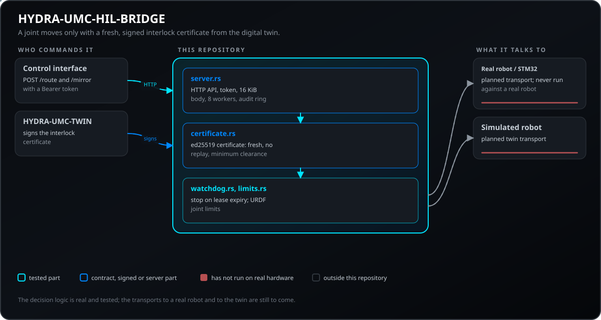
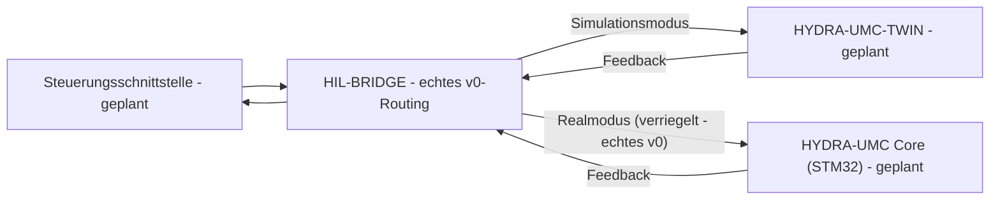
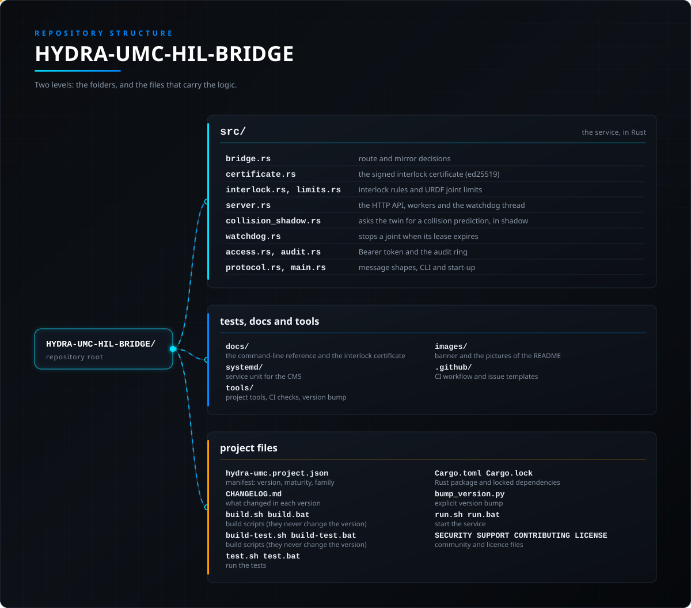

<!-- =============================================================================
HYDRA-UMC-HIL-BRIDGE - Hardware-in-the-loop bridge
Copyright (C) JuanenRac (Electro Hobby 3D) <electrohobby3d@gmail.com>
GPL-3.0-or-later - see LICENSE
============================================================================= -->

<p align="center">
  
</p>

# 🔁 HYDRA-UMC-HIL-BRIDGE

<p align="center"><a href="README.md">🇺🇸 English</a> | <a href="README_spa.md">🇪🇸 Español</a> | <a href="README_fra.md">🇫🇷 Français</a> | <a href="README_ita.md">🇮🇹 Italiano</a> | 🇩🇪 <b>Deutsch</b> | <a href="README_zho.md">🇨🇳 简体中文</a> | <a href="README_jpn.md">🇯🇵 日本語</a> | <a href="README_por.md">🇵🇹 Português</a></p>

### ⚡ Hardware-in-the-Loop-Schnittstelle für Real-vs-Virtual-Sync

<p align="center">
  
  
  
  
  
  
</p>

---

> **Stand von Sicherheit (Safety) und Security:** Dieses Ökosystem ist kein zertifiziertes Sicherheitssystem. Es gibt noch keinen Hardware-E-STOP-Pfad, keine von der Firmware durchgesetzten Grenzen oder Verriegelungen und keinen verifizierten Bewegungsbefehl; Firmware-Images werden mit CRC-32 und einer Ed25519-Signatur geprüft, und ein Release-Build verweigert die veröffentlichten Entwicklungsschlüssel (die Werkzeugköpfe und Erweiterungsplatinen hinter dem Relais laufen noch mit URTC-Bootloadern, die statt einer Signatur ein HMAC-SHA256 mit gemeinsamem Schlüssel verwenden); TLS und gegenseitiges TLS sind optional und standardmäßig aus; noch keine eigene Platine wurde bestückt oder getestet. Lesen Sie die [Sicherheitsbasis](https://github.com/JuanenRac/HYDRA-UMC-DOCS/blob/main/docs/SECURITY_BASELINE.md) und das [Bedrohungsmodell](https://github.com/JuanenRac/HYDRA-UMC-DOCS/blob/main/docs/THREAT_MODEL.md), bevor Sie sich für die Sicherheit einer Person auf eine Aussage hier verlassen.

---

## 📋 Auf einen Blick

| | |
|---|---|
| Version | `0.1.0` |
| Reifegrad | Funktionsfähig |
| Tests | 115 (`cargo test`) |
| Technik | Rust / hardware-in-the-loop I/O |
| Ziel | Der Raspberry Pi CM5 einer HYDRA-UMC-Zelle |
| Auf echter Hardware | Nur simuliert: gegen Emulatoren, Attrappen oder Simulatoren getestet; für diese Version ist kein Lauf auf echter Hardware vermerkt |

**Springe zu:** [Überblick](#-überblick) · [Architektur](#-architektur) · [Funktionen](#-funktionen) · [Sicherheit und Schutz](#-sicherheit-und-schutz) · [Schnittstellen](#-schnittstellen) · [Konfiguration](#-konfiguration) · [Schnellstart](#-schnellstart) · [Tests](#-tests) · [Fehlerbehebung](#-fehlerbehebung) · [Struktur des Repositorys](#-struktur-des-repositorys) · [Verwandte Projekte](#-verwandte-projekte)

## 🚦 Projektstatus

Jede Zeile ist ein Teil dieses Repositorys, und die Ampel sagt, wie weit er heute ist. Sie beruht auf dem, was das Repository zeigen kann (Tests, Builds, Läufe), nicht auf dem, was geplant ist.

🟢 Fertig und überprüft · 🟡 Funktioniert, mit bekannten Grenzen · 🟠 Teilweise fertig oder noch nicht überprüft · 🔴 Nicht gemacht oder funktioniert nicht

| Bereich | Stand | Was das hier bedeutet |
|---|---|---|
| Software | 🟡 | Funktioniert für seinen Hauptzweck; die Ehrlichkeitsprüfung oben nennt, was noch fehlt |
| Tests | 🟢 | 115 automatische Tests, bei jeder Änderung ausgeführt |
| Echte Hardware | 🟠 | Nur simuliert: gegen Emulatoren, Attrappen oder Simulatoren getestet; für diese Version ist kein Lauf auf echter Hardware vermerkt |
| Dokumentation | 🟢 | README in acht Sprachen, bei jeder Änderung gegen das Manifest geprüft |

## 🎯 Überblick

**HYDRA-UMC-HIL-BRIDGE** ist die Kommunikationsader, die die Hardware-in-the-Loop-Funktionalität (HIL) ermöglichen soll. Sie leitet Befehle zwischen den physischen Steuerungen und der Digital-Twin-Engine weiter und spiegelt den Zustand zwischen beiden; noch wurde keine echte Steuerung angeschlossen.

Sie ermöglicht es Entwicklern, Befehle von jeder Schnittstelle (App, Suite, Studio) an den Simulator zu senden, als wäre er ein physischer Roboter, und umgekehrt kann sie die Bewegungen eines physischen Roboters in die virtuelle Welt spiegeln, zur Fernüberwachung und zum Shadowing des digitalen Zwillings.

## 🧩 Rolle in HYDRA-UMC

**HYDRA-UMC-HIL-BRIDGE** sitzt zwischen einer Steuerungsoberfläche und einem Roboter, der echt oder simuliert sein kann. Im Realmodus bewegt ein Befehl ein Gelenk nur, wenn der digitale Zwilling dafür ein frisches Verriegelungszertifikat signiert hat; im Simulationsmodus spiegelt der Bridge stattdessen die Position. Er entscheidet; die Transporte zur echten Steuerung und zum Zwilling folgen noch.

## 🏛️ Architektur

Die modusbasierte Aufteilung bei `BRIDGE` und die Sicherheitsverriegelung
auf dem `Realmodus`-Pfad sind heute real (`bridge.rs`/`interlock.rs`) und
leiten an einen In-Memory-Empfänger weiter, statt an einen echten
laufenden Prozess. Alles, was einen echten `APP`-, `TWIN`- oder
`CORE`-Prozess über eine echte Verbindung betrifft, bleibt zukünftige
Arbeit.

<p align="center">
  
</p>

<details>
<summary>Textversion des Diagramms (Mermaid)</summary>



</details>

**Warum es so gebaut ist**

* **Warum diese Brücke keine `hardware/`/`firmware/`/`os/`-Ordner hat.** Reine Software - sie verbindet bereits vorhandene Hardware (echte Apps, echte HYDRA-UMC-Firmware) mit dem digitalen Zwilling, ohne eigene Platine.
* **Warum sie Geschwister, kein Submodul, von HYDRA-UMC-TWIN ist.** Eine Hardware-in-the-Loop-Brücke muss weiterlaufen (und die Befehle eines echten Geräts weiterfließen lassen), unabhängig davon, was die eigene Render-/Physikschleife von HYDRA-UMC-TWIN gerade tut - ein separater Prozess bedeutet, dass ein Neustart des Zwillings keinen laufenden echten Befehl verwirft.
* **Wie sich das ins restliche Ökosystem einfügt.** Lässt HYDRA-UMC-SUITE, HYDRA-UMC-ANDROID-CONTROL und HYDRA-UMC-IOS-CONTROL HYDRA-UMC-TWIN steuern, als wäre es eine echte, von HYDRA-UMC-SERVER unterstützte Zelle - dieselbe Steuerungsoberfläche, ein simuliertes Ziel.
* **Warum die Verriegelung dem eigenen `collision_imminent`-Flag des Zwillings vertraut und trotzdem einen Mindestabstand ergänzt und geschlossen ausfällt.** Der Zwilling hat die eigentliche geometrische/physikalische Überlegung beim Melden des Risikos schon geleistet, daher leitet die Brücke Kollisionen nicht erneut ab; aber ein Zwilling, der bei einem Millimeter "keine Kollision" sagt, eine NaN-Distanz oder gar kein Bericht sind keine Aussage, dass der Weg frei ist, und blockieren daher den Befehl (`MIN_CLEARANCE_M` = 5 cm, eine konservative Untergrenze und keine zertifizierte Distanz: die liegt bei der Firmware). Siehe die Moduldokumentation von `interlock.rs`, wie das die Detect-vs-Enforce-Grenze von HYDRA-UMC-SAFETY-ZONES spiegelt.
* **Warum der `Simulation`-Modus nie durch die Verriegelung blockiert wird.** Der ganze Sinn, einen Befehl an den Zwilling statt an echte Hardware zu leiten, ist es, eine vorhergesagte Kollision sicher beobachten zu können - sie dort zu blockieren würde genau die Funktion zunichtemachen, die sie unterstützen soll.
* **Warum `CommandSink` heute ein Trait mit nur einer In-Memory-Implementierung `RecordingSink` ist.** Es gibt noch keinen echten gRPC/WebSocket-Transport (siehe den eigenen Kommentar in `Cargo.toml`) - `RecordingSink` ist ehrlich damit: Es zeichnet auf, was es senden sollte, ohne irgendwohin zu übertragen, dieselbe Überlegung wie bei `NullEStopRequester` in HYDRA-UMC-SAFETY-ZONES.
* **Warum `CommandSink::send()` ein `Result` statt `()` zurückgibt.** Ein echter Transport kann bei der Zustellung scheitern (Timeout, Verbindungsabbruch), unabhängig davon, ob die Verriegelung den Befehl durchgelassen hat - wenn `send()` nicht fehlschlagen kann, hat die Brücke keine Möglichkeit, Erfolg für einen Befehl zu behaupten, der nie wirklich angekommen ist. `SimulatedTransport` existiert genau deshalb, damit dieser Fehlerpfad heute real und testbar ist, ohne auf einen echten Transport zu warten.
* **Warum `TransportFailure` ein eigenes `RouteOutcome`, getrennt von `BlockedByInterlock`, ist.** Es sind zwei verschiedene Arten von "ist nicht passiert": Die eine ist eine bewusste Sicherheitsverweigerung (die Verriegelung hat entschieden, nicht weiterzuleiten), die andere ist eine Best-Effort-Zustellung, die einfach nicht abgeschlossen wurde. Sie zu einem generischen Fehler zusammenzufassen würde verbergen, welche Sicherheitsschicht den Befehl tatsächlich gestoppt hat - nützlich zum Debuggen und für jede zukünftige Richtlinie, die sie unterschiedlich behandelt (ein Transportfehler erneut zu versuchen ist sinnvoll; nach einer Verriegelungsblockade erneut zu versuchen nicht).

## ✨ Funktionen

* 🔑 **Optionales Bearer-Token:** auf Loopback braucht die API kein Token; außerhalb von Loopback startet `serve` ohne eines nicht (`--token-file` oder `HYDRA_UMC_HIL_BRIDGE_TOKEN`). Ist ein Token gesetzt, muss jede Anfrage `Authorization: Bearer <token>` senden (Vergleich in konstanter Zeit); nur `GET /stats`, der Health-Pfad des Manifests, bleibt offen. *(implementiert)*
* 🛡️ **Sicherheitsverriegelung (v0):** der echte Subbefehl `route` blockiert einen für echte Hardware bestimmten Befehl, sobald ein Zwillings-Risikobericht eine bevorstehende Kollision meldet - siehe "Ehrlichkeitscheck" unten für das, was heute genau läuft.
* 🧯 **Die Verriegelung fällt geschlossen aus (v0):** Im Modus `real` wird ein Befehl nur mit einem Zwillings-Risikobericht weitergeleitet, der den Weg als frei meldet: ohne Bericht wird er blockiert (ihn wegzulassen galt früher als "keine Kollision" und genügte, um die Hardware zu erreichen), eine NaN-Distanz blockiert ihn, ebenso weniger als 5 cm Abstand, auch wenn der Zwilling `collision_imminent` nicht gesetzt hat (`MIN_CLEARANCE_M`). `--clear-distance METER` liefert der CLI einen Frei-Bericht; Anfragekörper über 16 KB werden mit `413` abgelehnt. Ein Bericht, den der Aufrufer in derselben Anfrage mitschickt, bleibt bis zum Zwillingstransport das Wort des Aufrufers. *(implementiert)*
* 🔏 **Reale Befehle werden vom Zwilling beglaubigt, und jeder Auftrag wird festgehalten:** im Modus `real` ist der Bericht, der einen Befehl freigibt, nicht mehr der, den der Aufrufer schreibt. Die Anfrage trägt `certificate`, einen mit dem Ed25519-Schlüssel von HYDRA-UMC-TWIN signierten Risikobericht für genau dieses Gelenk und diese Position; die Bridge hält nur den öffentlichen Schlüssel (`--twin-public-key-file`) und lehnt ein gefälschtes, für einen anderen Befehl gültiges, älter als 2 s (`--certificate-max-age-ms`) oder bereits benutztes Zertifikat ab. Ohne konfigurierten Schlüssel blockiert der reale Modus jeden Befehl; `--allow-unsigned-risk` (nur Prüfstand, bei jedem Start angekündigt) glaubt dem Bericht des Aufrufers wieder. Jeder reale Auftrag wird festgehalten (der Aufrufer aus `X-Hydra-Caller`, die Peer-Adresse, ob das Bearer-Token vorgelegt wurde, das Zertifikat und das Ergebnis), bevor er entschieden wird: mit `--audit-log DATEI` wird er an eine Datei angehängt und, wenn der Eintrag nicht geschrieben werden kann, wird der Auftrag abgelehnt; `GET /audit` listet die letzten. Ein fester Testvektor, mit einer unabhängigen RFC-8032-Implementierung geprüft, wird von beiden Repositories verifiziert. *(implementiert, gegen die echte Zwilling-Binärdatei erprobt; nie gegen Hardware)*
* ⏱️ **Ein realer Befehl ist eine Frist, und die Brücke hält das Gelenk selbst an, wenn sie abläuft:** Ein Befehl trägt `issued_at_ms`, `valid_for_ms` (höchstens 1000 ms, `--max-valid-for-ms`) und ein `seq`; ein abgelaufener, aus der Zukunft stammender, zu langer oder nicht neuerer als der letzte seines Gelenks wird blockiert, bevor sein Zertifikat verbraucht ist. Trifft vor Fristende kein neuerer gültiger Befehl ein, hält der Wächter das Gelenk an, protokolliert es im Audit und zählt es in `GET /stats`, ob der Erzeuger noch lebt oder nicht. Reale Befehle ohne Frist werden abgelehnt, außer mit `--allow-undated-commands` (bei jedem Start angekündigt). *(umgesetzt gegen die nur aufzeichnende Senke, noch ohne Transport; nie gegen Hardware)*
* 📐 **Gelenke und Bereiche des Roboters stammen aus seiner URDF, und Anfragen werden von mehreren Arbeitern bedient:** `serve --urdf DATEI` blockiert einen realen Befehl für ein Gelenk, das die URDF nicht hat, ein festes Gelenk oder eine Position außerhalb seines `<limit>`, bevor sein Zertifikat verbraucht wird (`outsideLimits` in `GET /stats`); mit `serve --workers N` (Standard 8) hält ein Client, der nur die halbe Anfrage sendet, einen Arbeiter und nicht die Brücke auf, während reale Aufträge weiter einzeln entschieden werden. *(umgesetzt; nie gegen Hardware)*
* 🌉 **Bidirektionale Brücke (v0, noch ohne Transport):** echtes modusbasiertes Routing (Real/Simulation) und echtes, bedingungsloses Spiegeln existieren bereits; es gibt noch keine echte gRPC/WebSocket-Verbindung zu einem echten HYDRA-UMC-TWIN oder HYDRA-UMC-Controller.
* ⚡ **Zero-Latency Mirroring (teilweise):** der echte Subbefehl `mirror` spiegelt einen Befehl heute in einen In-Memory-Empfänger; "Zero-Latency" über eine echte Netzwerkverbindung bleibt zukünftige Arbeit.
* 📡 **Einheitliches Protokoll (geplant):** nutzt gRPC für Hochgeschwindigkeits-Lokal-Sync und WebSockets für die Fernüberwachung - es ist absichtlich noch kein Netzwerktransport angeschlossen (siehe `Cargo.toml`).
* 🧪 **Fehlersicherer Transport, ohne Hardware testbar (v0):** `CommandSink::send()` gibt jetzt ein echtes `Result` zurück, und ein `SimulatedTransport` kann eine zeitüberschreitende oder getrennte Verbindung modellieren; die Brücke meldet ein eigenes `TransportFailure`-Ergebnis, statt jemals zu behaupten, ein Befehl sei zugestellt worden, obwohl er es nicht wurde - ausübbar über `--transport-latency-ms`/`--transport-timeout-ms`/`--transport-disconnected` bei `route`.
* 🌐 **HTTP-JSON-API (v0):** `serve [--addr ADDR] [--port PORT]` (Standard `127.0.0.1:8113`) stellt genau dieselbe Routing-/Spiegel-Logik über `POST /route`, `POST /mirror` und `GET /stats` auf einem echten, blockierenden `tiny_http`-Server bereit - dieselbe Binärdatei, die die `systemd/hydra-umc-hil-bridge.service`-Unit auf einer eingesetzten CM5 nur über Loopback ausführt. Siehe [`docs/CLI_REFERENCE.md`](docs/CLI_REFERENCE.md) für den vollständigen Anfrage-/Antwort-Vertrag.

**Ehrlichkeitscheck - was heute wirklich läuft:** `route --mode real|simulation --joint NAME --position WERT [--collision-risk] [--distance METER] [--transport-latency-ms MS] [--transport-timeout-ms MS] [--transport-disconnected]` trifft eine echte Routing-Entscheidung - der Modus `simulation` sendet immer, der Modus `real` unterliegt einer echten Sicherheitsverriegelung, die den Befehl blockiert, wenn kein Risikobericht des Zwillings vorliegt, wenn `--collision-risk` gesetzt ist, wenn die Distanz NaN ist oder weniger als 5 cm Abstand bleiben (`--clear-distance METER` liefert einen Freigabebericht). `mirror --joint NAME --position WERT` spiegelt einen Befehl bedingungslos. `serve` stellt beides über echtes HTTP JSON bereit statt über einmalige CLI-Aufrufe. Alle drei leiten standardmäßig an einen In-Memory-Empfänger weiter (`RecordingSink`, kein echter Controller oder eine echte HYDRA-UMC-TWIN-Instanz), oder an einen `SimulatedTransport`, der bei gesetzten Transport-Flags oben tatsächlich fehlschlagen kann (Timeout/Verbindungsabbruch) - es gibt noch keinen gRPC/WebSocket-Transport. Siehe [`CHANGELOG.md`](CHANGELOG.md) für genau das, was geliefert wurde, [`docs/CLI_REFERENCE.md`](docs/CLI_REFERENCE.md) für jeden Befehl/Endpunkt, und die Roadmap unten für das, was noch aussteht.

## 🔒 Sicherheit und Schutz

| Bedrohung | Abwehr | Wo |
|---|---|---|
| Ein Gelenk in eine Kollision bewegen | Ein Befehl im Realmodus braucht ein ed25519-Verriegelungszertifikat, vom Zwilling signiert (Domäne `hydra-umc-interlock-certificate-v1`), höchstens 2000 ms alt (`--certificate-max-age-ms`), höchstens 1000 ms in der Zukunft, nie wiederverwendet (8192 Nonces gemerkt) und mit mindestens 0,05 m Abstand | `certificate.rs`, `interlock.rs` |
| Ein Befehl ohne Zertifikat, ohne Datum oder mit riesiger Gültigkeit | Ohne `--twin-public-key-file` (oder `HYDRA_UMC_HIL_BRIDGE_TWIN_KEY_FILE`) wird im Realmodus jeder Befehl blockiert; `--allow-unsigned-risk` ist die Prüfstandseinstellung; undatierte Befehle brauchen `--allow-undated-commands`, die Gültigkeit begrenzt `--max-valid-for-ms` | `main.rs` |
| Ein unbekanntes oder außerhalb des Bereichs liegendes Gelenk und eine verlorene Verbindung | `--urdf` (oder `HYDRA_UMC_HIL_BRIDGE_URDF`) legt die Gelenke und ihre Bereiche fest, ohne sie gibt es keine Bereichsprüfung; ein Watchdog (50-ms-Takt) stoppt das Gelenk, wenn seine Lease abläuft, auch wenn die Worker-Threads beschäftigt sind | `limits.rs`, `server.rs`, `watchdog.rs` |
| Anonymer Zugriff, große Bodys, langsame Anfragen | Ein Bearer-Token mit mindestens 16 Zeichen (`HYDRA_UMC_HIL_BRIDGE_TOKEN` oder `--token-file`); ein Body hat höchstens 16 KiB (`413`), standardmäßig 8 Worker (`--workers`, 1 bis 256); jede Entscheidung kommt in einen Ring mit 200 Audit-Einträgen (`--audit-log` hält eine Datei) | `access.rs`, `server.rs`, `audit.rs` |

**Was er nie tut:** er bewegt im Realmodus nie ein Gelenk ohne frisches signiertes Zertifikat und hat noch keinen echten Roboter bewegt.

## 🔌 Schnittstellen

Eine HTTP-API auf `127.0.0.1:8113` und eine Kommandozeile, beide mit derselben Entscheidungslogik. Der `Content-Type` ist Pflicht (sonst `415`). Die vollständige Referenz ist `docs/CLI_REFERENCE.md`.

| Topic oder Route | Was es trägt |
|---|---|
| `POST /route` | einen Befehl für ein Gelenk entscheiden (echt oder simuliert) |
| `POST /mirror` | eine Position zwischen realer und virtueller Seite spiegeln |
| `GET /stats`, `GET /audit` | Zähler und der Ring der letzten Entscheidungen |
| `serve` | `serve [--addr 127.0.0.1] [--port 8113] [--workers N] [--token-file DATEI]`; die einmalige Kommandozeile nimmt `--joint --position --mode --collision-risk --distance --clear-distance` |

## ⚙️ Konfiguration

| Variable | Standard | Was sie festlegt |
|---|---|---|
| `HYDRA_UMC_HIL_BRIDGE_TOKEN`, `--token-file` | kein Token | das Bearer-Token, mindestens 16 Zeichen |
| `HYDRA_UMC_HIL_BRIDGE_TWIN_KEY_FILE`, `--twin-public-key-file` | nicht gesetzt | der öffentliche Schlüssel des Zwillings; ohne ihn blockiert der Realmodus jeden Befehl |
| `HYDRA_UMC_HIL_BRIDGE_ALLOW_UNSIGNED_RISK` | `0` | `1` nimmt Befehle ohne Zertifikat an (nur am Prüfstand) |
| `HYDRA_UMC_HIL_BRIDGE_ALLOW_UNDATED_COMMANDS`, `--max-valid-for-ms` | aus | Befehle ohne Datum annehmen; Obergrenze, wie lange ein Befehl gültig bleibt |
| `HYDRA_UMC_HIL_BRIDGE_URDF`, `--urdf` | nicht gesetzt | das URDF, dessen Gelenke und Bereiche geprüft werden |
| `HYDRA_UMC_HIL_BRIDGE_AUDIT_LOG`, `--audit-log` | nur der Ring | die Audit-Einträge zusätzlich in dieser Datei halten |
| `--certificate-max-age-ms`, `--workers` | `2000`, `8` | Altersgrenze eines Zertifikats; Worker-Threads (1 bis 256) |

## 🚀 Schnellstart

Benötigt eine aktuelle stabile Rust-Toolchain (`cargo`); Python 3 ist nur für die Projektwerkzeuge nötig.

```bash
cargo test                                                    # 115 tests, no hardware
bash run.sh        # Linux, macOS (run.bat on Windows)
cargo run --release -- serve --port 8113 --token-file token.txt   # real mode also needs --twin-public-key-file
```

## 🧪 Tests

115 Rust-Tests laufen mit `cargo test`; sie liegen in den Modulen von `src/`. Sie brauchen weder Hardware noch Netz.

Die CI führt `HYDRA_UMC_CI=1 python tools/ci_validate.py` aus; das prüft das Manifest, die Dokumente, die acht READMEs und die Bilder.

## 🏗️ Build und Veröffentlichung

Erfordert die Rust-Toolchain (`cargo`/`rustc`, Installation via [rustup](https://rustup.rs)) und Python 3.10+ (nur für `bump_version.py`).

```bash
# Linux / macOS
./build.sh   # `cargo test` (115 Tests), dann `cargo build --release`
./run.sh     # führt target/release/hydra-umc-hil-bridge aus, gibt Name + Version + Rolle aus
```

```bat
:: Windows
build.bat
run.bat
```

`build.sh`/`build.bat` ändern die Version nie (nur `python tools/hydra_project_tool.py bump` erhöht sie), führen die echte Testsuite aus und bauen dann eine Release-Binärdatei.

Die echten Subbefehle `route` und `mirror`:

```bash
./run.sh route --mode real --joint shoulder --position 0.5 --clear-distance 2.0
# SENT: routed to real HYDRA-UMC controller

./run.sh route --mode real --joint shoulder --position 0.5
# BLOCKED: safety interlock refused to forward to real hardware (no twin risk report: a real command is not forwarded without one)

./run.sh route --mode real --joint shoulder --position 0.5 --collision-risk --distance 0.02
# BLOCKED: safety interlock refused to forward to real hardware (twin reports imminent collision at 0.020m)

./run.sh route --mode simulation --joint shoulder --position 0.5 --collision-risk --distance 0.02
# SENT: routed to HYDRA-UMC-TWIN (simulation)

./run.sh mirror --joint elbow --position -0.3
# MIRRORED: joint 'elbow' = -0.300000 shadowed into the twin

./run.sh route --mode real --joint shoulder --position 0.5 --transport-timeout-ms 100 --transport-latency-ms 500
# TRANSPORT FAILURE: command was not confirmed delivered (transport timed out after 100ms)

./run.sh route --mode real --joint shoulder --position 0.5 --transport-disconnected
# TRANSPORT FAILURE: command was not confirmed delivered (transport is disconnected)
```

`route` beendet sich mit `0` (gesendet), `1` (durch die Sicherheitsverriegelung blockiert - ein echtes, aussagekräftiges Ergebnis, kein Fehler), `2` (ungültige Eingabe), oder `3` (Transportfehler - die Verriegelung hat den Befehl durchgelassen, aber die Zustellung wurde nicht bestätigt). `mirror` beendet sich mit `0`, `2` oder `3`.

Dieselbe Routing-/Spiegel-Logik ist auch über echtes HTTP JSON erreichbar:

```bash
./run.sh serve --addr 127.0.0.1 --port 8113
# [hil-bridge] HTTP API listening on 127.0.0.1:8113
# [hil-bridge] POST /route, POST /mirror, GET /stats

curl -X POST http://127.0.0.1:8113/route \
    -d '{"mode":"real","joint":"shoulder","position":1.0,"risk":{"collision_imminent":true,"distance_m":0.02}}'
# {"BlockedByInterlock":{"reason":"twin reports imminent collision at 0.020m"}}
```

Siehe [`docs/CLI_REFERENCE.md`](docs/CLI_REFERENCE.md) für den vollständigen Anfrage-/Antwort-Vertrag von `POST /route`/`POST /mirror`/`GET /stats` - dieselbe Binärdatei, die die `systemd/hydra-umc-hil-bridge.service`-Unit auf einer eingesetzten CM5 ausführt.

`Cargo.toml` enthält absichtlich noch keine externen Crates, abgesehen von `tiny_http`/`serde`/`serde_json` (die echte HTTP-JSON-Schnittstelle) - siehe den Kommentar in der Datei für das, was hinzugefügt wird, wenn die echte gRPC/WebSocket-Transportarbeit beginnt.

## 🩺 Fehlerbehebung

| Du siehst | Weil | Tu |
|---|---|---|
| every command is blocked in real mode | Es wurde kein öffentlicher Schlüssel des Zwillings angegeben | Gib `--twin-public-key-file` an; nur am Prüfstand `--allow-unsigned-risk` |
| a certificate is refused | Es ist älter als 2000 ms, zu weit in der Zukunft, wiederholt oder lässt weniger als 0,05 m Abstand | Lass den Zwilling für jeden Befehl ein neues signieren und halte die Uhren beider Seiten nah beieinander |
| `415`, `413` | Der `Content-Type` fehlt oder der Body ist größer als 16 KiB | Sende `Content-Type: application/json` und einen kleineren Body |

## 📂 Struktur des Repositorys

<p align="center">
  
</p>

<details>
<summary>Textversion des Baums</summary>

```text
HYDRA-UMC-HIL-BRIDGE/
├── src/
│   ├── bridge.rs                                Routen- und Spiegel-Entscheidungen
│   ├── certificate.rs                           das signierte Verriegelungszertifikat (ed25519)
│   ├── interlock.rs limits.rs                   Verriegelungsregeln und URDF-Gelenkgrenzen
│   ├── server.rs                                die HTTP-API, Worker und der Watchdog-Thread
│   ├── watchdog.rs                              stoppt ein Gelenk, wenn seine Lease abläuft
│   ├── access.rs audit.rs                       Bearer-Token und der Audit-Ring
│   └── protocol.rs main.rs                      Nachrichtenformen, CLI und Start
├── docs/                                        die Kommandozeilen-Referenz und das Verriegelungszertifikat
├── systemd/                                     Dienst-Unit für den CM5
├── tools/                                       Build- und Testläufer, Versionserhöhung, CI-Prüfer, README- und Bildgeneratoren samt Prüfungen
├── images/                                      Banner und die Bilder der README
├── .github/                                     CI-Workflow und Issue-Vorlagen
├── hydra-umc.project.json                       Manifest: Version, Reifegrad, Familie
├── CHANGELOG.md                                 was sich in jeder Version geändert hat
├── build.sh build.bat                           Build-Skripte (ändern die Version nie)
├── build-test.sh build-test.bat                 Build-Skripte (ändern die Version nie)
├── test.sh test.bat                             führen die Tests aus
├── Cargo.toml / Cargo.lock                      Rust-Paket und festgelegte Abhängigkeiten
├── bump_version.py / bump_manifest_version.py   ausdrückliche Versionserhöhung
├── run.sh run.bat                               den Dienst starten
└── SECURITY.md SUPPORT.md CONTRIBUTING.md CODE_OF_CONDUCT.md LICENSE LICENSE.md
```

</details>

## 🗺️ Roadmap und bekannte Grenzen

**Bekannte Grenzen heute**

* **Phase 1:** Digital-Twin-Synchronisation mit Echtzeit-Hardware-Telemetrie und Sub-10ms-Latenz.
* **Phase 2:** Physics Replica-Integration mit industriellen Simulatoren (Isaac Sim) und Unterstützung für verformbare Körper.
* **Phase 3:** Automatisierte Wiederherstellungsmuster von Node Healing für dezentrales Failover und frühzeitige Erkennung von Sensordegradation.
* **Phase 4:** Multi-Controller-HIL-Synchronisation (Swarm HIL) und Unterstützung für fotorealistische Erzeugung synthetischer Daten.

## 🌍 Sprachen

Diese README und die Dokumente des Repositorys gibt es in acht Sprachen: Englisch, Spanisch, Deutsch, Französisch, Italienisch, Japanisch, Chinesisch und Portugiesisch (Portugal). Sie entstehen gemeinsam, und die CI prüft, dass die acht Dateien dieselben Abschnitte und dieselben Links haben. Dieses Repository hat weder eine eigene Oberfläche noch einen eigenen Meldungskatalog, es gibt also keine Oberflächentexte zu übersetzen.

## 🔗 Verwandte Projekte

Dieses Projekt ist Teil des HYDRA-UMC-Robotik-Ökosystems desselben Autors (JuanenRac / Electro Hobby 3D). Gut zu wissen, da eine Anfrage eigentlich eines dieser Projekte betreffen könnte statt dieses Repositorys.

**Übergeordnetes Projekt**
- **[HYDRA-UMC-TWIN](https://github.com/JuanenRac/HYDRA-UMC-TWIN)** — Integrationsknoten für die Digital-Twin-Engine, mit einem echten Versionskompatibilitäts-Sync-Vertrag; das übergeordnete Projekt, dessen spezifischer Simulationsdienst dieses Repository innerhalb seiner eigenen Digital-Twin-Engine ist.

**Geschwisterprojekte** — die übrigen Simulationsdienste der eigenen Digital-Twin-Engine von HYDRA-UMC-TWIN
- **[HYDRA-UMC-PHYSICS-REPLICA](https://github.com/JuanenRac/HYDRA-UMC-PHYSICS-REPLICA)** — echte Vorwärtskinematik und Gelenkgrenzenvalidierung über eine echte URDF-Teilmenge.
- **[HYDRA-UMC-SYNTHETIC-DATA-GEN](https://github.com/JuanenRac/HYDRA-UMC-SYNTHETIC-DATA-GEN)** — echter prozeduraler 2D-Szenengenerator mit YOLO/COCO-Annotationsexport.

**Direkt verwandt**
- **[HYDRA-UMC-STUDIO](https://github.com/JuanenRac/HYDRA-UMC-STUDIO)** — Web-Steuerungs-Dashboard mit Echtzeit-3D-Visualisierung mehrerer Roboter — eine der 3 Client-Oberflächen, die über diese Bridge Befehle senden können, als wäre sie ein physischer Roboter, sobald ein echter Transport existiert.
- **[HYDRA-UMC-SUITE](https://github.com/JuanenRac/HYDRA-UMC-SUITE)** — Desktop-Schwarmleitstand (PySide6) für mehrere Server gleichzeitig, verpackt als eigenständige ausführbare Datei — eine der 3 Client-Oberflächen, die über diese Bridge Befehle senden können, als wäre sie ein physischer Roboter, sobald ein echter Transport existiert.
- **[HYDRA-UMC-ANDROID-CONTROL](https://github.com/JuanenRac/HYDRA-UMC-ANDROID-CONTROL)** — native Android-Steuerungs-App mit biometrischem Login und einer gekoppelten Wear-OS-Begleit-App — eine der 3 Client-Oberflächen, die über diese Bridge Befehle senden können, als wäre sie ein physischer Roboter, sobald ein echter Transport existiert.
- **[HYDRA-UMC-IOS-CONTROL](https://github.com/JuanenRac/HYDRA-UMC-IOS-CONTROL)** — iOS/iPadOS-Steuerungs-App (Flutter) mit Echtzeit-WebSocket-Synchronisierung — eine der 3 Client-Oberflächen, die über diese Bridge Befehle senden können, als wäre sie ein physischer Roboter, sobald ein echter Transport existiert.
- **[HYDRA-UMC-SERVER](https://github.com/JuanenRac/HYDRA-UMC-SERVER)** — das reale Headless-Backend (REST/WebSocket), mit dem jeder Steuerungsclient tatsächlich spricht — das Backend hinter allen 3 dieser Client-Oberflächen, der echte Controller, den das eigene `route --mode real` dieser Bridge letztlich anspricht, sobald ein Transport existiert.

**Ebenfalls Teil des Ökosystems**

*Kern-Hardware & Plattform*
- **[HYDRA-UMC](https://github.com/JuanenRac/HYDRA-UMC)** — der Entwurf des Motherboards des Roboterarms: CM5-Host + Dual-Core-STM32H745, gedacht zur Koordination von bis zu 8 Werkzeugarmen über CAN-OTA/SPI-OTA (Firmware in einer frühen Phase; noch keine bestückte Platine).
- **[HYDRA-UMC-OS](https://github.com/JuanenRac/HYDRA-UMC-OS)** — reproduzierbare Raspberry-Pi-OS-Produktschicht für den CM5: schreibgeschützter Agent, validierte Konfiguration/Profile, WiFi-Ersteinrichtung.
- **[HYDRA-UMC-SDK](https://github.com/JuanenRac/HYDRA-UMC-SDK)** — der gemeinsame JSON-Schema-Vertrag und die Software-Auftragsschranke, gegen die jede Bridge ihre Befehle validiert (keine zertifizierte Sicherheitsfunktion).
- **[HYDRA-UMC-CONNECTOR-HUB](https://github.com/JuanenRac/HYDRA-UMC-CONNECTOR-HUB)** — deklaratives Adapter-Manifest-Register und Validator für Konnektoren externer Maschinen; erweitert die eigene Vertragsidee des SDK auf externe Maschinen, ohne die Industrie-Gateway-Projekte zu ersetzen.

*Kern-Backend & Clients*
- **[HYDRA-UMC-DSI](https://github.com/JuanenRac/HYDRA-UMC-DSI)** — native Touch-UI für das eingebaute 7"-DSI-Touchscreen, direkt auf dem CM5 eingebettet.
- **[HYDRA-UMC-EDITOR-URDF](https://github.com/JuanenRac/HYDRA-UMC-EDITOR-URDF)** — grafischer Desktop-URDF-Ersteller/-Editor, der fertige Modelle in STUDIOs eigenen Katalog überträgt.
- **[HYDRA-UMC-EDITOR-STL](https://github.com/JuanenRac/HYDRA-UMC-EDITOR-STL)** — Desktop-STL-Modelleditor, der echte Teile im selben Modellkatalog transformiert/ersetzt/entfernt/hinzufügt, den auch HYDRA-UMC-EDITOR-URDF bearbeitet.
- **[HYDRA-UMC-BRIDGE-AMR](https://github.com/JuanenRac/HYDRA-UMC-BRIDGE-AMR)** — Koordinationsschranke für AGV-/AMR-Flotten über einen VDA-5050-MQTT-Publisher (nur gegen eine emulierte Flotte getestet).
- **[HYDRA-UMC-BRIDGE-CNC](https://github.com/JuanenRac/HYDRA-UMC-BRIDGE-CNC)** — High-Level-Koordinator für CNC-Zellen mit GRBL-Status-/Steuerbyte-Zugriff (nur gegen einen Emulator getestet).
- **[HYDRA-UMC-BRIDGE-DROIDS](https://github.com/JuanenRac/HYDRA-UMC-BRIDGE-DROIDS)** — Koordinationsschranke für laufende/humanoide Droiden, mit einem Boston-Dynamics-Spot-Befehlssender (nur gegen einen Emulator getestet).
- **[HYDRA-UMC-BRIDGE-LASER](https://github.com/JuanenRac/HYDRA-UMC-BRIDGE-LASER)** — Koordinator für Laserzellen, liest 3 Schlüssel-/Gehäuse-/Verriegelungs-GPIO-Signale (nur gegen einen simulierten Chip getestet; kann keinen Laser scharfschalten oder auslösen).
- **[HYDRA-UMC-BRIDGE-OPENPNP](https://github.com/JuanenRac/HYDRA-UMC-BRIDGE-OPENPNP)** — sicherer High-Level-Koordinator für den Leiterplattenfluss von OpenPnP Pick-and-Place.
- **[HYDRA-UMC-BRIDGE-PRINTER3D](https://github.com/JuanenRac/HYDRA-UMC-BRIDGE-PRINTER3D)** — sichere Koordinationsschranke für Moonraker/Klipper-3D-Drucker, mit echten gesicherten Job-Befehlen.
- **[HYDRA-UMC-BRIDGE-ROS2](https://github.com/JuanenRac/HYDRA-UMC-BRIDGE-ROS2)** — Koordinator mit einem träge importierten rclpy-ROS-2-Transport (noch nicht gegen eine ROS-2-Installation ausgeführt).
- **[HYDRA-UMC-BRIDGE-UAV](https://github.com/JuanenRac/HYDRA-UMC-BRIDGE-UAV)** — Koordinationsschranke für kameraausgestattete UAVs, mit einem MAVLink-Befehlssender (nur gegen einen Emulator getestet).

*URTC-Werkzeugplattform*
- **[URTC](https://github.com/JuanenRac/URTC)** — Firmware für die physische Universal-Robot-Tool-Controller-Platine, 25+ Werkzeugprofile über CAN-Bus.
- **[URTC-FLASHER](https://github.com/JuanenRac/URTC-FLASHER)** — Desktop-GUI-Flash-Tool für URTC-Platinen, CAN-OTA plus Full-Chip-SWD/JTAG.
- **[URTC-TESTER](https://github.com/JuanenRac/URTC-TESTER)** — Desktop-Live-CAN-Bus-Diagnosetool für URTC-Platinen, ein Panel pro Werkzeugprofil.
- **[URTC-WEB-STUDIO](https://github.com/JuanenRac/URTC-WEB-STUDIO)** — browserbasierte Alternative zu URTC-TESTER über die Web-Serial-API, ohne lokale Installation.
- **[URTC-GATEWAY](https://github.com/JuanenRac/URTC-GATEWAY)** — Gateway vor dem CAN-Bus von URTC: Liste erlaubter Kennungen, Ratenbegrenzung und Sitzungsschlüssel; Software auf dem Computer getestet, noch nicht an einem echten Bus.

*Vision-KI-Knoten (Hailo-8)*
- **[HYDRA-UMC-VISION-NODE](https://github.com/JuanenRac/HYDRA-UMC-VISION-NODE)** — Integrationsknoten für die Hailo-8-Vision-Pipeline, mit einer echten stufenweisen Hardware-Bereitschaftsprüfung.
- **[HYDRA-UMC-DETECTION-HEF](https://github.com/JuanenRac/HYDRA-UMC-DETECTION-HEF)** — echte Registry für kompilierte Modelle mit Hailo-Architektur-/Prüfsummen-Safe-Load-Verifizierung.
- **[HYDRA-UMC-VISION-STREAMER](https://github.com/JuanenRac/HYDRA-UMC-VISION-STREAMER)** — echter GStreamer-Pipeline- + MediaMTX-Konfigurationsgenerator mit einer echten HailoRT-Integrationsschranke.
- **[HYDRA-UMC-VISUAL-SERVOING-API](https://github.com/JuanenRac/HYDRA-UMC-VISUAL-SERVOING-API)** — Position-Based-Visual-Servoing-Korrekturgesetz mit Freigabe abhängig vom Zonenstatus; noch keine Posenschätzung per Kamera.
- **[HYDRA-UMC-SAFETY-ZONES](https://github.com/JuanenRac/HYDRA-UMC-SAFETY-ZONES)** — v0-Logik für Zonenverletzung, Kalibrierungsaktualität und E-STOP-Anforderung, die Objektpositionen aus einer Datei nimmt; kein Detektor speist sie, und noch kein physischer E-STOP ist angeschlossen.

*Kognitiver KI-Knoten (Hailo-10)*
- **[HYDRA-UMC-COGNITIVE-NODE](https://github.com/JuanenRac/HYDRA-UMC-COGNITIVE-NODE)** — Integrationsknoten für die Hailo-10-Cognitive-Pipeline (LLM-/VLA-/Sprach-Orchestrierung).
- **[HYDRA-UMC-VLA-ENGINE](https://github.com/JuanenRac/HYDRA-UMC-VLA-ENGINE)** — echte Aktions-Token-Kodierung/-Dekodierung und Trajektoriengenerierung für ein Vision-Language-Action-Modell.
- **[HYDRA-UMC-VOICE-UI](https://github.com/JuanenRac/HYDRA-UMC-VOICE-UI)** — echtes Sprach-Frontend (VAD + Intent-Parser) mit einem begrenzten, bestätigungsgesicherten Watch-Relay.
- **[HYDRA-UMC-SEMANTIC-PLANNER](https://github.com/JuanenRac/HYDRA-UMC-SEMANTIC-PLANNER)** — echte regelbasierte Aufgabenzerlegung und semantische Fehlerbehebung über MCU-Fehlercodes.
- **[HYDRA-UMC-DOCS-QA](https://github.com/JuanenRac/HYDRA-UMC-DOCS-QA)** — echte, nur auf der Standardbibliothek basierende TF-IDF-Dokumentensuche über die eigenen Markdown-Dokumente dieses Ökosystems.
- **[HYDRA-UMC-LOCAL-TECHNICIAN](https://github.com/JuanenRac/HYDRA-UMC-LOCAL-TECHNICIAN)** — lokaler, richtlinien-gesteuerter KI-Wartungstechniker für das Ökosystem selbst - beobachtet, diagnostiziert und schlägt Korrekturen vor; die zwei höchsten Risikostufen sind absichtlich noch nicht implementiert.

*Orchestrierung & Schwarm*
- **[HYDRA-UMC-ORCHESTRATOR](https://github.com/JuanenRac/HYDRA-UMC-ORCHESTRATOR)** — Integrationsknoten mit einem echten gRPC/Protobuf-Health-Report-Vertrag und einer Missions-Zustandsmaschine.
- **[HYDRA-UMC-JOB-DISPATCHER](https://github.com/JuanenRac/HYDRA-UMC-JOB-DISPATCHER)** — echte prioritätsbasierte Job-Queue mit Deduplizierung, über eine echte HTTP-API.
- **[HYDRA-UMC-NODE-HEALING](https://github.com/JuanenRac/HYDRA-UMC-NODE-HEALING)** — echter gRPC-basierter Flotten-Health-Watchdog mit Retry/Backoff und Identitäts-Mismatch-Erkennung.
- **[HYDRA-UMC-PATH-PLANNER-3D](https://github.com/JuanenRac/HYDRA-UMC-PATH-PLANNER-3D)** — echter RRT-basierter 3D-Pfadplaner mit echter Hindernis-/Arbeitsraum-Kollisionsvalidierung.
- **[HYDRA-UMC-SWARM-SYNC](https://github.com/JuanenRac/HYDRA-UMC-SWARM-SYNC)** — echte CRDT-LWW-Element-Map-Zustandssynchronisation, eigenschaftsgetestet auf Multi-Zellen-Konvergenz.

*Daten & Analytik*
- **[HYDRA-UMC-DATALAKE](https://github.com/JuanenRac/HYDRA-UMC-DATALAKE)** — echter sqlite3-gestützter Zeitreihenspeicher mit einer echten Ingest-/Abfrage-HTTP-API.
- **[HYDRA-UMC-ANOMALY-DETECTOR](https://github.com/JuanenRac/HYDRA-UMC-ANOMALY-DETECTOR)** — echter FFT- + statistischer Basislinien-Anomaliedetektor mit Drift-Überwachung.
- **[HYDRA-UMC-PRODUCTION-REPORTS](https://github.com/JuanenRac/HYDRA-UMC-PRODUCTION-REPORTS)** — echte OEE-/Verfügbarkeitsberechnung über den DATALAKE-Verlauf, mit reproduzierbarem CSV-Export.
- **[HYDRA-UMC-TELEMETRY-COLLECTOR](https://github.com/JuanenRac/HYDRA-UMC-TELEMETRY-COLLECTOR)** — echte CAN/WebSocket-Ingestion-Pipeline in DATALAKE, mit Sequenz-Deduplizierung.

*Industrie-Gateway*
- **[HYDRA-UMC-GATEWAY-INDUSTRIAL](https://github.com/JuanenRac/HYDRA-UMC-GATEWAY-INDUSTRIAL)** — Integrationsknoten, der zu Industrieprotokollen weiterleitet, mit einer echten Befehls-Allowlist-/Backpressure-Schicht.
- **[HYDRA-UMC-OPCUA-SERVER](https://github.com/JuanenRac/HYDRA-UMC-OPCUA-SERVER)** — echter OPC-UA-Adressraum, verifiziert mit einer echten Binärprotokoll-Client-Session.
- **[HYDRA-UMC-MQTT-BROKER](https://github.com/JuanenRac/HYDRA-UMC-MQTT-BROKER)** — echter MQTT-Broker mit optionaler Pro-Client-Authentifizierung und Topic-ACLs.
- **[HYDRA-UMC-MTCONNECT-ADAPTER](https://github.com/JuanenRac/HYDRA-UMC-MTCONNECT-ADAPTER)** — echte MTConnect-`/probe`- und `/current`-XML-Endpunkte mit Degraded-Mode-Ausgabe.

*Ergänzende Tools & Ökosystembetrieb*
- **[HYDRA-UMC-DASHBOARD-AI](https://github.com/JuanenRac/HYDRA-UMC-DASHBOARD-AI)** — Smart-Summaries- und Anomaly-Highlighting-Panels über DATALAKE/ANOMALY-DETECTOR, mit einem ehrlichen statistischen Fallback.
- **[HYDRA-UMC-TOOL-CLI](https://github.com/JuanenRac/HYDRA-UMC-TOOL-CLI)** — Flotten-CLI mit einem echten, stabilen Exit-Code-Vertrag, ein echter Live-Client der eigenen API von HYDRA-UMC-SERVER.
- **[HYDRA-UMC-WATCH](https://github.com/JuanenRac/HYDRA-UMC-WATCH)** — WearOS-Begleit-App mit haptischen Alarmmustern und einem Sprach-Relay zum gekoppelten Telefon (noch nicht auf einer physischen Uhr ausgeführt).
- **[URTC-SMART-RACK](https://github.com/JuanenRac/URTC-SMART-RACK)** — Firmware für ein Platinenmontagegestell mit echter Werkzeug-ID-Dekodierung und Smart-Idle-Vorheizlogik.
- **[URTC-VISION-TOOL](https://github.com/JuanenRac/URTC-VISION-TOOL)** — Firmware plus ein echter Python-Vision-Begleiter für einen Thermal-/RGB-Inspektionswerkzeugkopf.
- **[HYDRA-UMC-UPDATER](https://github.com/JuanenRac/HYDRA-UMC-UPDATER)** — administratives Desktop-Tool, das jedes Repository in diesem Ökosystem entdeckt, klont und aktualisiert.
- **[HYDRA-UMC-OS-REBUILDER](https://github.com/JuanenRac/HYDRA-UMC-OS-REBUILDER)** — Windows/Linux-Desktop-Tool, das ein flashbereites CM5-Image baut, vorgeladen mit den aktuellsten Versionen des Ökosystems, mit Ersteinrichtungs-Konfiguration für WLAN/Benutzer/SSH im Stil von Raspberry Pi Imager.
- **[HYDRA-UMC-OPS-AGENT](https://github.com/JuanenRac/HYDRA-UMC-OPS-AGENT)** — Wartungsvorfall-Koordinator: eine Edge-Rolle mit niedrigem Privileg sammelt einen bereinigten Inventar-/Gesundheits-Snapshot, eine Control-Plane-Rolle rendert ihn schreibgeschützt und bittet einen KI-Anbieter um einen Diagnosevorschlag - wendet nie einen Patch an und stellt nie etwas bereit.
- **[HYDRA-UMC-DEV-SERVER](https://github.com/JuanenRac/HYDRA-UMC-DEV-SERVER)** — reproduzierbarer Entwicklungshost (Raspberry Pi 5 / CM5), der den Quellcode des Ökosystems vorhält und begrenzte Build-/Test-Aufgaben über eine dauerhafte Warteschlange ausführt; eine dedizierte Entwicklerrolle, ausdrücklich kein operativer CM5.

## 📚 Dokumentation

Hier steht mehr:

* [docs/CLI_REFERENCE.md](docs/CLI_REFERENCE.md) - jede Kommandozeilenoption, die HTTP-Routen und ihre Fehler
* [docs/INTERLOCK_CERTIFICATE.md](docs/INTERLOCK_CERTIFICATE.md) - was das signierte Verriegelungszertifikat sagt und wie es geprüft wird
* [Sicherheitsgrundlage des Ökosystems](https://github.com/JuanenRac/HYDRA-UMC-DOCS/blob/main/docs/SECURITY_BASELINE.md)
* [Bedrohungsmodell des Ökosystems](https://github.com/JuanenRac/HYDRA-UMC-DOCS/blob/main/docs/THREAT_MODEL.md)
* [Änderungsprotokoll dieses Repositorys](CHANGELOG.md)
* [Lizenz dieses Repositorys](LICENSE.md)

## 🤝 Mitwirken und Community

* Führe vor einem Pull Request `HYDRA_UMC_CI=1 py -3 tools/ci_validate.py` (oder `HYDRA_UMC_CI=1 python3 tools/ci_validate.py`) aus: Es muss `CI_VALIDATION=PASS` ausgeben. Führe dafür nicht `build.sh` oder `build.bat` aus; Bauen ist keine Prüfung.
* Die acht READMEs entstehen aus einer einzigen Quelle in HYDRA-UMC-DOCS; bearbeite sie nicht von Hand. Ändere die Quelle und schreibe sie mit `tools/make_readmes.py` neu.
* Behaupte in einer README nichts, was nicht gelaufen ist: Schreibe „simuliert“ oder „nicht auf Hardware erprobt“, wo das stimmt.
* Siehe [CONTRIBUTING.md](CONTRIBUTING.md), den [Verhaltenskodex](CODE_OF_CONDUCT.md), [SECURITY.md](SECURITY.md) und [SUPPORT.md](SUPPORT.md).

## 👤 AUTOR

**JuanenRac (Electro Hobby 3D)** · electrohobby3d@gmail.com

## 📜 LIZENZ

GPL-3.0-or-later - [LICENSE](LICENSE).
