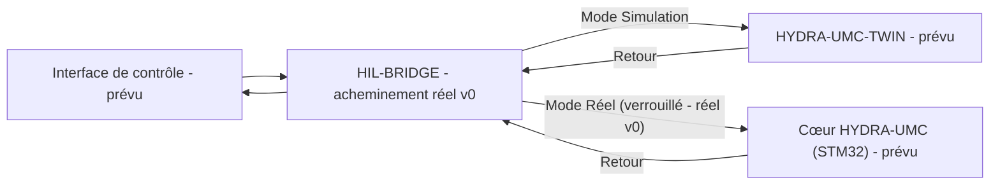

<!-- =============================================================================
HYDRA-UMC-HIL-BRIDGE - Hardware-in-the-loop bridge
Copyright (C) JuanenRac (Electro Hobby 3D) <electrohobby3d@gmail.com>
GPL-3.0-or-later - see LICENSE
============================================================================= -->

<p align="center">
  
</p>

# 🔁 HYDRA-UMC-HIL-BRIDGE

<p align="center"><a href="README.md">🇺🇸 English</a> | <a href="README_spa.md">🇪🇸 Español</a> | 🇫🇷 <b>Français</b> | <a href="README_ita.md">🇮🇹 Italiano</a> | <a href="README_deu.md">🇩🇪 Deutsch</a> | <a href="README_zho.md">🇨🇳 简体中文</a> | <a href="README_jpn.md">🇯🇵 日本語</a> | <a href="README_por.md">🇵🇹 Português</a></p>

### ⚡ Interface Hardware-in-the-Loop pour la synchronisation réel vs virtuel

<p align="center">
  
  
  
  
  
  
</p>

---

> **État de la sûreté et de la cybersécurité :** cet écosystème n'est pas un système de sécurité certifié. Il n'existe pas encore de chaîne d'E-STOP matérielle, ni de limites ou de verrouillages imposés par le firmware, ni de commande de mouvement vérifiée ; les images de firmware sont contrôlées par CRC-32 et une signature Ed25519, et une compilation de version refuse les clés de développement publiées (les têtes d'outil et les cartes d'extension derrière le relais utilisent encore les chargeurs d'URTC, qui prennent un HMAC-SHA256 à clé partagée au lieu d'une signature) ; TLS et TLS mutuel sont optionnels et désactivés par défaut ; aucune carte propre n'a encore été assemblée ni testée. Lisez la [base de sécurité](https://github.com/JuanenRac/HYDRA-UMC-DOCS/blob/main/docs/SECURITY_BASELINE.md) et le [modèle de menaces](https://github.com/JuanenRac/HYDRA-UMC-DOCS/blob/main/docs/THREAT_MODEL.md) avant de vous fier à une affirmation d'ici pour la sécurité d'une personne.

---

## 📋 En un coup d'œil

| | |
|---|---|
| Version | `0.1.1` |
| Maturité | Fonctionnel |
| Tests | 115 (`cargo test`) |
| Technologie | Rust / hardware-in-the-loop I/O |
| Cible | Le Raspberry Pi CM5 d'une cellule HYDRA-UMC |
| Sur matériel réel | Simulé seulement : testé avec des émulateurs, des doubles de test ou des simulateurs ; aucune exécution sur du matériel réel n'est consignée pour cette version |

**Aller à :** [Présentation](#-présentation) · [Architecture](#-architecture) · [Fonctionnalités](#-fonctionnalités) · [Sécurité et protection](#-sécurité-et-protection) · [Interfaces](#-interfaces) · [Configuration](#-configuration) · [Démarrage rapide](#-démarrage-rapide) · [Tests](#-tests) · [Dépannage](#-dépannage) · [Structure du dépôt](#-structure-du-dépôt) · [Projets liés](#-projets-liés)

## 🚦 État du projet

Chaque ligne est une partie de ce dépôt et le feu dit où elle en est aujourd'hui. Elle est écrite d'après ce que le dépôt peut montrer (tests, compilations, exécutions), pas d'après ce qui est prévu.

🟢 Fait et vérifié · 🟡 Fonctionne, avec des limites connues · 🟠 À moitié fait ou pas encore vérifié · 🔴 Pas fait ou ne fonctionne pas

| Domaine | État | Ce que cela veut dire ici |
|---|---|---|
| Logiciel | 🟡 | Fonctionne pour son usage principal ; la vérification d'honnêteté ci-dessus liste ce qui manque encore |
| Tests | 🟢 | 115 tests automatiques, exécutés à chaque modification |
| Matériel réel | 🟠 | Simulé seulement : testé avec des émulateurs, des doubles de test ou des simulateurs ; aucune exécution sur du matériel réel n'est consignée pour cette version |
| Documentation | 🟢 | README en huit langues, vérifié par rapport au manifeste à chaque modification |

## 🎯 Présentation

**HYDRA-UMC-HIL-BRIDGE** est l'artère de communication destinée à permettre la fonctionnalité Hardware-in-the-Loop (HIL). Elle achemine les commandes entre les contrôleurs physiques et le moteur de Digital Twin et reflète l'état entre les deux ; aucun contrôleur réel ne lui a encore été connecté.

Il permet aux développeurs d'envoyer des commandes depuis n'importe quelle interface (App, Suite, Studio) au simulateur comme s'il s'agissait d'un robot physique, et inversement, il peut refléter les mouvements d'un robot physique dans le monde virtuel pour une supervision à distance et un suivi (shadowing) du jumeau numérique.

## 🧩 Rôle dans HYDRA-UMC

**HYDRA-UMC-HIL-BRIDGE** se place entre une interface de commande et un robot qui peut être réel ou simulé. En mode réel, une commande ne déplace une articulation que si le jumeau numérique a signé pour elle un certificat de verrouillage récent ; en mode simulation, le bridge reflète la position. Il décide ; les transports vers le contrôleur réel et vers le jumeau restent à venir.

## 🏛️ Architecture

La répartition par mode au niveau de `BRIDGE` et la porte de verrouillage
de sécurité sur le chemin `Mode Réel` sont réelles aujourd'hui
(`bridge.rs`/`interlock.rs`), acheminant vers un récepteur en mémoire
plutôt qu'un vrai processus en direct. Tout ce qui touche un vrai
processus `APP`, `TWIN` ou `CORE` via une vraie connexion reste du
travail futur.

<p align="center">
  
</p>

<details>
<summary>Version texte du diagramme (Mermaid)</summary>



</details>

**Pourquoi il est construit ainsi**

* **Pourquoi ce pont n'a pas de dossiers `hardware/`/`firmware/`/`os/`.** Logiciel pur - il relie du matériel déjà existant (vraies applications, vrai firmware HYDRA-UMC) au jumeau numérique, sans carte propre.
* **Pourquoi c'est un frère, pas un sous-module, de HYDRA-UMC-TWIN.** Un pont hardware-in-the-loop doit continuer de fonctionner (et continuer de faire circuler les commandes d'un vrai appareil) indépendamment de ce que fait à cet instant la propre boucle rendu/physique de HYDRA-UMC-TWIN - un processus séparé signifie qu'un redémarrage du jumeau ne perd pas une vraie commande en cours.
* **Comment cela s'intègre dans le reste de l'écosystème.** Permet à HYDRA-UMC-SUITE, HYDRA-UMC-ANDROID-CONTROL et HYDRA-UMC-IOS-CONTROL de contrôler HYDRA-UMC-TWIN comme s'il s'agissait d'une vraie cellule adossée à HYDRA-UMC-SERVER - la même surface de contrôle, une cible simulée.
* **Pourquoi l'interverrouillage fait confiance au drapeau `collision_imminent` du jumeau, tout en ajoutant un dégagement minimal et en échouant en fermé.** Le jumeau a déjà fait le raisonnement géométrique/physique réel quand il signale un risque, donc le pont ne re-dérive pas les collisions ; mais un jumeau qui dit « pas de collision » à un millimètre, une distance NaN ou l'absence de rapport ne disent pas que la voie est libre, et bloquent donc la commande (`MIN_CLEARANCE_M` = 5 cm, un plancher prudent et non une distance certifiée : cela relève du firmware). Voir la documentation du module `interlock.rs` pour la façon dont cela reflète la frontière détecter-vs-imposer de HYDRA-UMC-SAFETY-ZONES.
* **Pourquoi le mode `Simulation` n'est jamais verrouillé.** Tout l'intérêt d'acheminer une commande vers le jumeau plutôt que vers le matériel réel est de pouvoir observer en toute sécurité une collision prédite se dérouler - la bloquer là annulerait la fonctionnalité même qu'elle est censée soutenir.
* **Pourquoi `CommandSink` est un trait avec seulement une implémentation `RecordingSink` en mémoire aujourd'hui.** Aucun vrai transport gRPC/WebSocket n'existe encore (voir le propre commentaire de `Cargo.toml`) - `RecordingSink` est honnête à ce sujet : il enregistre ce qu'on lui a demandé d'envoyer sans rien transmettre nulle part, le même raisonnement que `NullEStopRequester` dans HYDRA-UMC-SAFETY-ZONES.
* **Pourquoi `CommandSink::send()` renvoie un `Result` plutôt que `()`.** Un vrai transport peut échouer à livrer (timeout, déconnexion) indépendamment du fait que le verrouillage ait laissé passer la commande - si `send()` ne peut pas échouer, le pont n'a aucun moyen d'éviter de prétendre au succès pour une commande qui n'est jamais réellement arrivée. `SimulatedTransport` existe précisément pour que ce chemin d'échec soit réel et testable dès aujourd'hui, sans attendre qu'un vrai transport existe.
* **Pourquoi `TransportFailure` est un `RouteOutcome` distinct de `BlockedByInterlock`.** Ce sont deux types différents de « ne s'est pas produit » : l'un est un refus de sécurité délibéré (le verrouillage a décidé de ne pas transmettre), l'autre est une livraison au mieux qui ne s'est simplement pas terminée. Les fusionner en un échec générique masquerait quelle couche de sécurité a réellement arrêté la commande - utile pour le débogage et pour toute politique future qui les traiterait différemment (réessayer un échec de transport est raisonnable ; réessayer après un blocage du verrouillage ne l'est pas).

## ✨ Fonctionnalités

* 🔑 **Jeton Bearer optionnel :** sur loopback l'API n'a pas besoin de jeton ; hors loopback `serve` refuse de démarrer sans (`--token-file` ou `HYDRA_UMC_HIL_BRIDGE_TOKEN`). Avec un jeton configuré, chaque requête doit envoyer `Authorization: Bearer <token>` (comparaison en temps constant) ; seul `GET /stats`, le chemin de santé du manifeste, reste ouvert. *(implémenté)*
* 🛡️ **Verrouillage de sécurité (v0) :** le vrai sous-commande `route` bloque une commande destinée au matériel réel dès qu'un rapport de risque du jumeau signale une collision imminente - voir « Vérification d'honnêteté » ci-dessous pour ce qui fonctionne exactement aujourd'hui.
* 🧯 **L'interverrouillage échoue en fermé (v0) :** en mode `real`, une commande n'est transmise qu'avec un rapport de risque du jumeau indiquant que la voie est libre : sans rapport elle est bloquée (l'omettre valait « pas de collision », ce qui suffisait pour atteindre le matériel), une distance NaN la bloque, tout comme moins de 5 cm de dégagement même si le jumeau n'a pas levé `collision_imminent` (`MIN_CLEARANCE_M`). `--clear-distance MÈTRES` fournit à la CLI un rapport de voie libre ; les corps de requête de plus de 16 Ko sont refusés avec `413`. Un rapport que l'appelant envoie dans la même requête reste la parole de l'appelant tant que le transport du jumeau n'existe pas. *(implémenté)*
* 🔏 **Les commandes réelles sont certifiées par le jumeau, et chaque ordre est consigné :** en mode `real`, le rapport qui conditionne une commande n'est plus celui qu'écrit l'appelant. La requête porte `certificate`, un rapport de risque signé avec la clé Ed25519 de HYDRA-UMC-TWIN pour exactement cette articulation et cette position ; le bridge ne détient que la clé publique (`--twin-public-key-file`) et refuse un certificat falsifié, destiné à une autre commande, vieux de plus de 2 s (`--certificate-max-age-ms`) ou déjà utilisé. Sans clé configurée, le mode réel bloque toute commande ; `--allow-unsigned-risk` (banc d'essai seulement, annoncé à chaque démarrage) croit de nouveau le rapport de l'appelant. Chaque ordre réel est consigné (l'appelant d'après `X-Hydra-Caller`, l'adresse du pair, la présentation ou non du jeton Bearer, le certificat et le résultat) avant d'être décidé : avec `--audit-log FICHIER` il est ajouté à un fichier et, si la consignation échoue, l'ordre est refusé ; `GET /audit` liste les derniers. Un vecteur d'essai fixe, vérifié avec une implémentation indépendante de la RFC 8032, est contrôlé par les deux dépôts. *(implémenté, essayé contre le vrai binaire du jumeau ; jamais contre du matériel)*
* ⏱️ **Une commande réelle est un bail, et le pont arrête lui-même l'articulation quand il expire :** une commande porte `issued_at_ms`, `valid_for_ms` (1000 ms au plus, `--max-valid-for-ms`) et un `seq` ; celle qui est expirée, venue du futur, trop longue ou pas plus récente que la dernière de son articulation est bloquée avant que son certificat soit consommé. Si aucune commande valide plus récente n'arrive avant la fin du bail, le chien de garde arrête l'articulation, l'inscrit à l'audit et le compte dans `GET /stats`, que le producteur soit vivant ou non. Les commandes réelles sans fenêtre sont refusées sauf avec `--allow-undated-commands` (annoncé à chaque démarrage). *(implémenté contre le récepteur qui ne fait qu'enregistrer, sans transport pour l'instant ; jamais contre du matériel)*
* 📐 **Les articulations et plages du robot viennent de son URDF, et les requêtes sont servies par plusieurs fils :** `serve --urdf FICHIER` bloque une commande réelle pour une articulation que l'URDF n'a pas, une articulation fixe ou une position hors de son `<limit>` avant que son certificat soit consommé (`outsideLimits` dans `GET /stats`) ; avec `serve --workers N` (8 par défaut), un client qui n'envoie que la moitié d'une requête occupe un fil et non le pont, et les ordres réels restent décidés un par un. *(implémenté ; jamais contre du matériel)*
* 🌉 **Pont bidirectionnel (v0, sans transport pour l'instant) :** un vrai acheminement basé sur le mode (Réel/Simulation) et une vraie mise en miroir inconditionnelle existent ; il n'y a encore aucune vraie connexion gRPC/WebSocket vers un vrai HYDRA-UMC-TWIN ou contrôleur HYDRA-UMC.
* ⚡ **Mise en miroir sans latence (partiel) :** le vrai sous-commande `mirror` reflète aujourd'hui une commande vers un récepteur en mémoire ; la « latence zéro » sur une vraie connexion réseau reste du travail futur.
* 📡 **Protocole unifié (prévu) :** utilise gRPC pour une synchronisation locale haute vitesse et les WebSockets pour la surveillance à distance - aucun transport réseau n'est encore branché, volontairement (voir `Cargo.toml`).
* 🧪 **Transport à sécurité intrinsèque, testable sans matériel (v0) :** `CommandSink::send()` renvoie désormais un vrai `Result`, et un `SimulatedTransport` peut simuler une liaison en timeout ou déconnectée ; le pont rapporte un résultat `TransportFailure` distinct plutôt que de jamais prétendre qu'une commande a été livrée alors qu'elle ne l'a pas été - exerçable via `--transport-latency-ms`/`--transport-timeout-ms`/`--transport-disconnected` sur `route`.
* 🌐 **API HTTP JSON (v0) :** `serve [--addr ADDR] [--port PORT]` (par défaut `127.0.0.1:8113`) expose exactement la même logique d'acheminement/mise en miroir via `POST /route`, `POST /mirror` et `GET /stats` sur un vrai serveur `tiny_http` bloquant - le même binaire que celui exécuté par l'unité `systemd/hydra-umc-hil-bridge.service` sur une CM5 déployée, en loopback uniquement. Voir [`docs/CLI_REFERENCE.md`](docs/CLI_REFERENCE.md) pour le contrat complet requête/réponse.

**Vérification d'honnêteté - ce qui fonctionne réellement aujourd'hui :** `route --mode real|simulation --joint NOM --position VALEUR [--collision-risk] [--distance MÈTRES] [--transport-latency-ms MS] [--transport-timeout-ms MS] [--transport-disconnected]` prend une vraie décision d'acheminement - le mode `simulation` envoie toujours, le mode `real` est soumis à un vrai verrouillage de sécurité qui bloque la commande en l'absence de rapport de risque du jumeau, quand `--collision-risk` est indiqué, quand la distance est NaN ou quand il reste moins de 5 cm de dégagement (`--clear-distance MÈTRES` fournit un rapport dégagé). `mirror --joint NOM --position VALEUR` reflète une commande inconditionnellement. `serve` expose les deux via du vrai HTTP JSON plutôt que des invocations CLI ponctuelles. Tous les trois acheminent par défaut vers un récepteur en mémoire (`RecordingSink`, pas un vrai contrôleur ni une vraie instance HYDRA-UMC-TWIN), ou vers un `SimulatedTransport` qui peut réellement échouer (timeout/déconnexion) quand les indicateurs de transport ci-dessus sont passés - il n'y a pas encore de transport gRPC/WebSocket. Voir [`CHANGELOG.md`](CHANGELOG.md) pour ce qui a été livré exactement, [`docs/CLI_REFERENCE.md`](docs/CLI_REFERENCE.md) pour chaque commande/endpoint, et la Roadmap ci-dessous pour ce qui reste à venir.

## 🔒 Sécurité et protection

| Menace | Défense | Où |
|---|---|---|
| Déplacer une articulation vers une collision | Une commande en mode réel exige un certificat de verrouillage ed25519 signé par le jumeau (domaine `hydra-umc-interlock-certificate-v1`), vieux de 2000 ms au plus (`--certificate-max-age-ms`), de 1000 ms au plus dans le futur, jamais rejoué (8192 nonces retenus) et avec un dégagement d'au moins 0,05 m | `certificate.rs`, `interlock.rs` |
| Une commande sans certificat, sans date ou avec une validité énorme | Sans `--twin-public-key-file` (ou `HYDRA_UMC_HIL_BRIDGE_TWIN_KEY_FILE`) en mode réel toute commande est bloquée ; `--allow-unsigned-risk` est le réglage de banc ; les commandes sans date exigent `--allow-undated-commands` et la validité est plafonnée par `--max-valid-for-ms` | `main.rs` |
| Une articulation inconnue ou hors plage, et une liaison perdue | `--urdf` (ou `HYDRA_UMC_HIL_BRIDGE_URDF`) définit les articulations et leurs plages, et sans lui il n'y a aucun contrôle de plage ; un chien de garde (cycle de 50 ms) arrête l'articulation à l'échéance de son bail même si les fils de travail sont occupés | `limits.rs`, `server.rs`, `watchdog.rs` |
| Accès anonyme, gros corps, requêtes lentes | Un jeton Bearer d'au moins 16 caractères (`HYDRA_UMC_HIL_BRIDGE_TOKEN` ou `--token-file`) ; un corps fait 16 KiB au plus (`413`), 8 workers par défaut (`--workers`, de 1 à 256) ; chaque décision entre dans un anneau de 200 entrées d'audit (`--audit-log` garde un fichier) | `access.rs`, `server.rs`, `audit.rs` |

**Ce qu'il ne fait jamais :** il ne déplace jamais une articulation en mode réel sans certificat signé récent, et n'a pas encore piloté de vrai robot.

## 🔌 Interfaces

Une API HTTP sur `127.0.0.1:8113` et une ligne de commande, qui atteignent la même logique de décision. Le `Content-Type` est obligatoire (sinon `415`). La référence complète est `docs/CLI_REFERENCE.md`.

| Topic ou route | Ce qu'il porte |
|---|---|
| `POST /route` | décider une commande pour une articulation (réelle ou simulée) |
| `POST /mirror` | refléter une position entre le côté réel et le côté virtuel |
| `GET /stats`, `GET /audit` | compteurs et anneau des décisions récentes |
| `serve` | `serve [--addr 127.0.0.1] [--port 8113] [--workers N] [--token-file FICHIER]` ; la ligne de commande ponctuelle accepte `--joint --position --mode --collision-risk --distance --clear-distance` |

## ⚙️ Configuration

| Variable | Par défaut | Ce qu'elle définit |
|---|---|---|
| `HYDRA_UMC_HIL_BRIDGE_TOKEN`, `--token-file` | pas de jeton | le jeton Bearer, 16 caractères au minimum |
| `HYDRA_UMC_HIL_BRIDGE_TWIN_KEY_FILE`, `--twin-public-key-file` | non défini | la clé publique du jumeau ; sans elle le mode réel bloque toute commande |
| `HYDRA_UMC_HIL_BRIDGE_ALLOW_UNSIGNED_RISK` | `0` | `1` accepte des commandes sans certificat (banc seulement) |
| `HYDRA_UMC_HIL_BRIDGE_ALLOW_UNDATED_COMMANDS`, `--max-valid-for-ms` | désactivé | accepter des commandes sans date ; plafond de validité d'une commande |
| `HYDRA_UMC_HIL_BRIDGE_URDF`, `--urdf` | non défini | l'URDF dont les articulations et plages sont contrôlées |
| `HYDRA_UMC_HIL_BRIDGE_AUDIT_LOG`, `--audit-log` | anneau seulement | garder aussi les entrées d'audit dans ce fichier |
| `--certificate-max-age-ms`, `--workers` | `2000`, `8` | âge maximal d'un certificat ; fils de travail (1 à 256) |

## 🚀 Démarrage rapide

Nécessite une chaîne d'outils Rust stable récente (`cargo`) ; Python 3 n'est nécessaire que pour les outils du projet.

```bash
cargo test                                                    # 115 tests, no hardware
bash run.sh        # Linux, macOS (run.bat on Windows)
cargo run --release -- serve --port 8113 --token-file token.txt   # real mode also needs --twin-public-key-file
```

## 🧪 Tests

115 tests Rust s'exécutent avec `cargo test` ; ils sont dans les modules de `src/`. Ils n'ont besoin ni de matériel ni de réseau.

La CI exécute `HYDRA_UMC_CI=1 python tools/ci_validate.py`, qui vérifie le manifeste, les documents, les huit README et les images.

## 🏗️ Compilation et publication

Nécessite la chaîne d'outils Rust (`cargo`/`rustc`, à installer via [rustup](https://rustup.rs)) et Python 3.10+ (uniquement pour `bump_version.py`).

```bash
# Linux / macOS
./build.sh   # `cargo test` (115 tests), puis `cargo build --release`
./run.sh     # exécute target/release/hydra-umc-hil-bridge, affiche nom + version + rôle
```

```bat
:: Windows
build.bat
run.bat
```

`build.sh`/`build.bat` ne changent jamais la version (seule `python tools/hydra_project_tool.py bump` la fait monter), exécutent la vraie suite de tests, puis construisent un binaire release.

Les vrais sous-commandes `route` et `mirror` :

```bash
./run.sh route --mode real --joint shoulder --position 0.5 --clear-distance 2.0
# SENT: routed to real HYDRA-UMC controller

./run.sh route --mode real --joint shoulder --position 0.5
# BLOCKED: safety interlock refused to forward to real hardware (no twin risk report: a real command is not forwarded without one)

./run.sh route --mode real --joint shoulder --position 0.5 --collision-risk --distance 0.02
# BLOCKED: safety interlock refused to forward to real hardware (twin reports imminent collision at 0.020m)

./run.sh route --mode simulation --joint shoulder --position 0.5 --collision-risk --distance 0.02
# SENT: routed to HYDRA-UMC-TWIN (simulation)

./run.sh mirror --joint elbow --position -0.3
# MIRRORED: joint 'elbow' = -0.300000 shadowed into the twin

./run.sh route --mode real --joint shoulder --position 0.5 --transport-timeout-ms 100 --transport-latency-ms 500
# TRANSPORT FAILURE: command was not confirmed delivered (transport timed out after 100ms)

./run.sh route --mode real --joint shoulder --position 0.5 --transport-disconnected
# TRANSPORT FAILURE: command was not confirmed delivered (transport is disconnected)
```

`route` se termine avec `0` (envoyé), `1` (bloqué par le verrouillage de sécurité - un vrai résultat significatif, pas une erreur), `2` (entrée invalide), ou `3` (échec de transport - le verrouillage a laissé passer la commande, mais la livraison n'a pas été confirmée). `mirror` se termine avec `0`, `2` ou `3`.

La même logique d'acheminement/mise en miroir est aussi accessible via du vrai HTTP JSON :

```bash
./run.sh serve --addr 127.0.0.1 --port 8113
# [hil-bridge] HTTP API listening on 127.0.0.1:8113
# [hil-bridge] POST /route, POST /mirror, GET /stats

curl -X POST http://127.0.0.1:8113/route \
    -d '{"mode":"real","joint":"shoulder","position":1.0,"risk":{"collision_imminent":true,"distance_m":0.02}}'
# {"BlockedByInterlock":{"reason":"twin reports imminent collision at 0.020m"}}
```

Voir [`docs/CLI_REFERENCE.md`](docs/CLI_REFERENCE.md) pour le contrat complet requête/réponse de `POST /route`/`POST /mirror`/`GET /stats` - c'est le même binaire que celui exécuté par l'unité `systemd/hydra-umc-hil-bridge.service` sur une CM5 déployée.

`Cargo.toml` ne comporte volontairement aucune crate externe pour l'instant, en dehors de `tiny_http`/`serde`/`serde_json` (la vraie interface HTTP JSON) - voir le commentaire dans le fichier pour ce qui sera ajouté quand le vrai travail de transport gRPC/WebSocket commencera.

## 🩺 Dépannage

| Vous voyez | Parce que | Faites |
|---|---|---|
| every command is blocked in real mode | Aucune clé publique du jumeau n'a été donnée | Donnez `--twin-public-key-file` ; sur un banc seulement, `--allow-unsigned-risk` |
| a certificate is refused | Il a plus de 2000 ms, est trop dans le futur, est rejoué ou laisse moins de 0,05 m de dégagement | Faites signer un nouveau par le jumeau pour chaque commande et gardez les horloges des deux côtés proches |
| `415`, `413` | Le `Content-Type` manque ou le corps dépasse 16 KiB | Envoyez `Content-Type: application/json` et un corps plus petit |

## 📂 Structure du dépôt

<p align="center">
  
</p>

<details>
<summary>Version texte de l'arborescence</summary>

```text
HYDRA-UMC-HIL-BRIDGE/
├── src/
│   ├── bridge.rs                                décisions de route et de miroir
│   ├── certificate.rs                           le certificat de verrouillage signé (ed25519)
│   ├── interlock.rs limits.rs                   règles de verrouillage et limites d'articulation URDF
│   ├── server.rs                                l'API HTTP, les workers et le fil de chien de garde
│   ├── watchdog.rs                              arrête une articulation à l'échéance de son bail
│   ├── access.rs audit.rs                       jeton Bearer et l'anneau d'audit
│   └── protocol.rs main.rs                      formes de message, CLI et démarrage
├── docs/                                        la référence de la ligne de commande et le certificat de verrouillage
├── systemd/                                     unité de service pour la CM5
├── tools/                                       exécuteur de build et de tests, montée de version, validateur CI, générateurs et vérifications des README et des images
├── images/                                      bannière et images du README
├── .github/                                     workflow CI et modèles de tickets
├── hydra-umc.project.json                       manifeste : version, maturité, famille
├── CHANGELOG.md                                 ce qui a changé à chaque version
├── build.sh build.bat                           scripts de build (ils ne changent jamais la version)
├── build-test.sh build-test.bat                 scripts de build (ils ne changent jamais la version)
├── test.sh test.bat                             lancent les tests
├── Cargo.toml / Cargo.lock                      paquet Rust et dépendances figées
├── bump_version.py / bump_manifest_version.py   montée de version explicite
├── run.sh run.bat                               démarrer le service
└── SECURITY.md SUPPORT.md CONTRIBUTING.md CODE_OF_CONDUCT.md LICENSE LICENSE.md
```

</details>

## 🗺️ Feuille de route et limites connues

**Limites connues aujourd'hui**

* **Phase 1 :** Synchronisation du jumeau numérique avec la télémétrie matérielle en temps réel et latence inférieure à 10 ms.
* **Phase 2 :** Intégration de Physics Replica avec des simulateurs de classe industrielle (Isaac Sim) et prise en charge des corps déformables.
* **Phase 3 :** Modèles de récupération automatisés de Node Healing pour un basculement décentralisé et détection précoce de la dégradation des capteurs.
* **Phase 4 :** Synchronisation HIL multi-contrôleurs (Swarm HIL) et prise en charge de la génération de données synthétiques photoréalistes.

## 🌍 Langues

Ce README et les documents du dépôt existent en huit langues : anglais, espagnol, allemand, français, italien, japonais, chinois et portugais (Portugal). Ils sont écrits ensemble et la CI vérifie que les huit fichiers ont les mêmes sections et les mêmes liens. Ce dépôt n'a ni écran ni catalogue de messages propre, il n'y a donc aucune chaîne d'interface à traduire.

## 🔗 Projets liés

Ce projet fait partie de l'écosystème robotique HYDRA-UMC du même auteur (JuanenRac / Electro Hobby 3D). Bon à savoir, car une demande pourrait en réalité concerner l'un de ceux-ci plutôt que ce dépôt.

**Projet Parent**
- **[HYDRA-UMC-TWIN](https://github.com/JuanenRac/HYDRA-UMC-TWIN)** — hub d'intégration pour le moteur de jumeau numérique, avec un vrai contrat de synchronisation par compatibilité de version ; le parent dont ce dépôt est un service de simulation spécifique, au sein de son propre moteur de jumeau numérique.

**Projets Frères** — les autres services de simulation du propre moteur de jumeau numérique de HYDRA-UMC-TWIN
- **[HYDRA-UMC-PHYSICS-REPLICA](https://github.com/JuanenRac/HYDRA-UMC-PHYSICS-REPLICA)** — vraie cinématique directe et validation des limites articulaires sur un vrai sous-ensemble URDF.
- **[HYDRA-UMC-SYNTHETIC-DATA-GEN](https://github.com/JuanenRac/HYDRA-UMC-SYNTHETIC-DATA-GEN)** — vrai générateur procédural de scènes 2D avec export d'annotations YOLO/COCO.

**Directement Liés**
- **[HYDRA-UMC-STUDIO](https://github.com/JuanenRac/HYDRA-UMC-STUDIO)** — tableau de bord de contrôle web avec visualisation 3D multi-robot en temps réel — l'une des 3 interfaces client pouvant envoyer des commandes via ce bridge comme s'il s'agissait d'un robot physique, une fois qu'un vrai transport existe.
- **[HYDRA-UMC-SUITE](https://github.com/JuanenRac/HYDRA-UMC-SUITE)** — centre de commande d'essaim de bureau (PySide6) pour plusieurs serveurs à la fois, empaqueté en exécutable autonome — l'une des 3 interfaces client pouvant envoyer des commandes via ce bridge comme s'il s'agissait d'un robot physique, une fois qu'un vrai transport existe.
- **[HYDRA-UMC-ANDROID-CONTROL](https://github.com/JuanenRac/HYDRA-UMC-ANDROID-CONTROL)** — application de contrôle Android native avec connexion biométrique et un compagnon Wear OS jumelé — l'une des 3 interfaces client pouvant envoyer des commandes via ce bridge comme s'il s'agissait d'un robot physique, une fois qu'un vrai transport existe.
- **[HYDRA-UMC-IOS-CONTROL](https://github.com/JuanenRac/HYDRA-UMC-IOS-CONTROL)** — application de contrôle iOS/iPadOS (Flutter) avec synchronisation WebSocket en temps réel — l'une des 3 interfaces client pouvant envoyer des commandes via ce bridge comme s'il s'agissait d'un robot physique, une fois qu'un vrai transport existe.
- **[HYDRA-UMC-SERVER](https://github.com/JuanenRac/HYDRA-UMC-SERVER)** — le vrai backend headless (REST/WebSocket) auquel parle réellement chaque client de contrôle — le backend derrière ces 3 interfaces client, le vrai contrôleur que le propre `route --mode real` de ce bridge cible finalement une fois qu'un transport existe.

**Fait Également Partie de l'Écosystème**

*Matériel & Plateforme de Base*
- **[HYDRA-UMC](https://github.com/JuanenRac/HYDRA-UMC)** — la conception de la carte mère du bras robotique : hôte CM5 + coprocesseur STM32H745 double cœur, destinée à coordonner jusqu'à 8 bras-outils via CAN-OTA/SPI-OTA (firmware à un stade précoce ; aucune carte assemblée pour l'instant).
- **[HYDRA-UMC-OS](https://github.com/JuanenRac/HYDRA-UMC-OS)** — couche produit reproductible sur Raspberry Pi OS pour le CM5 : agent en lecture seule, config/profils validés, provisionnement WiFi de premier contact.
- **[HYDRA-UMC-SDK](https://github.com/JuanenRac/HYDRA-UMC-SDK)** — le contrat JSON-Schema partagé et la barrière logicielle de contrôle des jobs contre laquelle chaque bridge valide ses commandes (pas une fonction de sécurité certifiée).
- **[HYDRA-UMC-CONNECTOR-HUB](https://github.com/JuanenRac/HYDRA-UMC-CONNECTOR-HUB)** — registre déclaratif et validateur de manifestes d'adaptateur pour les connecteurs de machines externes ; étend la propre idée de contrat du SDK aux machines externes sans remplacer les projets de passerelle industrielle.

*Backend Central & Clients*
- **[HYDRA-UMC-DSI](https://github.com/JuanenRac/HYDRA-UMC-DSI)** — interface tactile native pour l'écran tactile DSI 7" embarqué, intégrée directement sur le CM5.
- **[HYDRA-UMC-EDITOR-URDF](https://github.com/JuanenRac/HYDRA-UMC-EDITOR-URDF)** — créateur/éditeur graphique de bureau pour URDF qui envoie les modèles terminés vers le propre catalogue de STUDIO.
- **[HYDRA-UMC-EDITOR-STL](https://github.com/JuanenRac/HYDRA-UMC-EDITOR-STL)** — éditeur de bureau de modèles STL, transformant/remplaçant/retirant/ajoutant de vraies pièces dans le même catalogue de modèles qu'édite aussi HYDRA-UMC-EDITOR-URDF.
- **[HYDRA-UMC-BRIDGE-AMR](https://github.com/JuanenRac/HYDRA-UMC-BRIDGE-AMR)** — frontière de coordination pour les flottes AGV/AMR via un éditeur MQTT VDA 5050 (testé uniquement contre une flotte émulée).
- **[HYDRA-UMC-BRIDGE-CNC](https://github.com/JuanenRac/HYDRA-UMC-BRIDGE-CNC)** — coordinateur haut niveau pour cellules CNC avec accès au statut/octets de contrôle GRBL (testé uniquement contre un émulateur).
- **[HYDRA-UMC-BRIDGE-DROIDS](https://github.com/JuanenRac/HYDRA-UMC-BRIDGE-DROIDS)** — frontière de coordination pour droïdes à pattes/humanoïdes, avec un émetteur de commandes Boston Dynamics Spot (testé uniquement contre un émulateur).
- **[HYDRA-UMC-BRIDGE-LASER](https://github.com/JuanenRac/HYDRA-UMC-BRIDGE-LASER)** — coordinateur de cellules laser lisant 3 signaux GPIO de clé/enceinte/verrouillage (testé uniquement contre une puce simulée ; il ne peut ni armer ni tirer un laser).
- **[HYDRA-UMC-BRIDGE-OPENPNP](https://github.com/JuanenRac/HYDRA-UMC-BRIDGE-OPENPNP)** — coordinateur haut niveau sûr pour le flux de cartes du pick-and-place OpenPnP.
- **[HYDRA-UMC-BRIDGE-PRINTER3D](https://github.com/JuanenRac/HYDRA-UMC-BRIDGE-PRINTER3D)** — frontière de coordination sûre pour imprimantes 3D Moonraker/Klipper, avec de vraies commandes de tâche contrôlées.
- **[HYDRA-UMC-BRIDGE-ROS2](https://github.com/JuanenRac/HYDRA-UMC-BRIDGE-ROS2)** — coordinateur avec un transport ROS 2 rclpy à importation paresseuse (pas encore exécuté contre une installation ROS 2).
- **[HYDRA-UMC-BRIDGE-UAV](https://github.com/JuanenRac/HYDRA-UMC-BRIDGE-UAV)** — frontière de coordination pour UAV équipés de caméra, avec un émetteur de commandes MAVLink (testé uniquement contre un émulateur).

*Plateforme d'Outils URTC*
- **[URTC](https://github.com/JuanenRac/URTC)** — firmware pour la carte physique Universal Robot Tool Controller, plus de 25 profils d'outil sur bus CAN.
- **[URTC-FLASHER](https://github.com/JuanenRac/URTC-FLASHER)** — outil de bureau à interface graphique pour flasher les cartes URTC, CAN-OTA plus SWD/JTAG puce complète.
- **[URTC-TESTER](https://github.com/JuanenRac/URTC-TESTER)** — outil de bureau de diagnostic CAN-bus en direct pour cartes URTC, un panneau par profil d'outil.
- **[URTC-WEB-STUDIO](https://github.com/JuanenRac/URTC-WEB-STUDIO)** — alternative basée navigateur à URTC-TESTER via la Web Serial API, sans installation locale.
- **[URTC-GATEWAY](https://github.com/JuanenRac/URTC-GATEWAY)** — passerelle devant le bus CAN d'URTC : liste d'identifiants autorisés, limite de débit et clé de session ; logiciel testé sur ordinateur, pas encore sur un bus réel.

*Nœud IA de Vision (Hailo-8)*
- **[HYDRA-UMC-VISION-NODE](https://github.com/JuanenRac/HYDRA-UMC-VISION-NODE)** — hub d'intégration pour le pipeline de vision Hailo-8, avec une vraie vérification de disponibilité matérielle par étape.
- **[HYDRA-UMC-DETECTION-HEF](https://github.com/JuanenRac/HYDRA-UMC-DETECTION-HEF)** — registre réel de modèles compilés avec vérification de chargement sécurisé par architecture Hailo/checksum.
- **[HYDRA-UMC-VISION-STREAMER](https://github.com/JuanenRac/HYDRA-UMC-VISION-STREAMER)** — générateur réel de pipeline GStreamer + config MediaMTX, avec une vraie frontière d'intégration HailoRT.
- **[HYDRA-UMC-VISUAL-SERVOING-API](https://github.com/JuanenRac/HYDRA-UMC-VISUAL-SERVOING-API)** — loi de correction Position-Based Visual Servoing avec autorisation conditionnée à l'état de zone ; pas encore d'estimation de pose par caméra.
- **[HYDRA-UMC-SAFETY-ZONES](https://github.com/JuanenRac/HYDRA-UMC-SAFETY-ZONES)** — logique v0 de violation de zone, de fraîcheur de calibration et de demande d'E-STOP qui lit les positions d'objets dans un fichier ; aucun détecteur ne l'alimente et aucun E-STOP physique n'y est encore relié.

*Nœud IA Cognitif (Hailo-10)*
- **[HYDRA-UMC-COGNITIVE-NODE](https://github.com/JuanenRac/HYDRA-UMC-COGNITIVE-NODE)** — hub d'intégration pour le pipeline cognitif Hailo-10 (orchestration LLM/VLA/voix).
- **[HYDRA-UMC-VLA-ENGINE](https://github.com/JuanenRac/HYDRA-UMC-VLA-ENGINE)** — vrai encodage/décodage de jetons d'action et génération de trajectoire pour un modèle Vision-Language-Action.
- **[HYDRA-UMC-VOICE-UI](https://github.com/JuanenRac/HYDRA-UMC-VOICE-UI)** — vrai front-end vocal (VAD + analyseur d'intention) avec un relais Watch borné et soumis à confirmation.
- **[HYDRA-UMC-SEMANTIC-PLANNER](https://github.com/JuanenRac/HYDRA-UMC-SEMANTIC-PLANNER)** — vraie décomposition de tâches basée sur des règles et récupération sémantique d'erreurs sur les codes d'erreur MCU.
- **[HYDRA-UMC-DOCS-QA](https://github.com/JuanenRac/HYDRA-UMC-DOCS-QA)** — vraie recherche documentaire TF-IDF (bibliothèque standard uniquement) sur les propres documents Markdown de cet écosystème.
- **[HYDRA-UMC-LOCAL-TECHNICIAN](https://github.com/JuanenRac/HYDRA-UMC-LOCAL-TECHNICIAN)** — technicien de maintenance IA local et à portes de politique pour l'écosystème lui-même - observe, diagnostique et propose des corrections ; les deux niveaux de risque les plus élevés ne sont délibérément pas encore implémentés.

*Orchestration & Essaim*
- **[HYDRA-UMC-ORCHESTRATOR](https://github.com/JuanenRac/HYDRA-UMC-ORCHESTRATOR)** — hub d'intégration avec un vrai contrat de rapport de santé gRPC/Protobuf et une machine à états de mission.
- **[HYDRA-UMC-JOB-DISPATCHER](https://github.com/JuanenRac/HYDRA-UMC-JOB-DISPATCHER)** — vraie file de tâches basée sur la priorité avec déduplication, via une vraie API HTTP.
- **[HYDRA-UMC-NODE-HEALING](https://github.com/JuanenRac/HYDRA-UMC-NODE-HEALING)** — vrai chien de garde de santé de flotte basé sur gRPC, avec retry/backoff et détection d'incohérence d'identité.
- **[HYDRA-UMC-PATH-PLANNER-3D](https://github.com/JuanenRac/HYDRA-UMC-PATH-PLANNER-3D)** — vrai planificateur de trajectoire 3D basé sur RRT, avec vraie validation des collisions obstacle/espace de travail.
- **[HYDRA-UMC-SWARM-SYNC](https://github.com/JuanenRac/HYDRA-UMC-SWARM-SYNC)** — vraie synchronisation d'état CRDT LWW-Element-Map, testée par propriétés pour la convergence multi-cellule.

*Données & Analytique*
- **[HYDRA-UMC-DATALAKE](https://github.com/JuanenRac/HYDRA-UMC-DATALAKE)** — vrai magasin de séries temporelles basé sur sqlite3, avec une vraie API HTTP d'ingestion/requête.
- **[HYDRA-UMC-ANOMALY-DETECTOR](https://github.com/JuanenRac/HYDRA-UMC-ANOMALY-DETECTOR)** — vrai détecteur d'anomalies FFT + ligne de base statistique, avec surveillance de dérive.
- **[HYDRA-UMC-PRODUCTION-REPORTS](https://github.com/JuanenRac/HYDRA-UMC-PRODUCTION-REPORTS)** — vrai calcul OEE/disponibilité sur l'historique de DATALAKE, avec export CSV reproductible.
- **[HYDRA-UMC-TELEMETRY-COLLECTOR](https://github.com/JuanenRac/HYDRA-UMC-TELEMETRY-COLLECTOR)** — vrai pipeline d'ingestion CAN/WebSocket vers DATALAKE, avec déduplication par séquence.

*Passerelle Industrielle*
- **[HYDRA-UMC-GATEWAY-INDUSTRIAL](https://github.com/JuanenRac/HYDRA-UMC-GATEWAY-INDUSTRIAL)** — hub d'intégration relayant vers les protocoles industriels, avec une vraie couche de liste blanche de commandes/contre-pression.
- **[HYDRA-UMC-OPCUA-SERVER](https://github.com/JuanenRac/HYDRA-UMC-OPCUA-SERVER)** — vrai espace d'adressage OPC-UA, vérifié avec une vraie session client du protocole binaire.
- **[HYDRA-UMC-MQTT-BROKER](https://github.com/JuanenRac/HYDRA-UMC-MQTT-BROKER)** — vrai broker MQTT avec authentification par client optionnelle et ACL de sujets.
- **[HYDRA-UMC-MTCONNECT-ADAPTER](https://github.com/JuanenRac/HYDRA-UMC-MTCONNECT-ADAPTER)** — vrais points de terminaison XML MTConnect `/probe` et `/current`, avec sortie en mode dégradé.

*Outils Complémentaires & Opérations de l'Écosystème*
- **[HYDRA-UMC-DASHBOARD-AI](https://github.com/JuanenRac/HYDRA-UMC-DASHBOARD-AI)** — panneaux Smart Summaries et Anomaly Highlighting sur DATALAKE/ANOMALY-DETECTOR, avec un repli statistique honnête.
- **[HYDRA-UMC-TOOL-CLI](https://github.com/JuanenRac/HYDRA-UMC-TOOL-CLI)** — CLI de flotte avec un vrai contrat de codes de sortie stable, un vrai client en direct de la propre API de HYDRA-UMC-SERVER.
- **[HYDRA-UMC-WATCH](https://github.com/JuanenRac/HYDRA-UMC-WATCH)** — application compagnon WearOS avec des motifs d'alerte haptique et un relais vocal vers le téléphone jumelé (pas encore exécutée sur une montre physique).
- **[URTC-SMART-RACK](https://github.com/JuanenRac/URTC-SMART-RACK)** — firmware pour un rack de montage de cartes avec décodage réel d'ID d'outil et logique de préchauffage Smart Idle.
- **[URTC-VISION-TOOL](https://github.com/JuanenRac/URTC-VISION-TOOL)** — firmware plus un vrai compagnon de vision Python pour une tête d'outil d'inspection thermique/RGB.
- **[HYDRA-UMC-UPDATER](https://github.com/JuanenRac/HYDRA-UMC-UPDATER)** — outil administratif de bureau qui découvre, clone et met à jour chaque dépôt de cet écosystème.
- **[HYDRA-UMC-OS-REBUILDER](https://github.com/JuanenRac/HYDRA-UMC-OS-REBUILDER)** — outil de bureau Windows/Linux qui construit une image de la CM5 prête à graver, préchargée avec les versions les plus actuelles de l'écosystème, avec une configuration de premier démarrage Wi-Fi/utilisateur/SSH façon Raspberry Pi Imager.
- **[HYDRA-UMC-OPS-AGENT](https://github.com/JuanenRac/HYDRA-UMC-OPS-AGENT)** — coordinateur d'incidents de maintenance : un rôle edge à faible privilège collecte un instantané d'inventaire/santé assaini, un rôle control-plane le rend en lecture seule et demande à un fournisseur d'IA de suggérer un diagnostic - n'applique jamais de correctif ni ne déploie rien.
- **[HYDRA-UMC-DEV-SERVER](https://github.com/JuanenRac/HYDRA-UMC-DEV-SERVER)** — hôte de développement reproductible (Raspberry Pi 5 / CM5) qui héberge le code source de l'écosystème et exécute des tâches de compilation/test délimitées via une file d'attente durable ; un rôle de développement dédié, explicitement distinct d'un CM5 opérationnel.

## 📚 Documentation

Où lire la suite :

* [docs/CLI_REFERENCE.md](docs/CLI_REFERENCE.md) - chaque option de la ligne de commande, les routes HTTP et leurs erreurs
* [docs/INTERLOCK_CERTIFICATE.md](docs/INTERLOCK_CERTIFICATE.md) - ce que dit le certificat de verrouillage signé et comment il est vérifié
* [Base de sécurité de l'écosystème](https://github.com/JuanenRac/HYDRA-UMC-DOCS/blob/main/docs/SECURITY_BASELINE.md)
* [Modèle de menaces de l'écosystème](https://github.com/JuanenRac/HYDRA-UMC-DOCS/blob/main/docs/THREAT_MODEL.md)
* [Journal des modifications de ce dépôt](CHANGELOG.md)
* [Licence de ce dépôt](LICENSE.md)

## 🤝 Contribuer et communauté

* Avant une pull request, exécutez `HYDRA_UMC_CI=1 py -3 tools/ci_validate.py` (ou `HYDRA_UMC_CI=1 python3 tools/ci_validate.py`) : il doit afficher `CI_VALIDATION=PASS`. N'exécutez pas `build.sh` ni `build.bat` pour cette vérification ; compiler n'est pas vérifier.
* Les huit README sont écrits à partir d'une source unique dans HYDRA-UMC-DOCS ; ne les modifiez pas à la main. Changez la source et réécrivez-les avec `tools/make_readmes.py`.
* N'affirmez pas dans un README ce qui n'a pas tourné : écrivez « simulé » ou « non essayé sur matériel » quand c'est la vérité.
* Voir [CONTRIBUTING.md](CONTRIBUTING.md), le [code de conduite](CODE_OF_CONDUCT.md), [SECURITY.md](SECURITY.md) et [SUPPORT.md](SUPPORT.md).

## 👤 AUTEUR

**JuanenRac (Electro Hobby 3D)** · electrohobby3d@gmail.com

## 📜 LICENCE

GPL-3.0-or-later - [LICENSE](LICENSE).
