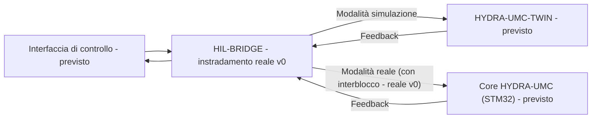

<!-- =============================================================================
HYDRA-UMC-HIL-BRIDGE - Hardware-in-the-loop bridge
Copyright (C) JuanenRac (Electro Hobby 3D) <electrohobby3d@gmail.com>
GPL-3.0-or-later - see LICENSE
============================================================================= -->

<p align="center">
  
</p>

# 🔁 HYDRA-UMC-HIL-BRIDGE

<p align="center"><a href="README.md">🇺🇸 English</a> | <a href="README_spa.md">🇪🇸 Español</a> | <a href="README_fra.md">🇫🇷 Français</a> | 🇮🇹 <b>Italiano</b> | <a href="README_deu.md">🇩🇪 Deutsch</a> | <a href="README_zho.md">🇨🇳 简体中文</a> | <a href="README_jpn.md">🇯🇵 日本語</a> | <a href="README_por.md">🇵🇹 Português</a></p>

### ⚡ Interfaccia Hardware-in-the-Loop per la sincronizzazione reale vs virtuale

<p align="center">
  
  
  
  
  
  
</p>

---

> **Stato di sicurezza (safety e security):** questo ecosistema non è un sistema di sicurezza certificato. Non esiste ancora un percorso E-STOP hardware, né limiti o interblocchi imposti dal firmware, né un comando di movimento verificato; le immagini firmware sono controllate con CRC-32 e una firma Ed25519, e una compilazione di rilascio rifiuta le chiavi di sviluppo pubblicate (le teste utensile e le schede di espansione dietro il relè usano ancora i bootloader di URTC, che accettano un HMAC-SHA256 a chiave condivisa invece di una firma); TLS e TLS reciproco sono opzionali e disattivati per impostazione predefinita; nessuna scheda propria è stata ancora assemblata o provata. Leggi la [base di sicurezza](https://github.com/JuanenRac/HYDRA-UMC-DOCS/blob/main/docs/SECURITY_BASELINE.md) e il [modello delle minacce](https://github.com/JuanenRac/HYDRA-UMC-DOCS/blob/main/docs/THREAT_MODEL.md) prima di fidarti di qualsiasi affermazione qui per la sicurezza di una persona.

---

## 📋 In breve

| | |
|---|---|
| Versione | `0.1.2` |
| Maturità | Funzionale |
| Test | 139 (`cargo test`) |
| Tecnologia | Rust / hardware-in-the-loop I/O |
| Destinazione | Il Raspberry Pi CM5 di una cella HYDRA-UMC |
| Su hardware reale | Solo simulato: provato con emulatori, test double o simulatori; per questa versione non risulta alcuna esecuzione su hardware reale |

**Vai a:** [Panoramica](#-panoramica) · [Architettura](#-architettura) · [Funzionalità](#-funzionalità) · [Sicurezza e protezione](#-sicurezza-e-protezione) · [Interfacce](#-interfacce) · [Configurazione](#-configurazione) · [Avvio rapido](#-avvio-rapido) · [Test](#-test) · [Risoluzione dei problemi](#-risoluzione-dei-problemi) · [Struttura del repository](#-struttura-del-repository) · [Progetti correlati](#-progetti-correlati)

## 🚦 Stato del progetto

Ogni riga è una parte di questo repository e il semaforo dice a che punto è oggi. È scritta in base a ciò che il repository può mostrare (test, compilazioni, esecuzioni), non a ciò che è previsto.

🟢 Fatto e verificato · 🟡 Funziona, con limiti noti · 🟠 Fatto a metà o non ancora verificato · 🔴 Non fatto o non funzionante

| Area | Stato | Cosa significa qui |
|---|---|---|
| Software | 🟡 | Funziona per il suo scopo principale; la verifica di onestà qui sopra elenca ciò che manca ancora |
| Test | 🟢 | 139 test automatici, eseguiti a ogni modifica |
| Hardware reale | 🟠 | Solo simulato: provato con emulatori, test double o simulatori; per questa versione non risulta alcuna esecuzione su hardware reale |
| Documentazione | 🟢 | README in otto lingue, verificato rispetto al manifesto a ogni modifica |

## 🎯 Panoramica

**HYDRA-UMC-HIL-BRIDGE** è l'arteria di comunicazione pensata per abilitare la funzionalità Hardware-in-the-Loop (HIL). Instrada i comandi tra i controllori fisici e il motore di Digital Twin e rispecchia lo stato tra i due; non è ancora stato collegato alcun controllore reale.

Consente agli sviluppatori di inviare comandi da qualsiasi interfaccia (App, Suite, Studio) al simulatore come se fosse un robot fisico e, viceversa, può riflettere i movimenti di un robot fisico nel mondo virtuale per la supervisione remota e il shadowing del digital twin.

## 🧩 Ruolo in HYDRA-UMC

**HYDRA-UMC-HIL-BRIDGE** sta tra un'interfaccia di controllo e un robot che può essere reale o simulato. In modalità reale un comando muove un giunto solo quando il gemello digitale ha firmato per esso un certificato di interblocco recente; in simulazione il bridge rispecchia la posizione. Decide; i trasporti verso il controller reale e verso il gemello devono ancora arrivare.

## 🏛️ Architettura

La suddivisione basata su modalità in `BRIDGE` e la porta dell'interblocco
di sicurezza sul percorso `Modalità reale` sono reali oggi
(`bridge.rs`/`interlock.rs`), instradando verso un ricevitore in memoria
anziché un vero processo live. Tutto ciò che tocca un vero processo
`APP`, `TWIN` o `CORE` tramite una vera connessione resta lavoro futuro.

<p align="center">
  
</p>

<details>
<summary>Versione testuale del diagramma (Mermaid)</summary>



</details>

**Perché è fatto così**

* **Perché questo ponte non ha cartelle `hardware/`/`firmware/`/`os/`.** Software puro - collega hardware già esistente (app reali, firmware reale HYDRA-UMC) al gemello digitale, senza scheda propria.
* **Perché è fratello, non un sottomodulo, di HYDRA-UMC-TWIN.** Un ponte hardware-in-the-loop deve continuare a funzionare (e continuare a far fluire i comandi di un dispositivo reale) indipendentemente da ciò che sta facendo in quell'istante il ciclo rendering/fisica proprio di HYDRA-UMC-TWIN - un processo separato significa che un riavvio del gemello non perde un comando reale in corso.
* **Come si inserisce nel resto dell'ecosistema.** Permette a HYDRA-UMC-SUITE, HYDRA-UMC-ANDROID-CONTROL e HYDRA-UMC-IOS-CONTROL di controllare HYDRA-UMC-TWIN come se fosse una vera cella supportata da HYDRA-UMC-SERVER - la stessa superficie di controllo, un obiettivo simulato.
* **Perché l'interblocco si fida del flag `collision_imminent` del gemello, ma aggiunge comunque uno spazio minimo e fallisce in chiuso.** Il gemello ha già fatto il ragionamento geometrico/fisico reale quando segnala il rischio, quindi il ponte non ricalcola le collisioni; ma un gemello che dice "nessuna collisione" a un millimetro, una distanza NaN o l'assenza di rapporto non affermano che il percorso sia libero, e quindi bloccano il comando (`MIN_CLEARANCE_M` = 5 cm, un minimo prudente e non una distanza certificata: quella spetta al firmware). Vedi la documentazione del modulo `interlock.rs` per come questo rispecchia il confine rilevare-vs-imporre di HYDRA-UMC-SAFETY-ZONES.
* **Perché la modalità `Simulation` non è mai soggetta all'interblocco.** Tutto il senso di instradare un comando verso il twin invece che verso l'hardware reale è poter vedere svolgersi in sicurezza una collisione prevista - bloccarla lì vanificherebbe la funzione stessa che esiste per supportare.
* **Perché `CommandSink` è un trait con solo un'implementazione `RecordingSink` in memoria oggi.** Non esiste ancora nessun vero trasporto gRPC/WebSocket (vedi il commento proprio di `Cargo.toml`) - `RecordingSink` è onesto al riguardo: registra ciò che gli è stato chiesto di inviare senza trasmettere da nessuna parte, lo stesso ragionamento di `NullEStopRequester` in HYDRA-UMC-SAFETY-ZONES.
* **Perché `CommandSink::send()` restituisce un `Result` invece di `()`.** Un vero trasporto può fallire nella consegna (timeout, disconnessione) indipendentemente dal fatto che l'interblocco abbia lasciato passare il comando - se `send()` non può fallire, il ponte non ha modo di evitare di dichiarare successo per un comando mai arrivato davvero. `SimulatedTransport` esiste proprio perché questo percorso di fallimento sia reale e testabile oggi, senza aspettare che esista un vero trasporto.
* **Perché `TransportFailure` è un `RouteOutcome` separato da `BlockedByInterlock`.** Sono due tipi diversi di "non è successo": uno è un rifiuto di sicurezza deliberato (l'interblocco ha deciso di non inoltrarlo), l'altro è una consegna al meglio delle possibilità che semplicemente non si è completata. Fonderli in un fallimento generico nasconderebbe quale livello di sicurezza abbia effettivamente fermato il comando - utile per il debug e per qualsiasi policy futura che li tratti diversamente (ritentare dopo un fallimento di trasporto è ragionevole; ritentare dopo un blocco dell'interblocco no).

## ✨ Funzionalità

* 🔑 **Token Bearer opzionale:** su loopback l'API non richiede token; fuori dal loopback `serve` rifiuta di avviarsi senza (`--token-file` o `HYDRA_UMC_HIL_BRIDGE_TOKEN`). Con un token impostato, ogni richiesta deve inviare `Authorization: Bearer <token>` (confronto a tempo costante); solo `GET /stats`, il percorso di salute del manifesto, resta aperto. *(implementato)*
* 🛡️ **Interblocco di sicurezza (v0):** il vero sottocomando `route` blocca un comando diretto all'hardware reale ogni volta che un report di rischio del twin segnala una collisione imminente - vedi "Verifica di onestà" sotto per cosa funziona esattamente oggi.
* 🧯 **L'interblocco fallisce in chiuso (v0):** in modalità `real` un comando viene inoltrato solo con un rapporto di rischio del gemello che dice che il percorso è libero: senza rapporto è bloccato (ometterlo equivaleva a "nessuna collisione", sufficiente per raggiungere l'hardware), una distanza NaN lo blocca, così come meno di 5 cm di spazio libero anche se il gemello non ha alzato `collision_imminent` (`MIN_CLEARANCE_M`). `--clear-distance METRI` fornisce alla CLI un rapporto di via libera; i corpi di richiesta oltre 16 KB sono rifiutati con `413`. Un rapporto che il chiamante invia nella stessa richiesta resta parola del chiamante finché non esiste il trasporto del gemello. *(implementato)*
* 🔏 **I comandi reali sono certificati dal gemello, e ogni ordine viene registrato:** in modalità `real` il rapporto che condiziona un comando non è più quello scritto da chi chiama. La richiesta porta `certificate`, un rapporto di rischio firmato con la chiave Ed25519 di HYDRA-UMC-TWIN per esattamente quell'articolazione e quella posizione; il bridge possiede solo la chiave pubblica (`--twin-public-key-file`) e rifiuta un certificato contraffatto, di un altro comando, più vecchio di 2 s (`--certificate-max-age-ms`) o già usato. Senza chiave configurata la modalità reale blocca ogni comando; `--allow-unsigned-risk` (solo banco di prova, annunciato a ogni avvio) torna a credere al rapporto di chi chiama. Ogni ordine reale viene registrato (chi chiama da `X-Hydra-Caller`, l'indirizzo del peer, se è stato presentato il token Bearer, il certificato e l'esito) prima di essere deciso: con `--audit-log FILE` viene aggiunto a un file e, se la registrazione non può essere scritta, l'ordine viene rifiutato; `GET /audit` elenca gli ultimi. Un vettore di prova fisso, verificato con un'implementazione indipendente della RFC 8032, è controllato da entrambi i repository. *(implementato, provato contro il vero binario del gemello; mai contro hardware)*
* ⏱️ **Un comando reale è un contratto a tempo, e il ponte ferma da solo l'articolazione quando scade:** il comando porta `issued_at_ms`, `valid_for_ms` (al massimo 1000 ms, `--max-valid-for-ms`) e un `seq`; quello scaduto, dal futuro, troppo lungo o non più recente dell'ultimo della sua articolazione viene bloccato prima di consumare il certificato. Se non arriva un comando valido più recente prima della scadenza, il guardiano ferma l'articolazione, lo registra nell'audit e lo conta in `GET /stats`, che il produttore sia vivo o no. I comandi reali senza finestra sono rifiutati salvo con `--allow-undated-commands` (annunciato a ogni avvio). *(implementato contro il ricevitore che si limita a registrare, ancora senza trasporto; mai contro hardware)*
* 📐 **Le articolazioni e gli intervalli del robot vengono dal suo URDF, e le richieste sono servite da più thread:** `serve --urdf FILE` blocca un comando reale per un'articolazione che l'URDF non ha, una fissa o una posizione fuori dal suo `<limit>` prima che il certificato venga consumato (`outsideLimits` in `GET /stats`); con `serve --workers N` (8 per impostazione predefinita) un client che invia metà richiesta occupa un thread e non il ponte, e gli ordini reali continuano a essere decisi uno alla volta. *(implementato; mai contro hardware)*
* 🚧 **Previsione di collisione del gemello, richiesta in ombra (spenta per impostazione):** con `serve --collision-shadow` (e `--twin-url`) il ponte chiede al gemello, dopo ogni comando reale consegnato, se prevede un contatto con una zona o con il robot stesso, e registra la risposta nel registro di audit, in `GET /stats` e nell'intestazione `X-Collision-Shadow`. Si limita a informare: non blocca mai un comando né cambia la decisione dell'interblocco, e un gemello che non risponde è `failed`, mai `clear`. Non provato con un robot reale.
* 🌉 **Bridge bidirezionale (v0, senza trasporto per ora):** esiste un vero instradamento basato su modalità (Reale/Simulazione) e un vero mirroring incondizionato; non esiste ancora nessuna vera connessione gRPC/WebSocket verso un vero HYDRA-UMC-TWIN o controller HYDRA-UMC.
* ⚡ **Mirroring a latenza zero (parziale):** il vero sottocomando `mirror` oggi riflette un comando verso un ricevitore in memoria; la "latenza zero" su una vera connessione di rete resta lavoro futuro.
* 📡 **Protocollo unificato (previsto):** utilizza gRPC per la sincronizzazione locale ad alta velocità e WebSocket per il monitoraggio remoto - nessun trasporto di rete è ancora collegato, di proposito (vedi `Cargo.toml`).
* 🧪 **Trasporto a prova di guasto, testabile senza hardware (v0):** `CommandSink::send()` ora restituisce un vero `Result`, e un `SimulatedTransport` può simulare un collegamento in timeout o disconnesso; il ponte segnala un esito `TransportFailure` distinto invece di dichiarare mai che un comando è stato consegnato quando non lo è stato - esercitabile tramite `--transport-latency-ms`/`--transport-timeout-ms`/`--transport-disconnected` su `route`.
* 🌐 **API HTTP JSON (v0):** `serve [--addr ADDR] [--port PORT]` (default `127.0.0.1:8113`) espone esattamente la stessa logica di instradamento/mirroring tramite `POST /route`, `POST /mirror` e `GET /stats` su un vero server `tiny_http` bloccante - lo stesso binario eseguito dall'unità `systemd/hydra-umc-hil-bridge.service` su una CM5 distribuita, solo su loopback. Vedi [`docs/CLI_REFERENCE.md`](docs/CLI_REFERENCE.md) per il contratto completo di richiesta/risposta.

**Verifica di onestà - cosa funziona davvero oggi:** `route --mode real|simulation --joint NOME --position VALORE [--collision-risk] [--distance METRI] [--transport-latency-ms MS] [--transport-timeout-ms MS] [--transport-disconnected]` prende una vera decisione di instradamento - la modalità `simulation` invia sempre, la modalità `real` è soggetta a un vero interblocco di sicurezza che blocca il comando quando manca il rapporto di rischio del gemello, quando viene indicato `--collision-risk`, quando la distanza è NaN o quando restano meno di 5 cm di margine (`--clear-distance METRI` fornisce un rapporto libero). `mirror --joint NOME --position VALORE` riflette un comando incondizionatamente. `serve` espone entrambi tramite vero HTTP JSON invece di invocazioni CLI singole. Tutti e tre instradano per default verso un ricevitore in memoria (`RecordingSink`, non un vero controller né una vera istanza HYDRA-UMC-TWIN), oppure verso un `SimulatedTransport` che può fallire davvero (timeout/disconnessione) quando vengono passati i flag di trasporto sopra - non esiste ancora trasporto gRPC/WebSocket. Vedi [`CHANGELOG.md`](CHANGELOG.md) per ciò che è stato consegnato esattamente, [`docs/CLI_REFERENCE.md`](docs/CLI_REFERENCE.md) per ogni comando/endpoint, e la Roadmap sotto per ciò che resta da fare.

## 🔒 Sicurezza e protezione

| Minaccia | Difesa | Dove |
|---|---|---|
| Muovere un giunto verso una collisione | Un comando in modalità reale richiede un certificato di interblocco ed25519 firmato dal gemello (dominio `hydra-umc-interlock-certificate-v1`), vecchio al massimo 2000 ms (`--certificate-max-age-ms`), al massimo 1000 ms nel futuro, mai riutilizzato (8192 nonce ricordati) e con una distanza di almeno 0,05 m | `certificate.rs`, `interlock.rs` |
| Un comando senza certificato, senza data o con una validità enorme | Senza `--twin-public-key-file` (o `HYDRA_UMC_HIL_BRIDGE_TWIN_KEY_FILE`) in modalità reale ogni comando è bloccato; `--allow-unsigned-risk` è l'impostazione da banco; i comandi senza data richiedono `--allow-undated-commands` e la validità è limitata da `--max-valid-for-ms` | `main.rs` |
| Un giunto sconosciuto o fuori range, e un collegamento perso | `--urdf` (o `HYDRA_UMC_HIL_BRIDGE_URDF`) definisce i giunti e i loro range, e senza di esso non c'è controllo di range; un watchdog (ciclo di 50 ms) ferma il giunto alla scadenza del suo lease anche se i thread di lavoro sono occupati | `limits.rs`, `server.rs`, `watchdog.rs` |
| Accesso anonimo, corpi grandi, richieste lente | Un token Bearer di almeno 16 caratteri (`HYDRA_UMC_HIL_BRIDGE_TOKEN` o `--token-file`); un corpo è al massimo 16 KiB (`413`), 8 worker per impostazione predefinita (`--workers`, da 1 a 256); ogni decisione entra in un anello di 200 voci di audit (`--audit-log` conserva un file) | `access.rs`, `server.rs`, `audit.rs` |

**Cosa non fa mai:** non muove mai un giunto in modalità reale senza un certificato firmato recente, e non ha ancora pilotato un robot reale.

## 🔌 Interfacce

Un'API HTTP su `127.0.0.1:8113` e una riga di comando, che raggiungono la stessa logica di decisione. Il `Content-Type` è obbligatorio (altrimenti `415`). Il riferimento completo è `docs/CLI_REFERENCE.md`.

| Topic o rotta | Cosa porta |
|---|---|
| `POST /route` | decidere un comando per un giunto (reale o simulato) |
| `POST /mirror` | rispecchiare una posizione tra il lato reale e quello virtuale |
| `GET /stats`, `GET /audit` | contatori e anello delle decisioni recenti |
| `serve` | `serve [--addr 127.0.0.1] [--port 8113] [--workers N] [--token-file FILE]`; la riga di comando singola accetta `--joint --position --mode --collision-risk --distance --clear-distance` |

## ⚙️ Configurazione

| Variabile | Predefinito | Cosa imposta |
|---|---|---|
| `HYDRA_UMC_HIL_BRIDGE_TOKEN`, `--token-file` | nessun token | il token Bearer, almeno 16 caratteri |
| `HYDRA_UMC_HIL_BRIDGE_TWIN_KEY_FILE`, `--twin-public-key-file` | non impostato | la chiave pubblica del gemello; senza di essa la modalità reale blocca ogni comando |
| `HYDRA_UMC_HIL_BRIDGE_ALLOW_UNSIGNED_RISK` | `0` | `1` accetta comandi senza certificato (solo da banco) |
| `HYDRA_UMC_HIL_BRIDGE_ALLOW_UNDATED_COMMANDS`, `--max-valid-for-ms` | disattivato | accettare comandi senza data; tetto alla validità di un comando |
| `HYDRA_UMC_HIL_BRIDGE_URDF`, `--urdf` | non impostato | l'URDF i cui giunti e range vengono controllati |
| `HYDRA_UMC_HIL_BRIDGE_AUDIT_LOG`, `--audit-log` | solo l'anello | conservare le voci di audit anche in questo file |
| `--certificate-max-age-ms`, `--workers` | `2000`, `8` | età massima di un certificato; thread di lavoro (da 1 a 256) |

## 🚀 Avvio rapido

Richiede una toolchain Rust stabile recente (`cargo`); Python 3 serve solo per gli strumenti del progetto.

```bash
cargo test                                                    # 115 tests, no hardware
bash run.sh        # Linux, macOS (run.bat on Windows)
cargo run --release -- serve --port 8113 --token-file token.txt   # real mode also needs --twin-public-key-file
```

## 🧪 Test

139 test Rust si eseguono con `cargo test`; stanno dentro i moduli di `src/`. Non richiedono hardware né rete.

La CI esegue `HYDRA_UMC_CI=1 python tools/ci_validate.py`, che controlla il manifesto, i documenti, gli otto README e le immagini.

## 🏗️ Compilazione e rilascio

Richiede il toolchain Rust (`cargo`/`rustc`, installabile via [rustup](https://rustup.rs)) e Python 3.10+ (solo per `bump_version.py`).

```bash
# Linux / macOS
./build.sh   # `cargo test` (115 test), poi `cargo build --release`
./run.sh     # esegue target/release/hydra-umc-hil-bridge, stampa nome + version + ruolo
```

```bat
:: Windows
build.bat
run.bat
```

`build.sh`/`build.bat` non cambiano mai la versione (solo `python tools/hydra_project_tool.py bump` la alza), eseguono la vera suite di test, e poi costruiscono un binario release.

I veri sottocomandi `route` e `mirror`:

```bash
./run.sh route --mode real --joint shoulder --position 0.5 --clear-distance 2.0
# SENT: routed to real HYDRA-UMC controller

./run.sh route --mode real --joint shoulder --position 0.5
# BLOCKED: safety interlock refused to forward to real hardware (no twin risk report: a real command is not forwarded without one)

./run.sh route --mode real --joint shoulder --position 0.5 --collision-risk --distance 0.02
# BLOCKED: safety interlock refused to forward to real hardware (twin reports imminent collision at 0.020m)

./run.sh route --mode simulation --joint shoulder --position 0.5 --collision-risk --distance 0.02
# SENT: routed to HYDRA-UMC-TWIN (simulation)

./run.sh mirror --joint elbow --position -0.3
# MIRRORED: joint 'elbow' = -0.300000 shadowed into the twin

./run.sh route --mode real --joint shoulder --position 0.5 --transport-timeout-ms 100 --transport-latency-ms 500
# TRANSPORT FAILURE: command was not confirmed delivered (transport timed out after 100ms)

./run.sh route --mode real --joint shoulder --position 0.5 --transport-disconnected
# TRANSPORT FAILURE: command was not confirmed delivered (transport is disconnected)
```

`route` esce con `0` (inviato), `1` (bloccato dall'interblocco di sicurezza - un vero risultato significativo, non un errore), `2` (input non valido), o `3` (fallimento di trasporto - l'interblocco lo ha lasciato passare, ma la consegna non è stata confermata). `mirror` esce con `0`, `2` o `3`.

La stessa logica di instradamento/mirroring è raggiungibile anche via vero HTTP JSON:

```bash
./run.sh serve --addr 127.0.0.1 --port 8113
# [hil-bridge] HTTP API listening on 127.0.0.1:8113
# [hil-bridge] POST /route, POST /mirror, GET /stats

curl -X POST http://127.0.0.1:8113/route \
    -d '{"mode":"real","joint":"shoulder","position":1.0,"risk":{"collision_imminent":true,"distance_m":0.02}}'
# {"BlockedByInterlock":{"reason":"twin reports imminent collision at 0.020m"}}
```

Vedi [`docs/CLI_REFERENCE.md`](docs/CLI_REFERENCE.md) per il contratto completo di richiesta/risposta di `POST /route`/`POST /mirror`/`GET /stats` - è lo stesso binario eseguito dall'unità `systemd/hydra-umc-hil-bridge.service` su una CM5 distribuita.

`Cargo.toml` non ha ancora crate esterne di proposito, a parte `tiny_http`/`serde`/`serde_json` (la vera interfaccia HTTP JSON) - vedere il commento nel file per cosa verrà aggiunto quando inizierà il vero lavoro di trasporto gRPC/WebSocket.

## 🩺 Risoluzione dei problemi

| Vedi | Perché | Fai |
|---|---|---|
| every command is blocked in real mode | Non è stata data la chiave pubblica del gemello | Dai `--twin-public-key-file`; solo su banco, `--allow-unsigned-risk` |
| a certificate is refused | Ha più di 2000 ms, è troppo nel futuro, è ripetuto o lascia meno di 0,05 m di distanza | Fai firmare al gemello uno nuovo per ogni comando e tieni vicini gli orologi dei due lati |
| `415`, `413` | Manca il `Content-Type` o il corpo supera 16 KiB | Invia `Content-Type: application/json` e un corpo più piccolo |

## 📂 Struttura del repository

<p align="center">
  
</p>

<details>
<summary>Versione testuale dell'albero</summary>

```text
HYDRA-UMC-HIL-BRIDGE/
├── src/
│   ├── bridge.rs                                decisioni di instradamento e specchio
│   ├── certificate.rs                           il certificato di interblocco firmato (ed25519)
│   ├── interlock.rs limits.rs                   regole di interblocco e limiti dei giunti URDF
│   ├── server.rs                                l'API HTTP, i worker e il thread watchdog
│   ├── collision_shadow.rs                      chiede al gemello una previsione di collisione, in ombra
│   ├── watchdog.rs                              ferma un giunto alla scadenza del suo lease
│   ├── access.rs audit.rs                       token Bearer e l'anello di audit
│   └── protocol.rs main.rs                      forme dei messaggi, CLI e avvio
├── docs/                                        il riferimento della riga di comando e il certificato di interblocco
├── systemd/                                     unità di servizio per la CM5
├── tools/                                       esecutore di build e test, aumento di versione, validatore CI, generatori e controlli di README e immagini
├── images/                                      banner e immagini del README
├── .github/                                     workflow CI e modelli di segnalazione
├── hydra-umc.project.json                       manifesto: versione, maturità, famiglia
├── CHANGELOG.md                                 cosa è cambiato in ogni versione
├── build.sh build.bat                           script di build (non cambiano mai la versione)
├── build-test.sh build-test.bat                 script di build (non cambiano mai la versione)
├── test.sh test.bat                             eseguono i test
├── Cargo.toml / Cargo.lock                      pacchetto Rust e dipendenze bloccate
├── bump_version.py / bump_manifest_version.py   aumento di versione esplicito
├── run.sh run.bat                               avviare il servizio
└── SECURITY.md SUPPORT.md CONTRIBUTING.md CODE_OF_CONDUCT.md LICENSE LICENSE.md
```

</details>

## 🗺️ Roadmap e limiti noti

**Limiti noti oggi**

* **Fase 1:** Sincronizzazione del Digital Twin con telemetria hardware in tempo reale e latenza inferiore a 10 ms.
* **Fase 2:** Integrazione di Physics Replica con simulatori di livello industriale (Isaac Sim) e supporto per corpi deformabili.
* **Fase 3:** Modelli di ripristino automatizzati di Node Healing per failover decentralizzato e rilevamento precoce del degrado dei sensori.
* **Fase 4:** Sincronizzazione HIL multi-controller (Swarm HIL) e supporto alla generazione di dati sintetici fotorealistici.

## 🌍 Lingue

Questo README e i documenti del repository esistono in otto lingue: inglese, spagnolo, tedesco, francese, italiano, giapponese, cinese e portoghese (Portogallo). Sono scritti insieme e la CI verifica che gli otto file abbiano le stesse sezioni e gli stessi link. Questo repository non ha uno schermo né un catalogo di messaggi propri, quindi non ci sono stringhe di interfaccia da tradurre.

## 🔗 Progetti correlati

Questo progetto fa parte dell'ecosistema robotico HYDRA-UMC dello stesso autore (JuanenRac / Electro Hobby 3D). Vale la pena conoscerlo, poiché una richiesta potrebbe in realtà riguardare uno di questi invece di questo repository.

**Progetto Padre**
- **[HYDRA-UMC-TWIN](https://github.com/JuanenRac/HYDRA-UMC-TWIN)** — hub di integrazione per il motore di gemello digitale, con un vero contratto di sincronizzazione per compatibilità di versione; il genitore di cui questo repository è un servizio di simulazione specifico, all'interno del proprio motore di gemello digitale.

**Progetti Fratelli** — gli altri servizi di simulazione del motore di gemello digitale proprio di HYDRA-UMC-TWIN
- **[HYDRA-UMC-PHYSICS-REPLICA](https://github.com/JuanenRac/HYDRA-UMC-PHYSICS-REPLICA)** — vera cinematica diretta e validazione dei limiti articolari su un vero sottoinsieme URDF.
- **[HYDRA-UMC-SYNTHETIC-DATA-GEN](https://github.com/JuanenRac/HYDRA-UMC-SYNTHETIC-DATA-GEN)** — vero generatore procedurale di scene 2D con esportazione di annotazioni YOLO/COCO.

**Direttamente Correlati**
- **[HYDRA-UMC-STUDIO](https://github.com/JuanenRac/HYDRA-UMC-STUDIO)** — dashboard di controllo web con visualizzazione 3D multi-robot in tempo reale — una delle 3 interfacce client che possono inviare comandi attraverso questo bridge come se fosse un robot fisico, una volta che esiste un trasporto reale.
- **[HYDRA-UMC-SUITE](https://github.com/JuanenRac/HYDRA-UMC-SUITE)** — centro di comando sciame desktop (PySide6) per più server contemporaneamente, pacchettizzato come eseguibile standalone — una delle 3 interfacce client che possono inviare comandi attraverso questo bridge come se fosse un robot fisico, una volta che esiste un trasporto reale.
- **[HYDRA-UMC-ANDROID-CONTROL](https://github.com/JuanenRac/HYDRA-UMC-ANDROID-CONTROL)** — app di controllo nativa per Android con login biometrico e un companion Wear OS abbinato — una delle 3 interfacce client che possono inviare comandi attraverso questo bridge come se fosse un robot fisico, una volta che esiste un trasporto reale.
- **[HYDRA-UMC-IOS-CONTROL](https://github.com/JuanenRac/HYDRA-UMC-IOS-CONTROL)** — app di controllo per iOS/iPadOS (Flutter) con sincronizzazione WebSocket in tempo reale — una delle 3 interfacce client che possono inviare comandi attraverso questo bridge come se fosse un robot fisico, una volta che esiste un trasporto reale.
- **[HYDRA-UMC-SERVER](https://github.com/JuanenRac/HYDRA-UMC-SERVER)** — il vero backend headless (REST/WebSocket) con cui parla davvero ogni client di controllo — il backend dietro tutte e 3 queste interfacce client, il vero controller a cui punta infine il proprio `route --mode real` di questo bridge una volta che esiste un trasporto.

**Fa Anche Parte dell'Ecosistema**

*Hardware e Piattaforma di Base*
- **[HYDRA-UMC](https://github.com/JuanenRac/HYDRA-UMC)** — il progetto della scheda madre del braccio robotico: host CM5 + coprocessore STM32H745 dual-core, pensato per coordinare fino a 8 bracci utensile via CAN-OTA/SPI-OTA (firmware in fase iniziale; nessuna scheda assemblata per ora).
- **[HYDRA-UMC-OS](https://github.com/JuanenRac/HYDRA-UMC-OS)** — livello prodotto riproducibile su Raspberry Pi OS per il CM5: agente in sola lettura, config/profili validati, provisioning WiFi al primo contatto.
- **[HYDRA-UMC-SDK](https://github.com/JuanenRac/HYDRA-UMC-SDK)** — il contratto JSON-Schema condiviso e la barriera software di controllo dei job contro cui ogni bridge valida i propri comandi (non è una funzione di sicurezza certificata).
- **[HYDRA-UMC-CONNECTOR-HUB](https://github.com/JuanenRac/HYDRA-UMC-CONNECTOR-HUB)** — registro dichiarativo e validatore di manifesti adattatore per connettori di macchine esterne; estende la propria idea di contratto dell'SDK alle macchine esterne senza sostituire i progetti di gateway industriale.

*Backend Centrale e Client*
- **[HYDRA-UMC-DSI](https://github.com/JuanenRac/HYDRA-UMC-DSI)** — interfaccia touch nativa per il touchscreen DSI da 7" a bordo, incorporata direttamente nel CM5.
- **[HYDRA-UMC-EDITOR-URDF](https://github.com/JuanenRac/HYDRA-UMC-EDITOR-URDF)** — creatore/editor grafico desktop di URDF che invia i modelli finiti al catalogo di STUDIO.
- **[HYDRA-UMC-EDITOR-STL](https://github.com/JuanenRac/HYDRA-UMC-EDITOR-STL)** — editor desktop di modelli STL, che trasforma/sostituisce/rimuove/aggiunge veri pezzi nello stesso catalogo di modelli modificato anche da HYDRA-UMC-EDITOR-URDF.
- **[HYDRA-UMC-BRIDGE-AMR](https://github.com/JuanenRac/HYDRA-UMC-BRIDGE-AMR)** — barriera di coordinamento per flotte AGV/AMR tramite un publisher MQTT VDA 5050 (testato solo contro una flotta emulata).
- **[HYDRA-UMC-BRIDGE-CNC](https://github.com/JuanenRac/HYDRA-UMC-BRIDGE-CNC)** — coordinatore ad alto livello per celle CNC con accesso a stato/byte di controllo GRBL (testato solo contro un emulatore).
- **[HYDRA-UMC-BRIDGE-DROIDS](https://github.com/JuanenRac/HYDRA-UMC-BRIDGE-DROIDS)** — barriera di coordinamento per droidi con zampe/umanoidi, con un mittente di comandi per Boston Dynamics Spot (testato solo contro un emulatore).
- **[HYDRA-UMC-BRIDGE-LASER](https://github.com/JuanenRac/HYDRA-UMC-BRIDGE-LASER)** — coordinatore per celle laser che legge 3 segnali GPIO di chiave/involucro/interblocco (testato solo contro un chip simulato; non può armare né far partire un laser).
- **[HYDRA-UMC-BRIDGE-OPENPNP](https://github.com/JuanenRac/HYDRA-UMC-BRIDGE-OPENPNP)** — coordinatore ad alto livello sicuro per il flusso schede del pick-and-place OpenPnP.
- **[HYDRA-UMC-BRIDGE-PRINTER3D](https://github.com/JuanenRac/HYDRA-UMC-BRIDGE-PRINTER3D)** — barriera di coordinamento sicura per stampanti 3D Moonraker/Klipper, con comandi di lavoro reali e controllati.
- **[HYDRA-UMC-BRIDGE-ROS2](https://github.com/JuanenRac/HYDRA-UMC-BRIDGE-ROS2)** — coordinatore con un trasporto ROS 2 rclpy importato in modo lazy (non ancora eseguito contro un'installazione ROS 2).
- **[HYDRA-UMC-BRIDGE-UAV](https://github.com/JuanenRac/HYDRA-UMC-BRIDGE-UAV)** — barriera di coordinamento per UAV dotati di fotocamera, con un mittente di comandi MAVLink (testato solo contro un emulatore).

*Piattaforma Strumenti URTC*
- **[URTC](https://github.com/JuanenRac/URTC)** — firmware per la scheda fisica dell'Universal Robot Tool Controller, oltre 25 profili utensile su bus CAN.
- **[URTC-FLASHER](https://github.com/JuanenRac/URTC-FLASHER)** — strumento desktop con GUI per il flashing delle schede URTC, CAN-OTA più SWD/JTAG a chip intero.
- **[URTC-TESTER](https://github.com/JuanenRac/URTC-TESTER)** — strumento desktop di diagnostica CAN-bus dal vivo per schede URTC, un pannello per profilo utensile.
- **[URTC-WEB-STUDIO](https://github.com/JuanenRac/URTC-WEB-STUDIO)** — alternativa basata su browser a URTC-TESTER tramite la Web Serial API, senza installazione locale.
- **[URTC-GATEWAY](https://github.com/JuanenRac/URTC-GATEWAY)** — gateway davanti al bus CAN di URTC: elenco di identificatori consentiti, limite di frequenza e chiave di sessione; software provato su computer, non ancora su un bus reale.

*Nodo IA Visione (Hailo-8)*
- **[HYDRA-UMC-VISION-NODE](https://github.com/JuanenRac/HYDRA-UMC-VISION-NODE)** — hub di integrazione per la pipeline di visione Hailo-8, con un vero controllo di prontezza hardware per fase.
- **[HYDRA-UMC-DETECTION-HEF](https://github.com/JuanenRac/HYDRA-UMC-DETECTION-HEF)** — registro reale di modelli compilati con verifica di caricamento sicuro per architettura Hailo/checksum.
- **[HYDRA-UMC-VISION-STREAMER](https://github.com/JuanenRac/HYDRA-UMC-VISION-STREAMER)** — generatore reale di pipeline GStreamer + config MediaMTX, con una vera barriera di integrazione HailoRT.
- **[HYDRA-UMC-VISUAL-SERVOING-API](https://github.com/JuanenRac/HYDRA-UMC-VISUAL-SERVOING-API)** — legge di correzione Position-Based Visual Servoing con autorizzazione condizionata allo stato di zona; ancora nessuna stima di posa da telecamera.
- **[HYDRA-UMC-SAFETY-ZONES](https://github.com/JuanenRac/HYDRA-UMC-SAFETY-ZONES)** — logica v0 di violazione zona, freschezza di calibrazione e richiesta E-STOP che legge le posizioni degli oggetti da un file; nessun rilevatore la alimenta e nessun E-STOP fisico è ancora collegato.

*Nodo IA Cognitivo (Hailo-10)*
- **[HYDRA-UMC-COGNITIVE-NODE](https://github.com/JuanenRac/HYDRA-UMC-COGNITIVE-NODE)** — hub di integrazione per la pipeline cognitiva Hailo-10 (orchestrazione LLM/VLA/voce).
- **[HYDRA-UMC-VLA-ENGINE](https://github.com/JuanenRac/HYDRA-UMC-VLA-ENGINE)** — vera codifica/decodifica di token d'azione e generazione di traiettoria per un modello Vision-Language-Action.
- **[HYDRA-UMC-VOICE-UI](https://github.com/JuanenRac/HYDRA-UMC-VOICE-UI)** — vero front-end vocale (VAD + parser di intenti) con un relay verso Watch limitato e soggetto a conferma.
- **[HYDRA-UMC-SEMANTIC-PLANNER](https://github.com/JuanenRac/HYDRA-UMC-SEMANTIC-PLANNER)** — vera scomposizione dei task basata su regole e recupero semantico degli errori sui codici errore MCU.
- **[HYDRA-UMC-DOCS-QA](https://github.com/JuanenRac/HYDRA-UMC-DOCS-QA)** — vera ricerca documentale TF-IDF (solo libreria standard) sui documenti Markdown di questo ecosistema.
- **[HYDRA-UMC-LOCAL-TECHNICIAN](https://github.com/JuanenRac/HYDRA-UMC-LOCAL-TECHNICIAN)** — tecnico di manutenzione IA locale e con cancelli di policy per l'ecosistema stesso - osserva, diagnostica e propone correzioni; i due livelli di rischio più alti non sono deliberatamente ancora implementati.

*Orchestrazione e Sciame*
- **[HYDRA-UMC-ORCHESTRATOR](https://github.com/JuanenRac/HYDRA-UMC-ORCHESTRATOR)** — hub di integrazione con un vero contratto di health-report gRPC/Protobuf e una macchina a stati di missione.
- **[HYDRA-UMC-JOB-DISPATCHER](https://github.com/JuanenRac/HYDRA-UMC-JOB-DISPATCHER)** — vera coda di lavori basata su priorità con deduplicazione, su una vera API HTTP.
- **[HYDRA-UMC-NODE-HEALING](https://github.com/JuanenRac/HYDRA-UMC-NODE-HEALING)** — vero watchdog di salute della flotta basato su gRPC, con retry/backoff e rilevamento di discrepanza d'identità.
- **[HYDRA-UMC-PATH-PLANNER-3D](https://github.com/JuanenRac/HYDRA-UMC-PATH-PLANNER-3D)** — vero pianificatore di percorsi 3D basato su RRT, con vera validazione delle collisioni ostacolo/spazio di lavoro.
- **[HYDRA-UMC-SWARM-SYNC](https://github.com/JuanenRac/HYDRA-UMC-SWARM-SYNC)** — vera sincronizzazione di stato CRDT LWW-Element-Map, con property test per la convergenza multi-cella.

*Dati e Analisi*
- **[HYDRA-UMC-DATALAKE](https://github.com/JuanenRac/HYDRA-UMC-DATALAKE)** — vero archivio di serie temporali basato su sqlite3, con una vera API HTTP di ingestione/query.
- **[HYDRA-UMC-ANOMALY-DETECTOR](https://github.com/JuanenRac/HYDRA-UMC-ANOMALY-DETECTOR)** — vero rilevatore di anomalie FFT + baseline statistica, con monitoraggio della deriva.
- **[HYDRA-UMC-PRODUCTION-REPORTS](https://github.com/JuanenRac/HYDRA-UMC-PRODUCTION-REPORTS)** — vero calcolo OEE/disponibilità sullo storico di DATALAKE, con esportazione CSV riproducibile.
- **[HYDRA-UMC-TELEMETRY-COLLECTOR](https://github.com/JuanenRac/HYDRA-UMC-TELEMETRY-COLLECTOR)** — vera pipeline di ingestione CAN/WebSocket verso DATALAKE, con deduplicazione per sequenza.

*Gateway Industriale*
- **[HYDRA-UMC-GATEWAY-INDUSTRIAL](https://github.com/JuanenRac/HYDRA-UMC-GATEWAY-INDUSTRIAL)** — hub di integrazione che inoltra ai protocolli industriali, con un vero livello di allowlist dei comandi/backpressure.
- **[HYDRA-UMC-OPCUA-SERVER](https://github.com/JuanenRac/HYDRA-UMC-OPCUA-SERVER)** — vero spazio di indirizzi OPC-UA, verificato con una vera sessione client del protocollo binario.
- **[HYDRA-UMC-MQTT-BROKER](https://github.com/JuanenRac/HYDRA-UMC-MQTT-BROKER)** — vero broker MQTT con autenticazione opzionale per client e ACL sui topic.
- **[HYDRA-UMC-MTCONNECT-ADAPTER](https://github.com/JuanenRac/HYDRA-UMC-MTCONNECT-ADAPTER)** — veri endpoint XML `/probe` e `/current` di MTConnect, con output in modalità degradata.

*Strumenti Complementari e Operazioni dell'Ecosistema*
- **[HYDRA-UMC-DASHBOARD-AI](https://github.com/JuanenRac/HYDRA-UMC-DASHBOARD-AI)** — pannelli Smart Summaries e Anomaly Highlighting su DATALAKE/ANOMALY-DETECTOR, con un fallback statistico onesto.
- **[HYDRA-UMC-TOOL-CLI](https://github.com/JuanenRac/HYDRA-UMC-TOOL-CLI)** — CLI di flotta con un vero e stabile contratto di exit-code, un client live reale della stessa API di HYDRA-UMC-SERVER.
- **[HYDRA-UMC-WATCH](https://github.com/JuanenRac/HYDRA-UMC-WATCH)** — app companion WearOS con schemi di avviso aptico e un relay vocale verso il telefono abbinato (non ancora eseguita su un orologio fisico).
- **[URTC-SMART-RACK](https://github.com/JuanenRac/URTC-SMART-RACK)** — firmware per un rack di montaggio schede con decodifica reale dell'ID utensile e logica di preriscaldamento Smart Idle.
- **[URTC-VISION-TOOL](https://github.com/JuanenRac/URTC-VISION-TOOL)** — firmware più un vero companion di visione Python per una testa utensile di ispezione termica/RGB.
- **[HYDRA-UMC-UPDATER](https://github.com/JuanenRac/HYDRA-UMC-UPDATER)** — strumento amministrativo desktop che scopre, clona e aggiorna ogni repository di questo ecosistema.
- **[HYDRA-UMC-OS-REBUILDER](https://github.com/JuanenRac/HYDRA-UMC-OS-REBUILDER)** — strumento desktop Windows/Linux che costruisce un'immagine della CM5 pronta da scrivere, precaricata con le versioni più aggiornate dell'ecosistema, con configurazione di primo avvio Wi-Fi/utente/SSH in stile Raspberry Pi Imager.
- **[HYDRA-UMC-OPS-AGENT](https://github.com/JuanenRac/HYDRA-UMC-OPS-AGENT)** — coordinatore di incidenti di manutenzione: un ruolo edge a basso privilegio raccoglie uno snapshot di inventario/salute sanificato, un ruolo control-plane lo rende in sola lettura e chiede a un provider di IA di suggerire una diagnosi - non applica mai una patch né distribuisce nulla.
- **[HYDRA-UMC-DEV-SERVER](https://github.com/JuanenRac/HYDRA-UMC-DEV-SERVER)** — host di sviluppo riproducibile (Raspberry Pi 5 / CM5) che conserva il codice sorgente dell'ecosistema ed esegue attività delimitate di build/test tramite una coda durevole; un ruolo di sviluppo dedicato, esplicitamente distinto da un CM5 operativo.

## 📚 Documentazione

Dove leggere di più:

* [docs/CLI_REFERENCE.md](docs/CLI_REFERENCE.md) - ogni opzione della riga di comando, le rotte HTTP e i loro errori
* [docs/INTERLOCK_CERTIFICATE.md](docs/INTERLOCK_CERTIFICATE.md) - cosa dice il certificato di interblocco firmato e come viene verificato
* [Base di sicurezza dell'ecosistema](https://github.com/JuanenRac/HYDRA-UMC-DOCS/blob/main/docs/SECURITY_BASELINE.md)
* [Modello delle minacce dell'ecosistema](https://github.com/JuanenRac/HYDRA-UMC-DOCS/blob/main/docs/THREAT_MODEL.md)
* [Registro delle modifiche di questo repository](CHANGELOG.md)
* [Licenza di questo repository](LICENSE.md)

## 🤝 Contribuire e comunità

* Prima di una pull request esegui `HYDRA_UMC_CI=1 py -3 tools/ci_validate.py` (oppure `HYDRA_UMC_CI=1 python3 tools/ci_validate.py`): deve stampare `CI_VALIDATION=PASS`. Non eseguire `build.sh` né `build.bat` per questa verifica; compilare non è verificare.
* I otto README sono scritti da un'unica fonte in HYDRA-UMC-DOCS; non modificarli a mano. Cambia la fonte e riscrivili con `tools/make_readmes.py`.
* Non affermare in un README ciò che non è stato eseguito: scrivi «simulato» o «non provato su hardware» quando è la verità.
* Vedi [CONTRIBUTING.md](CONTRIBUTING.md), il [codice di condotta](CODE_OF_CONDUCT.md), [SECURITY.md](SECURITY.md) e [SUPPORT.md](SUPPORT.md).

## 👤 AUTORE

**JuanenRac (Electro Hobby 3D)** · electrohobby3d@gmail.com

## 📜 LICENZA

GPL-3.0-or-later - [LICENSE](LICENSE).
