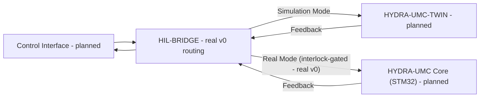

<p align="center">
  
</p>

# 🌉 HYDRA-UMC-HIL-BRIDGE

<p align="center"><a href="README.md">🇺🇸 English</a> | <a href="README_spa.md">🇪🇸 Español</a> | <a href="README_fra.md">🇫🇷 Français</a> | <a href="README_ita.md">🇮🇹 Italiano</a> | <a href="README_deu.md">🇩🇪 Deutsch</a> | <a href="README_zho.md">🇨🇳 简体中文</a> | <a href="README_jpn.md">🇯🇵 日本語</a> | 🇵🇹 <b>Português</b></p>

### ⚡ Interface hardware-in-the-loop para sincronização real-vs-virtual

<p align="center">
  
  
  
  
</p>

---

> **Estado de segurança (safety e security):** este ecossistema não é um sistema de segurança certificado. Ainda não existe um caminho de E-STOP por hardware, nem limites ou interlocks impostos pelo firmware, nem um comando de movimento verificado; as imagens de firmware são verificadas com CRC32 e um HMAC-SHA256 de chave partilhada, não com uma assinatura assimétrica; TLS e TLS mútuo são opcionais e estão desativados por defeito; nenhuma placa própria foi ainda montada ou testada. Leia a [base de segurança](https://github.com/JuanenRac/HYDRA-UMC-DOCS/blob/main/docs/SECURITY_BASELINE.md) e o [modelo de ameaças](https://github.com/JuanenRac/HYDRA-UMC-DOCS/blob/main/docs/THREAT_MODEL.md) antes de confiar em qualquer afirmação aqui para a segurança de uma pessoa.

## 📋 Num relance

| | |
|---|---|
| Versão | `0.0.9` |
| Maturidade | Funcional |
| Tecnologia | Rust / hardware-in-the-loop I/O |
| Destino | O Raspberry Pi CM5 de uma célula HYDRA-UMC |
| Em hardware real | Só simulado: testado com emuladores, dublês de teste ou simuladores; não há registo de execução em hardware real para esta versão |

## 1. 🛠️ VISÃO TÉCNICA GERAL

O **HYDRA-UMC-HIL-BRIDGE** é a artéria de comunicação destinada a permitir a funcionalidade Hardware-in-the-Loop (HIL). Encaminha comandos entre os controladores físicos e o motor de Digital Twin e espelha o estado entre ambos; ainda não foi ligado nenhum controlador real.

Permite aos programadores enviar comandos de qualquer interface (App, Suite, Studio) ao simulador como se fosse um robô físico e, inversamente, pode espelhar os movimentos de um robô físico no mundo virtual para supervisão remota e sombreamento de gémeo digital.

### Funcionalidades principais:
* 🔑 **Token Bearer opcional:** em loopback a API não precisa de token; fora do loopback `serve` recusa-se a arrancar sem um (`--token-file` ou `HYDRA_UMC_HIL_BRIDGE_TOKEN`). Com um token definido, todo o pedido tem de enviar `Authorization: Bearer <token>` (comparação em tempo constante); só `GET /stats`, o caminho de saúde do manifesto, fica aberto. *(implementado)*
* 🛡️ **Interbloqueio de segurança (v0):** o subcomando real `route` bloqueia um comando destinado a hardware real sempre que um relatório de risco do gémeo diga que uma colisão é iminente - veja a "Verificação de honestidade" abaixo para saber exatamente o que corre hoje.
* 🧯 **O interbloqueio falha em fechado (v0):** em modo `real` um comando só é reencaminhado com um relatório de risco do gémeo que diga que o caminho está livre: sem relatório fica bloqueado (omiti-lo equivalia a "sem colisão", o que bastava para chegar ao hardware), uma distância NaN bloqueia-o, e também menos de 5 cm de folga mesmo que o gémeo não tenha levantado `collision_imminent` (`MIN_CLEARANCE_M`). `--clear-distance METROS` dá à CLI um relatório de caminho livre; os corpos de pedido com mais de 16 KB são recusados com `413`. Um relatório que o chamador envia no mesmo pedido continua a ser palavra do chamador até existir o transporte do gémeo. *(implementado)*
* 🔏 **Os comandos reais são certificados pelo gémeo, e cada ordem fica registada:** no modo `real`, o relatório que deixa passar um comando já não é o que escreve quem chama. O pedido leva `certificate`, um relatório de risco assinado com a chave Ed25519 do HYDRA-UMC-TWIN para exatamente essa articulação e posição; o bridge só tem a chave pública (`--twin-public-key-file`) e recusa um certificado forjado, de outro comando, com mais de 2 s (`--certificate-max-age-ms`) ou já usado. Sem chave configurada, o modo real bloqueia todos os comandos; `--allow-unsigned-risk` (só para a bancada, anunciado em cada arranque) volta a acreditar no relatório de quem chama. Cada ordem real é registada (quem chama por `X-Hydra-Caller`, o endereço do par, se o token Bearer foi apresentado, o certificado e o resultado) antes de ser decidida: com `--audit-log FICHEIRO` é acrescentada a um ficheiro e, se o registo não puder ser escrito, a ordem é recusada; `GET /audit` lista as últimas. Um vetor de teste fixo, verificado com uma implementação independente da RFC 8032, é validado pelos dois repositórios. *(implementado, experimentado com o binário real do gémeo; nunca com hardware)*
* ⏱️ **Um comando real é um prazo, e a ponte para a articulação por si própria quando ele termina:** o comando traz `issued_at_ms`, `valid_for_ms` (no máximo 1000 ms, `--max-valid-for-ms`) e um `seq`; o que está caducado, vem do futuro, dura demasiado ou não é mais recente do que o último da sua articulação é bloqueado antes de gastar o certificado. Se não chegar um comando válido mais recente antes do fim do prazo, o vigilante para a articulação, regista-o na auditoria e conta-o em `GET /stats`, esteja o produtor vivo ou não. Os comandos reais sem janela são recusados, salvo com `--allow-undated-commands` (anunciado em cada arranque). *(implementado contra o recetor que apenas regista, ainda sem transporte; nunca contra hardware)*
* 📐 **As articulações e os intervalos do robô vêm do seu URDF, e os pedidos são atendidos por vários fios:** `serve --urdf FICHEIRO` bloqueia um comando real para uma articulação que o URDF não tem, uma fixa ou uma posição fora do seu `<limit>` antes de o certificado ser gasto (`outsideLimits` em `GET /stats`); com `serve --workers N` (8 por omissão) um cliente que envia meio pedido ocupa um fio e não a ponte, e as ordens reais continuam a ser decididas uma de cada vez. *(implementado; nunca contra hardware)*
* 🌉 **Ponte bidirecional (v0, ainda sem transporte):** existem o encaminhamento real por modo (Real/Simulação) e o espelhamento incondicional real; ainda não há ligação gRPC/WebSocket real a um HYDRA-UMC-TWIN ou controlador HYDRA-UMC verdadeiros.
* ⚡ **Espelhamento de latência zero (parcial):** o subcomando real `mirror` sombreia hoje um comando num sumidouro de registo; a "latência zero" por uma ligação de rede real continua a ser trabalho futuro.
* 📡 **Protocolo unificado (planeado):** usa gRPC para sincronização local de alta velocidade e WebSockets para monitorização remota - ainda não há transporte de rede ligado, de propósito (veja `Cargo.toml`).
* 🧪 **Transporte com falha segura, testável sem hardware (v0):** `CommandSink::send()` devolve um `Result` real, e um `SimulatedTransport` pode modelar uma ligação expirada ou desligada; a ponte reporta um resultado `TransportFailure` distinto em vez de alguma vez afirmar que um comando foi entregue quando não foi - exercitável com `--transport-latency-ms`/`--transport-timeout-ms`/`--transport-disconnected` em `route`.
* 🌐 **API JSON HTTP (v0):** `serve [--addr ADDR] [--port PORT]` (por defeito `127.0.0.1:8113`) expõe a mesma lógica exata de encaminhamento/espelhamento em `POST /route`, `POST /mirror` e `GET /stats` através de um servidor `tiny_http` bloqueante real - o mesmo binário que a unidade `systemd/hydra-umc-hil-bridge.service` de um CM5 implantado executa só em loopback. Veja [`docs/CLI_REFERENCE.md`](docs/CLI_REFERENCE.md) para o contrato completo de pedido/resposta.

**Verificação de honestidade - o que realmente funciona hoje:** `route --mode real|simulation --joint NAME --position VALUE [--collision-risk] [--distance METERS] [--clear-distance METERS] [--transport-latency-ms MS] [--transport-timeout-ms MS] [--transport-disconnected]` toma uma decisão de encaminhamento real - o modo `simulation` envia sempre, o modo `real` é controlado por um interbloqueio de segurança real que bloqueia o comando sem relatório de risco do gémeo, com `--collision-risk`, com uma distância NaN ou com menos de 5 cm de folga. `mirror --joint NAME --position VALUE` sombreia um comando incondicionalmente. `serve` expõe ambos por HTTP JSON real em vez de invocações CLI de uma só vez. Todos encaminham por defeito para um sumidouro em memória (`RecordingSink`, não um controlador real nem uma instância real do HYDRA-UMC-TWIN), ou para um `SimulatedTransport` que pode falhar de verdade (tempo esgotado/desligado) quando se passam as opções de transporte acima - ainda não há transporte gRPC/WebSocket. Veja o [`CHANGELOG.md`](CHANGELOG.md) para saber exatamente o que foi entregue, [`docs/CLI_REFERENCE.md`](docs/CLI_REFERENCE.md) para cada comando/ponto final e o Roteiro abaixo para o que ainda falta.

---

## 2. 🔄 FLUXO DE SINCRONIZAÇÃO HIL

A divisão por modos em `BRIDGE` e a porta do interbloqueio de segurança no caminho `Real Mode` são reais hoje (`bridge.rs`/`interlock.rs`), encaminhando para um sumidouro em memória em vez de um processo em direto. Tudo o que toca num processo real de `APP`, `TWIN` ou `CORE` por uma ligação real continua a ser trabalho futuro.



---

## 3. 🧱 ARQUITETURA E DECISÕES DE DESENHO

* **Porque esta ponte não tem pastas `hardware/`/`firmware/`/`os/`.** Software puro - liga hardware existente (apps reais, firmware real do HYDRA-UMC) ao gémeo digital, sem placa própria.
* **Porque é um irmão, e não um submódulo, do HYDRA-UMC-TWIN.** Uma ponte hardware-in-the-loop precisa de continuar a funcionar (e de manter a circulação dos comandos de um dispositivo real) independentemente do que o ciclo de desenho/física do próprio HYDRA-UMC-TWIN esteja a fazer nesse instante - um processo separado significa que um reinício do gémeo não deixa cair um comando real em curso.
* **Como isto se encaixa no resto do ecossistema.** Permite à HYDRA-UMC-SUITE, à HYDRA-UMC-ANDROID-CONTROL e à HYDRA-UMC-IOS-CONTROL controlar o HYDRA-UMC-TWIN como se fosse uma célula real apoiada no HYDRA-UMC-SERVER - a mesma superfície de controlo, um destino simulado.
* **Porque o interbloqueio confia no próprio indicador `collision_imminent` do gémeo, e mesmo assim acrescenta uma folga mínima e falha em fechado.** O gémeo já fez o raciocínio geométrico/físico real quando reporta o risco, pelo que a ponte não volta a derivar colisões; mas um gémeo que diz "sem colisão" a um milímetro, uma distância NaN ou a ausência de relatório não são uma afirmação de que o caminho esteja livre, pelo que bloqueiam o comando (`MIN_CLEARANCE_M` = 5 cm, um piso conservador e não uma distância certificada: isso é do firmware). Veja a documentação do módulo `interlock.rs` para ver como isto reflete a fronteira detetar-vs-impor do HYDRA-UMC-SAFETY-ZONES.
* **Porque o modo `Simulation` nunca é controlado pelo interbloqueio.** O objetivo de encaminhar um comando para o gémeo em vez de hardware real é poder ver uma colisão prevista acontecer em segurança - bloqueá-la aí anularia a funcionalidade que existe para suportar.
* **Porque o `CommandSink` é um trait com apenas uma implementação `RecordingSink` em memória hoje.** Ainda não existe transporte gRPC/WebSocket real (veja o comentário do próprio `Cargo.toml`) - o `RecordingSink` é honesto quanto a isso: regista o que lhe pediram para enviar sem transmitir a lado nenhum, o mesmo raciocínio do `NullEStopRequester` no HYDRA-UMC-SAFETY-ZONES.
* **Porque o `CommandSink::send()` devolve um `Result` em vez de `()`.** Um transporte real pode falhar a entrega (tempo esgotado, desligado) independentemente de o interbloqueio ter deixado passar o comando - se o `send()` não puder falhar, a ponte não tem forma de evitar declarar sucesso num comando que nunca chegou. O `SimulatedTransport` existe precisamente para que esse caminho de falha seja real e testável hoje, sem esperar que exista um transporte real.
* **Porque o `TransportFailure` é um `RouteOutcome` separado de `BlockedByInterlock`.** São tipos diferentes de "não aconteceu": um é uma recusa de segurança deliberada (o interbloqueio decidiu não o reencaminhar), o outro é uma entrega de melhor esforço que simplesmente não se completou. Fundi-los numa falha genérica esconderia que camada de segurança parou realmente o comando - útil para depuração e para qualquer política futura que os trate de forma diferente (p. ex. repetir uma falha de transporte é razoável; repetir por cima de um bloqueio do interbloqueio não é).

---

## 📂 ESTRUTURA DE DIRETÓRIOS

Ponte de software puro sem desenho de hardware próprio, pelo que este projeto não tem pastas `hardware/`, `firmware/` nem `os/`, segundo a política de estrutura dos repositórios.

```text
HYDRA-UMC-HIL-BRIDGE/
├── src/
│   ├── protocol.rs       # Tipos reais JointCommand/Mode
│   ├── interlock.rs      # Decisão real do interbloqueio de segurança
│   ├── bridge.rs         # Encaminhamento real por modo + espelhamento + CommandSink/SimulatedTransport
│   ├── certificate.rs    # Verifica o certificado de risco Ed25519 do gémeo: ligado ao comando, atualidade, uso único
│   ├── audit.rs          # Quem enviou cada ordem real: linhas JSON antes de a decidir, últimos registos em memória
│   ├── server.rs         # Superfície JSON/HTTP simples (tiny_http, bloqueante, sem runtime assíncrono)
│   └── main.rs           # Ponto de entrada + subcomandos reais `route`/`mirror`
├── docs/                # Documentação e guias de integração
├── images/              # Multimédia e diagramas
├── systemd/
│   └── hydra-umc-hil-bridge.service # Unidade systemd local do CM5 para a API route/mirror
├── tools/
│   ├── build_test.py    # Verificação de compilação sem versão
│   └── ci_validate.py   # Validação de manifesto/CHANGELOG/docs usada pelo CI
├── Cargo.toml           # Metadados do pacote, dependências, versão em odómetro
├── bump_version.py      # Subida de versão ao estilo conta-quilómetros (executada só pelo comando `bump` explícito)
├── bump_manifest_version.py # Sincroniza a versão de hydra-umc.project.json com a nativa (--sync)
├── build.sh / build.bat # Valida e compila (compilar nunca altera a versão)
├── build-test.sh / build-test.bat # Verificação de compilação sem versão (sem CHANGELOG/subida de versão)
└── run.sh / run.bat     # Executa o binário de lançamento compilado (reencaminha argumentos)
```

---

## 🏗️ GUIA DE COMPILAÇÃO E EXECUÇÃO

Requer a cadeia de ferramentas Rust (`cargo`/`rustc`, instale com o [rustup](https://rustup.rs)) e Python 3.10+ (só para o `bump_version.py`).

```bash
# Linux / macOS
./build.sh   # `cargo test` (115 testes), depois `cargo build --release`
./run.sh     # executa target/release/hydra-umc-hil-bridge, imprime nome + versão + função
```

```bat
:: Windows
build.bat
run.bat
```

`build.sh`/`build.bat` nunca alteram a versão (só `python tools/hydra_project_tool.py bump` a sobe), executam a suite de testes real e compilam depois um binário de lançamento.

Os subcomandos reais `route` e `mirror`:

```bash
./run.sh route --mode real --joint shoulder --position 0.5 --clear-distance 2.0
# SENT: routed to real HYDRA-UMC controller

./run.sh route --mode real --joint shoulder --position 0.5
# BLOCKED: safety interlock refused to forward to real hardware (no twin risk report: a real command is not forwarded without one)

./run.sh route --mode real --joint shoulder --position 0.5 --collision-risk --distance 0.02
# BLOCKED: safety interlock refused to forward to real hardware (twin reports imminent collision at 0.020m)

./run.sh route --mode simulation --joint shoulder --position 0.5 --collision-risk --distance 0.02
# SENT: routed to HYDRA-UMC-TWIN (simulation)

./run.sh mirror --joint elbow --position -0.3
# MIRRORED: joint 'elbow' = -0.300000 shadowed into the twin

./run.sh route --mode real --joint shoulder --position 0.5 --transport-timeout-ms 100 --transport-latency-ms 500
# TRANSPORT FAILURE: command was not confirmed delivered (transport timed out after 100ms)

./run.sh route --mode real --joint shoulder --position 0.5 --transport-disconnected
# TRANSPORT FAILURE: command was not confirmed delivered (transport is disconnected)
```

O `route` termina com `0` (enviado), `1` (bloqueado pelo interbloqueio de segurança - um resultado real e com significado, não um erro), `2` (entrada inválida) ou `3` (falha de transporte - o interbloqueio deixou passar, mas a entrega não foi confirmada). O `mirror` termina com `0`, `2` ou `3`.

A mesma lógica de encaminhamento/espelhamento também está acessível por HTTP JSON real:

```bash
./run.sh serve --addr 127.0.0.1 --port 8113
# [hil-bridge] HTTP API listening on 127.0.0.1:8113
# [hil-bridge] POST /route, POST /mirror, GET /stats

curl -X POST http://127.0.0.1:8113/route \
    -d '{"mode":"real","joint":"shoulder","position":1.0,"risk":{"collision_imminent":true,"distance_m":0.02}}'
# {"BlockedByInterlock":{"reason":"twin reports imminent collision at 0.020m"}}
```

Veja [`docs/CLI_REFERENCE.md`](docs/CLI_REFERENCE.md) para o contrato completo de pedido/resposta de `POST /route`/`POST /mirror`/`GET /stats` - é o mesmo binário que a unidade `systemd/hydra-umc-hil-bridge.service` de um CM5 implantado executa.

O `Cargo.toml` não traz intencionalmente crates externos para além de `tiny_http`/`serde`/`serde_json` (a superfície HTTP JSON real) - veja o comentário no seu interior para saber o que mais se acrescenta quando começar o trabalho de transporte gRPC/WebSocket real.

---

## 🚀 ROTEIRO
* **Fase 1:** Sincronização do Digital Twin com telemetria de hardware em tempo real e latência inferior a 10 ms.
* **Fase 2:** Integração da Physics Replica com simuladores de nível industrial (Isaac Sim) e suporte de corpos deformáveis.
* **Fase 3:** Padrões de recuperação automática do Node Healing para failover descentralizado e deteção precoce de degradação de sensores.
* **Fase 4:** Sincronização HIL de vários controladores (Swarm HIL) e suporte para geração de dados sintéticos fotorrealistas.

---

## 🔗 Projetos relacionados

Este projeto faz parte do ecossistema de robótica HYDRA-UMC do mesmo autor (JuanenRac / Electro Hobby 3D). Vale a pena conhecê-los, porque um pedido pode ser, na verdade, sobre um destes e não sobre este repositório.

**Projeto-mãe**
- **[HYDRA-UMC-TWIN](https://github.com/JuanenRac/HYDRA-UMC-TWIN)** — hub de integração para o motor de gémeo digital, com um contrato real de sincronização de compatibilidade de versões; o pai de que este repositório é um serviço de simulação específico, dentro do seu próprio motor de gémeo digital.

**Projetos irmãos** — os outros serviços de simulação do próprio motor de gémeo digital do HYDRA-UMC-TWIN
- **[HYDRA-UMC-PHYSICS-REPLICA](https://github.com/JuanenRac/HYDRA-UMC-PHYSICS-REPLICA)** — cinemática direta real e validação de limites de juntas sobre um subconjunto real de URDF.
- **[HYDRA-UMC-SYNTHETIC-DATA-GEN](https://github.com/JuanenRac/HYDRA-UMC-SYNTHETIC-DATA-GEN)** — gerador procedural real de cenas 2D com exportação de anotações YOLO/COCO.

**Diretamente relacionados**
- **[HYDRA-UMC-STUDIO](https://github.com/JuanenRac/HYDRA-UMC-STUDIO)** — painel de controlo web com visualização 3D multirrobô em tempo real — um dos 3 clientes que podem enviar comandos por esta ponte como se fosse um robô físico, quando existir um transporte real.
- **[HYDRA-UMC-SUITE](https://github.com/JuanenRac/HYDRA-UMC-SUITE)** — centro de comando de enxame para desktop (PySide6) para vários servidores em simultâneo, empacotado como executável independente — um dos 3 clientes que podem enviar comandos por esta ponte como se fosse um robô físico, quando existir um transporte real.
- **[HYDRA-UMC-ANDROID-CONTROL](https://github.com/JuanenRac/HYDRA-UMC-ANDROID-CONTROL)** — app de controlo Android nativa com início de sessão biométrico e um companheiro Wear OS emparelhado — um dos 3 clientes que podem enviar comandos por esta ponte como se fosse um robô físico, quando existir um transporte real.
- **[HYDRA-UMC-IOS-CONTROL](https://github.com/JuanenRac/HYDRA-UMC-IOS-CONTROL)** — app de controlo iOS/iPadOS (Flutter) com sincronização WebSocket em tempo real — um dos 3 clientes que podem enviar comandos por esta ponte como se fosse um robô físico, quando existir um transporte real.
- **[HYDRA-UMC-SERVER](https://github.com/JuanenRac/HYDRA-UMC-SERVER)** — o back-end headless real (REST/WebSocket) com que todos os clientes de controlo realmente comunicam — o back-end por trás desses 3 clientes, o controlador real a que o próprio `route --mode real` desta ponte acaba por se dirigir quando existir um transporte.

**Também fazem parte do ecossistema**

*Hardware e plataforma centrais*
- **[HYDRA-UMC](https://github.com/JuanenRac/HYDRA-UMC)** — o desenho da placa-mãe do braço robótico: anfitrião CM5 + STM32H745 de dois núcleos, pensado para orquestrar até 8 braços de ferramenta por CAN-OTA/SPI-OTA (firmware numa fase inicial; ainda sem placa montada).
- **[HYDRA-UMC-OS](https://github.com/JuanenRac/HYDRA-UMC-OS)** — camada de produto reproduzível do Raspberry Pi OS para o CM5: agente só de leitura, configuração/perfis validados, aprovisionamento Wi-Fi de primeiro contacto.
- **[HYDRA-UMC-SDK](https://github.com/JuanenRac/HYDRA-UMC-SDK)** — o contrato JSON-Schema partilhado e a fronteira de software de controlo de trabalhos contra a qual cada bridge valida os seus comandos (não é uma função de segurança certificada).
- **[HYDRA-UMC-CONNECTOR-HUB](https://github.com/JuanenRac/HYDRA-UMC-CONNECTOR-HUB)** — registo declarativo de manifestos de adaptador e validador para conectores de máquinas externas; estende a ideia de contrato do SDK a máquinas externas sem substituir os projetos de gateway industrial.

*Backend central e clientes*
- **[HYDRA-UMC-DSI](https://github.com/JuanenRac/HYDRA-UMC-DSI)** — interface tátil nativa para o ecrã tátil DSI de 7" integrado, executada no próprio CM5.
- **[HYDRA-UMC-EDITOR-URDF](https://github.com/JuanenRac/HYDRA-UMC-EDITOR-URDF)** — criador/editor gráfico de URDF para desktop que envia os modelos concluídos para o catálogo do STUDIO.
- **[HYDRA-UMC-EDITOR-STL](https://github.com/JuanenRac/HYDRA-UMC-EDITOR-STL)** — editor de modelos STL para desktop que transforma/substitui/remove/adiciona peças reais no mesmo catálogo de modelos que o HYDRA-UMC-EDITOR-URDF também edita.
- **[HYDRA-UMC-BRIDGE-AMR](https://github.com/JuanenRac/HYDRA-UMC-BRIDGE-AMR)** — fronteira de coordenação para frotas AGV/AMR através de um publicador MQTT VDA 5050 (testado apenas contra uma frota emulada).
- **[HYDRA-UMC-BRIDGE-CNC](https://github.com/JuanenRac/HYDRA-UMC-BRIDGE-CNC)** — coordenador de células CNC de alto nível com acesso ao estado GRBL e aos bytes de controlo (testado apenas contra um emulador).
- **[HYDRA-UMC-BRIDGE-DROIDS](https://github.com/JuanenRac/HYDRA-UMC-BRIDGE-DROIDS)** — fronteira de coordenação para droides com patas/humanoides, com um emissor de comandos para o Boston Dynamics Spot (testado apenas contra um emulador).
- **[HYDRA-UMC-BRIDGE-LASER](https://github.com/JuanenRac/HYDRA-UMC-BRIDGE-LASER)** — coordenador de células laser que lê 3 sinais GPIO (chave, caixa e interlock) (testado apenas contra um chip simulado; não pode armar nem disparar um laser).
- **[HYDRA-UMC-BRIDGE-OPENPNP](https://github.com/JuanenRac/HYDRA-UMC-BRIDGE-OPENPNP)** — coordenador seguro de fluxo de placa de alto nível para pick-and-place com OpenPnP.
- **[HYDRA-UMC-BRIDGE-PRINTER3D](https://github.com/JuanenRac/HYDRA-UMC-BRIDGE-PRINTER3D)** — fronteira de coordenação segura para impressoras 3D Moonraker/Klipper, com comandos de trabalho reais protegidos por portas.
- **[HYDRA-UMC-BRIDGE-ROS2](https://github.com/JuanenRac/HYDRA-UMC-BRIDGE-ROS2)** — coordenador com um transporte ROS 2 baseado em rclpy importado sob demanda (ainda não executado contra uma instalação ROS 2).
- **[HYDRA-UMC-BRIDGE-UAV](https://github.com/JuanenRac/HYDRA-UMC-BRIDGE-UAV)** — fronteira de coordenação para UAV com câmara, com um emissor de comandos MAVLink (testado apenas contra um emulador).

*Plataforma de ferramentas URTC*
- **[URTC](https://github.com/JuanenRac/URTC)** — firmware da placa física Universal Robot Tool Controller, mais de 25 perfis de ferramenta por barramento CAN.
- **[URTC-FLASHER](https://github.com/JuanenRac/URTC-FLASHER)** — ferramenta gráfica de gravação para desktop das placas URTC, por CAN-OTA e também SWD/JTAG de chip completo.
- **[URTC-TESTER](https://github.com/JuanenRac/URTC-TESTER)** — ferramenta de diagnóstico CAN em tempo real para desktop das placas URTC, com um painel por perfil de ferramenta.
- **[URTC-WEB-STUDIO](https://github.com/JuanenRac/URTC-WEB-STUDIO)** — alternativa no navegador ao URTC-TESTER através da Web Serial API, sem instalação local.
- **[URTC-GATEWAY](https://github.com/JuanenRac/URTC-GATEWAY)** — gateway à frente do barramento CAN do URTC: lista de identificadores permitidos, limite de taxa e chave de sessão; software testado num computador, ainda não num barramento real.

*Nó de IA de visão (Hailo-8)*
- **[HYDRA-UMC-VISION-NODE](https://github.com/JuanenRac/HYDRA-UMC-VISION-NODE)** — centro de integração do pipeline de visão Hailo-8, com uma verificação real de prontidão de hardware por fase.
- **[HYDRA-UMC-DETECTION-HEF](https://github.com/JuanenRac/HYDRA-UMC-DETECTION-HEF)** — registo real de modelos compilados com verificação segura de carga por arquitetura Hailo e soma de verificação.
- **[HYDRA-UMC-VISION-STREAMER](https://github.com/JuanenRac/HYDRA-UMC-VISION-STREAMER)** — pipeline GStreamer real e gerador de configuração MediaMTX com uma fronteira de integração HailoRT real.
- **[HYDRA-UMC-VISUAL-SERVOING-API](https://github.com/JuanenRac/HYDRA-UMC-VISUAL-SERVOING-API)** — lei de correção de servovisão baseada em posição com autorização condicionada ao estado da zona; ainda sem estimativa de pose por câmara.
- **[HYDRA-UMC-SAFETY-ZONES](https://github.com/JuanenRac/HYDRA-UMC-SAFETY-ZONES)** — lógica v0 de violação de zonas, atualidade da calibração e pedido de E-STOP que lê as posições dos objetos de um ficheiro; nenhum detetor a alimenta e ainda não há E-STOP físico ligado.

*Nó de IA cognitiva (Hailo-10)*
- **[HYDRA-UMC-COGNITIVE-NODE](https://github.com/JuanenRac/HYDRA-UMC-COGNITIVE-NODE)** — centro de integração do pipeline cognitivo do Hailo-10 (orquestração de LLM/VLA/voz).
- **[HYDRA-UMC-VLA-ENGINE](https://github.com/JuanenRac/HYDRA-UMC-VLA-ENGINE)** — codificação/descodificação real de tokens de ação e geração de trajetórias para um modelo Visão-Linguagem-Ação.
- **[HYDRA-UMC-VOICE-UI](https://github.com/JuanenRac/HYDRA-UMC-VOICE-UI)** — front-end de voz real (VAD + analisador de intenções) com um relé para o relógio limitado e protegido por confirmação.
- **[HYDRA-UMC-SEMANTIC-PLANNER](https://github.com/JuanenRac/HYDRA-UMC-SEMANTIC-PLANNER)** — decomposição real de tarefas baseada em regras e recuperação semântica de erros sobre os códigos de erro do MCU.
- **[HYDRA-UMC-DOCS-QA](https://github.com/JuanenRac/HYDRA-UMC-DOCS-QA)** — pesquisa real de documentos TF-IDF só com a biblioteca padrão sobre a documentação Markdown deste ecossistema.
- **[HYDRA-UMC-LOCAL-TECHNICIAN](https://github.com/JuanenRac/HYDRA-UMC-LOCAL-TECHNICIAN)** — técnico de manutenção de IA local, protegido por políticas, para o próprio ecossistema: observa, diagnostica e propõe correções; os dois níveis de maior risco não estão implementados de propósito.

*Orquestração e enxame*
- **[HYDRA-UMC-ORCHESTRATOR](https://github.com/JuanenRac/HYDRA-UMC-ORCHESTRATOR)** — centro de integração com um contrato real de relatório de saúde gRPC/Protobuf e uma máquina de estados de missões.
- **[HYDRA-UMC-JOB-DISPATCHER](https://github.com/JuanenRac/HYDRA-UMC-JOB-DISPATCHER)** — fila real de trabalhos por prioridade com deduplicação, sobre uma API HTTP real.
- **[HYDRA-UMC-NODE-HEALING](https://github.com/JuanenRac/HYDRA-UMC-NODE-HEALING)** — vigilante real de saúde da frota por gRPC com repetição/recuo e deteção de identidade incoerente.
- **[HYDRA-UMC-PATH-PLANNER-3D](https://github.com/JuanenRac/HYDRA-UMC-PATH-PLANNER-3D)** — planeador real de trajetórias 3D baseado em RRT com validação real de colisões com obstáculos e espaço de trabalho.
- **[HYDRA-UMC-SWARM-SYNC](https://github.com/JuanenRac/HYDRA-UMC-SWARM-SYNC)** — sincronização real de estado CRDT LWW-Element-Map, testada por propriedades para a convergência de várias células.

*Dados e análise*
- **[HYDRA-UMC-DATALAKE](https://github.com/JuanenRac/HYDRA-UMC-DATALAKE)** — armazém real de séries temporais sobre sqlite3 com uma API HTTP real de ingestão/consulta.
- **[HYDRA-UMC-ANOMALY-DETECTOR](https://github.com/JuanenRac/HYDRA-UMC-ANOMALY-DETECTOR)** — detetor real de anomalias por FFT e linha de base estatística, com monitorização de deriva.
- **[HYDRA-UMC-PRODUCTION-REPORTS](https://github.com/JuanenRac/HYDRA-UMC-PRODUCTION-REPORTS)** — cálculo real de OEE/disponibilidade sobre o histórico do DATALAKE, com exportação CSV reprodutível.
- **[HYDRA-UMC-TELEMETRY-COLLECTOR](https://github.com/JuanenRac/HYDRA-UMC-TELEMETRY-COLLECTOR)** — pipeline real de ingestão CAN/WebSocket para o DATALAKE, com deduplicação por sequência.

*Gateway industrial*
- **[HYDRA-UMC-GATEWAY-INDUSTRIAL](https://github.com/JuanenRac/HYDRA-UMC-GATEWAY-INDUSTRIAL)** — centro de integração que retransmite para protocolos industriais, com uma camada real de lista de comandos permitidos e contrapressão.
- **[HYDRA-UMC-OPCUA-SERVER](https://github.com/JuanenRac/HYDRA-UMC-OPCUA-SERVER)** — espaço de endereços OPC-UA real, verificado com uma sessão de cliente real do protocolo binário.
- **[HYDRA-UMC-MQTT-BROKER](https://github.com/JuanenRac/HYDRA-UMC-MQTT-BROKER)** — broker MQTT real com autenticação opcional por cliente e ACL de tópicos.
- **[HYDRA-UMC-MTCONNECT-ADAPTER](https://github.com/JuanenRac/HYDRA-UMC-MTCONNECT-ADAPTER)** — endpoints XML MTConnect `/probe` e `/current` reais com saída em modo degradado.

*Ferramentas complementares e operações do ecossistema*
- **[HYDRA-UMC-DASHBOARD-AI](https://github.com/JuanenRac/HYDRA-UMC-DASHBOARD-AI)** — painéis de Resumos Inteligentes e Realce de Anomalias sobre o DATALAKE/ANOMALY-DETECTOR, com um recurso estatístico honesto.
- **[HYDRA-UMC-TOOL-CLI](https://github.com/JuanenRac/HYDRA-UMC-TOOL-CLI)** — CLI da frota com um contrato de códigos de saída real e estável, um cliente vivo genuíno da API do HYDRA-UMC-SERVER.
- **[HYDRA-UMC-WATCH](https://github.com/JuanenRac/HYDRA-UMC-WATCH)** — aplicação companheira WearOS com padrões de alerta tátil e um relé de voz para o telemóvel emparelhado (ainda não executada num relógio físico).
- **[URTC-SMART-RACK](https://github.com/JuanenRac/URTC-SMART-RACK)** — firmware de um rack de montagem de placas com descodificação real do ID da ferramenta e lógica de pré-aquecimento Smart Idle.
- **[URTC-VISION-TOOL](https://github.com/JuanenRac/URTC-VISION-TOOL)** — firmware mais um companheiro de visão em Python real para uma cabeça de ferramenta de inspeção térmica/RGB.
- **[HYDRA-UMC-UPDATER](https://github.com/JuanenRac/HYDRA-UMC-UPDATER)** — ferramenta administrativa de desktop que descobre, clona e atualiza todos os repositórios deste ecossistema.
- **[HYDRA-UMC-OS-REBUILDER](https://github.com/JuanenRac/HYDRA-UMC-OS-REBUILDER)** — ferramenta de desktop para Windows/Linux que constrói uma imagem do CM5 pronta a gravar com as versões mais recentes do ecossistema, com configuração de primeiro arranque de Wi-Fi/utilizador/SSH ao estilo do Raspberry Pi Imager.
- **[HYDRA-UMC-OPS-AGENT](https://github.com/JuanenRac/HYDRA-UMC-OPS-AGENT)** — coordenador de incidentes de manutenção: um papel de borda de poucos privilégios recolhe um inventário/estado higienizado, um papel de plano de controlo mostra-o só de leitura e pede a um fornecedor de IA que sugira um diagnóstico; nunca aplica um patch nem implanta nada.
- **[HYDRA-UMC-DEV-SERVER](https://github.com/JuanenRac/HYDRA-UMC-DEV-SERVER)** — anfitrião de desenvolvimento reproduzível (Raspberry Pi 5 / CM5) que guarda o código-fonte do ecossistema e executa tarefas limitadas de compilação/teste numa fila durável; um papel de desenvolvimento dedicado, explicitamente não um CM5 operacional.

---

## 📚 Documentação e comunidade

- **[docs/CLI_REFERENCE.md](docs/CLI_REFERENCE.md)** — cada invocação de `route`/`mirror`/`serve`, saída real capturada de um binário de lançamento compilado, a tabela de códigos de saída e o contrato HTTP JSON de `POST /route`/`POST /mirror`/`GET /stats`.
- **[CONTRIBUTING.md](CONTRIBUTING.md)** — pilha tecnológica e diretrizes de código para um pull request.
- **[CODE_OF_CONDUCT.md](CODE_OF_CONDUCT.md)** — as normas de comportamento esperadas nesta comunidade.
- **[SECURITY.md](SECURITY.md)** — como comunicar uma vulnerabilidade e as áreas de segurança em que este projeto se concentra.
- **[SUPPORT.md](SUPPORT.md)** — onde fazer perguntas e comunicar erros.
- **[LICENSE.md](LICENSE.md)** — a licença deste projeto.

## 👤 AUTOR
**JuanenRac** (Electro Hobby 3D)
📧 electrohobby3d@gmail.com
📺 [youtube.com/@electrohobby3d](https://youtube.com/@electrohobby3d)

## 📜 LICENÇA
GPL-3.0-or-later - consulte LICENSE para mais detalhes.

