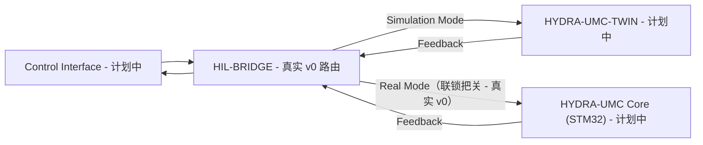

<!-- =============================================================================
HYDRA-UMC-HIL-BRIDGE - Hardware-in-the-loop bridge
Copyright (C) JuanenRac (Electro Hobby 3D) <electrohobby3d@gmail.com>
GPL-3.0-or-later - see LICENSE
============================================================================= -->

<p align="center">
  
</p>

# 🔁 HYDRA-UMC-HIL-BRIDGE

<p align="center"><a href="README.md">🇺🇸 English</a> | <a href="README_spa.md">🇪🇸 Español</a> | <a href="README_fra.md">🇫🇷 Français</a> | <a href="README_ita.md">🇮🇹 Italiano</a> | <a href="README_deu.md">🇩🇪 Deutsch</a> | 🇨🇳 <b>简体中文</b> | <a href="README_jpn.md">🇯🇵 日本語</a> | <a href="README_por.md">🇵🇹 Português</a></p>

### ⚡ 用于真实与虚拟同步的硬件在环接口

<p align="center">
  
  
  
  
  
  
</p>

---

> **安全与安防现状:**本生态系统不是经认证的安全系统。目前尚无硬件 E-STOP 通路,没有由固件强制执行的限位或联锁,也没有经过验证的运动指令;固件映像使用 CRC-32 和 Ed25519 签名校验,发布构建会拒绝已公开的开发密钥(中继之后的工具头和扩展板仍运行 URTC 的引导程序,它们使用共享密钥的 HMAC-SHA256 而不是签名);TLS 与双向 TLS 均为可选项,默认关闭;自制电路板尚未组装或测试。在依赖此处任何说法来保障人身安全之前,请先阅读[安全基线](https://github.com/JuanenRac/HYDRA-UMC-DOCS/blob/main/docs/SECURITY_BASELINE.md)和[威胁模型](https://github.com/JuanenRac/HYDRA-UMC-DOCS/blob/main/docs/THREAT_MODEL.md)。

---

## 📋 速览

| | |
|---|---|
| 版本 | `0.1.0` |
| 成熟度 | 可用 |
| 测试 | 115 (`cargo test`) |
| 技术栈 | Rust / hardware-in-the-loop I/O |
| 目标 | HYDRA-UMC 工作单元的 Raspberry Pi CM5 |
| 真实硬件 | 仅模拟：使用模拟器、替身或仿真测试；此版本没有在真实硬件上运行的记录 |

**跳转：** [概述](#-概述) · [架构](#-架构) · [功能](#-功能) · [安全与防护](#-安全与防护) · [接口](#-接口) · [配置](#-配置) · [快速开始](#-快速开始) · [测试](#-测试) · [故障排除](#-故障排除) · [仓库结构](#-仓库结构) · [相关项目](#-相关项目)

## 🚦 项目状态

每一行是本仓库的一个部分，灯号表示它今天做到了哪一步。内容依据仓库能够展示的证据（测试、构建、运行），而不是计划。

🟢 已完成并验证 · 🟡 可用，有已知限制 · 🟠 部分完成或尚未验证 · 🔴 未完成或不可用

| 领域 | 状态 | 在这里的含义 |
|---|---|---|
| 软件 | 🟡 | 主要用途可用；上面的诚实性检查列出了仍然缺少的内容 |
| 测试 | 🟢 | 115 项自动测试，每次变更都会运行 |
| 真实硬件 | 🟠 | 仅模拟：使用模拟器、替身或仿真测试；此版本没有在真实硬件上运行的记录 |
| 文档 | 🟢 | 八种语言的 README，每次变更都会与清单核对 |

## 🎯 概述

**HYDRA-UMC-HIL-BRIDGE** 是用来实现硬件在环(HIL)功能的通信干线。它在物理控制器与数字孪生引擎之间路由指令并镜像状态;目前还没有连接过任何真实控制器。

它使开发者能够从任何界面（应用程序、Suite、Studio）向仿真器发送指令，
就像它是一台物理机器人一样；反过来，它也可以将物理机器人的运动镜像到
虚拟世界中，用于远程监控和数字孪生影子跟随。

## 🧩 在 HYDRA-UMC 中的角色

**HYDRA-UMC-HIL-BRIDGE** 位于控制界面与可能是真实或模拟的机器人之间。在真实模式下，只有数字孪生为该关节签发了新的联锁证书，命令才会移动关节；在模拟模式下，桥接改为镜像位置。它负责决策；通往真实控制器和孪生的传输尚未实现。

## 🏛️ 架构

`BRIDGE` 处基于模式的分流，以及 `Real Mode` 路径上的安全联锁闸门，
今天都是真实的（`bridge.rs`/`interlock.rs`），路由到的是一个内存中的
接收器，而非真实的实时进程。任何涉及真实 `APP`、`TWIN` 或 `CORE` 进程、
通过真实连接的部分，仍是未来工作。

<p align="center">
  
</p>

<details>
<summary>图表的文本版本（Mermaid）</summary>



</details>

**为什么这样构建**

* **为何本桥接服务没有 `hardware/`/`firmware/`/`os/` 文件夹。** 纯软件——它将现有硬件（真实应用程序、真实的 HYDRA-UMC 固件）桥接到数字孪生系统，没有自己的板卡。
* **为何它是 HYDRA-UMC-TWIN 的兄弟项目，而非子模块。** 硬件在环桥接需要持续运行（并保持真实设备指令的持续流动），独立于 HYDRA-UMC-TWIN 自身的渲染/物理循环在那一刻正在做什么——作为独立进程意味着孪生系统的重启不会丢弃正在传输中的真实指令。
* **这如何融入生态系统的其余部分。** 使 HYDRA-UMC-SUITE、HYDRA-UMC-ANDROID-CONTROL 和 HYDRA-UMC-IOS-CONTROL 能够像控制一个真实的、由 HYDRA-UMC-SERVER 支撑的单元一样控制 HYDRA-UMC-TWIN——同一个控制界面，一个模拟的目标。
* **为什么联锁信任孪生自己的 `collision_imminent` 标志，同时仍增加最小间隙并采用故障关闭。** 孪生在报告风险时已经完成了真正的几何/物理推理，所以桥接器不会重新推导碰撞；但孪生在一毫米处说“无碰撞”、距离为 NaN 或根本没有报告，都不能说明路径畅通，因此会阻止命令（`MIN_CLEARANCE_M` = 5 厘米，这是保守的下限而不是认证距离：那由固件负责）。关于这如何对应 HYDRA-UMC-SAFETY-ZONES 的检测与执行边界，请参阅 `interlock.rs` 的模块文档。
* **为何 `Simulation` 模式永远不受联锁约束。** 把指令路由到孪生系统而非真实硬件的全部意义，就在于能够安全地看到预测的碰撞真实发生——如果在那里阻止它，就违背了这个功能本身存在的意义。
* **为何 `CommandSink` 今天只是一个只有内存实现 `RecordingSink` 的 trait。** 目前还没有真正的 gRPC/WebSocket 传输层（见 `Cargo.toml` 自身的注释）——`RecordingSink` 对此很诚实：它只记录被要求发送的内容，不会向任何地方传输，与 HYDRA-UMC-SAFETY-ZONES 中 `NullEStopRequester` 的思路完全相同。
* **为何 `CommandSink::send()` 返回 `Result` 而非 `()`。** 无论联锁是否放行了该指令，真实传输层都可能送达失败（超时、断开）——如果 `send()` 不能失败，桥接服务就无法避免在指令从未真正到达时仍宣称成功。`SimulatedTransport` 存在的意义正是让这条失败路径在今天就是真实且可测试的，而不必等到真实传输层出现。
* **为何 `TransportFailure` 是与 `BlockedByInterlock` 分开的 `RouteOutcome`。** 这是两种不同的「没有发生」：一种是刻意的安全拒绝（联锁决定不转发），另一种是尽力而为的投递未能完成。把两者合并成一个通用失败会掩盖到底是哪一层安全机制真正拦下了指令——这对调试有用，也为未来可能区别对待两者的策略留出空间（重试一次传输失败是合理的；重试一次联锁拦截则不是）。

## ✨ 功能

* 🔑 **可选的 Bearer 令牌：** 在回环地址上 API 不需要令牌；在非回环地址上，没有令牌 `serve` 就拒绝启动（`--token-file` 或 `HYDRA_UMC_HIL_BRIDGE_TOKEN`）。设置令牌后，每个请求都必须发送 `Authorization: Bearer <token>`（恒定时间比较）；只有清单声明的健康路径 `GET /stats` 保持开放。*(已实现)*
* 🛡️ **安全联锁（v0）：** 真实的 `route` 子命令会在孪生系统的风险报告指出碰撞即将发生时，阻止发往真实硬件的指令——下方"诚实说明"给出了今天到底能跑什么。
* 🧯 **联锁采用故障关闭（v0）：** 在 `real` 模式下，只有带有表明路径畅通的孪生风险报告时才会转发命令：没有报告就会被阻止（以前省略报告等于“无碰撞”，足以到达硬件），距离为 NaN 会被阻止，即使孪生没有设置 `collision_imminent`，间隙不足 5 厘米也会被阻止（`MIN_CLEARANCE_M`）。`--clear-distance 米数` 可向 CLI 提供畅通报告；超过 16 KB 的请求体会被以 `413` 拒绝。在孪生传输实现之前，调用方在同一请求中发送的报告仍只是调用方的一面之词。*（已实现）*
* 🔏 **真实命令由孪生体认证,每条指令都有记录:** 在 `real` 模式下,放行命令的报告不再是调用方自己写的那份。请求携带 `certificate`,即用 HYDRA-UMC-TWIN 的 Ed25519 密钥为恰好该关节和位置签名的风险报告;桥接只持有公钥(`--twin-public-key-file`),会拒绝伪造的、属于另一条命令的、超过 2 秒(`--certificate-max-age-ms`)或已被使用过的证书。未配置密钥时,真实模式会阻止所有命令;`--allow-unsigned-risk`(仅限台架使用,每次启动都会提示)会重新相信调用方的报告。每条真实指令在被裁决之前都会被记录(来自 `X-Hydra-Caller` 的调用方、对端地址、是否出示了 Bearer 令牌、证书和结果):使用 `--audit-log 文件` 时追加到文件,如果记录无法写入则拒绝该指令;`GET /audit` 列出最近的记录。一个固定的测试向量(已用独立的 RFC 8032 实现核对)由两个仓库共同验证。*(已实现,已针对真实的孪生体二进制程序试过;从未针对硬件)*
* ⏱️ **真实命令是一份限时租约,租约到期时网桥会自行停止该关节:** 命令带有 `issued_at_ms`、`valid_for_ms`(最多 1000 毫秒,`--max-valid-for-ms`)和 `seq`;已过期、来自未来、时间过长或不比该关节上一条更新的命令,会在消耗其证书之前被拦截。若在租约结束前没有更新的有效命令到达,无论生产者是否还活着,看门狗都会停止该关节,写入审计并计入 `GET /stats`。没有时间窗口的真实命令会被拒绝,除非使用 `--allow-undated-commands`(每次启动都会提示)。*(已针对只做记录的接收端实现,尚无传输层;从未在硬件上验证)*
* 📐 **机器人的关节和范围来自其 URDF,请求由多个工作线程处理:** `serve --urdf 文件` 会在消耗证书之前,拦截针对 URDF 中不存在的关节、固定关节或超出其 `<limit>` 的位置的真实命令(`GET /stats` 中的 `outsideLimits`);使用 `serve --workers N`(默认 8)时,只发送半个请求的客户端只会占用一个工作线程,而不是整个网桥,真实指令仍然逐条判定。*(已实现;从未针对硬件运行)*
* 🌉 **双向桥接（v0，尚无传输层）：** 真实的、基于模式（真实/仿真）的路由和真实的、无条件的镜像已经存在；目前还没有连接到真正的 HYDRA-UMC-TWIN 或 HYDRA-UMC 控制器的真实 gRPC/WebSocket 连接。
* ⚡ **零延迟镜像（部分）：** 真实的 `mirror` 子命令今天会把指令镜像到一个内存中的记录接收器；在真实网络连接上的"零延迟"仍是未来工作。
* 📡 **统一协议（计划中）：** 使用 gRPC 进行高速本地同步，使用 WebSocket 进行远程监控——目前故意还没有接入任何网络传输层（见 `Cargo.toml`）。
* 🧪 **故障安全传输层，无需硬件即可测试（v0）：** `CommandSink::send()` 现在返回真实的 `Result`；新增的 `SimulatedTransport` 可以模拟超时或断开的链路，桥接服务会报告一个独立的 `TransportFailure` 结果，绝不会在指令实际未送达时声称已送达——可通过 `route` 上的 `--transport-latency-ms`/`--transport-timeout-ms`/`--transport-disconnected` 触发验证。
* 🌐 **HTTP JSON API（v0）：** `serve [--addr ADDR] [--port PORT]`（默认 `127.0.0.1:8113`）通过一个真实的阻塞式 `tiny_http` 服务器，把同样的路由/镜像逻辑以 `POST /route`、`POST /mirror`、`GET /stats` 的形式对外提供——与部署到 CM5 上的 `systemd/hydra-umc-hil-bridge.service` 单元运行的是同一个二进制文件（仅限回环地址）。完整的请求/响应契约见 [`docs/CLI_REFERENCE.md`](docs/CLI_REFERENCE.md)。

**诚实说明——今天实际运行的内容：** `route --mode real|simulation --joint 名称 --position 数值 [--collision-risk] [--distance 米数] [--transport-latency-ms 毫秒] [--transport-timeout-ms 毫秒] [--transport-disconnected]` 会做出真实的路由决策——`simulation` 模式总是发送，`real` 模式受真实安全联锁约束，在没有孪生体风险报告、设置了 `--collision-risk`、距离为 NaN 或余量小于 5 厘米时就会阻止指令（`--clear-distance 米数` 可提供无碰撞报告）。`mirror --joint 名称 --position 数值` 会无条件镜像一条指令。`serve` 则把两者都以真实的 HTTP JSON 形式对外提供，而不再局限于一次性的 CLI 调用。三者默认都路由到一个内存中的接收器（`RecordingSink`，而非真正的控制器或真正的 HYDRA-UMC-TWIN 实例），如果传入上述传输层参数，则路由到一个真的会失败（超时/断开）的 `SimulatedTransport`——目前还没有 gRPC/WebSocket 传输层。具体已交付内容请参见 [`CHANGELOG.md`](CHANGELOG.md)，每个命令/端点请参见 [`docs/CLI_REFERENCE.md`](docs/CLI_REFERENCE.md)，尚待完成的内容请参见下方路线图。

## 🔒 安全与防护

| 威胁 | 防御 | 位置 |
|---|---|---|
| 把关节移向碰撞 | 真实模式的命令需要孪生签名的 ed25519 联锁证书（域 `hydra-umc-interlock-certificate-v1`），时效不超过 2000 ms（`--certificate-max-age-ms`），超前不超过 1000 ms，不得重放（记住 8192 个随机数），且间隙至少 0.05 m | `certificate.rs`, `interlock.rs` |
| 没有证书、没有日期或有效期极长的命令 | 真实模式下没有 `--twin-public-key-file`（或 `HYDRA_UMC_HIL_BRIDGE_TWIN_KEY_FILE`）时所有命令都被阻止；`--allow-unsigned-risk` 是台架设置；无日期的命令需要 `--allow-undated-commands`，有效期由 `--max-valid-for-ms` 限制 | `main.rs` |
| 未知或超出范围的关节，以及链路丢失 | `--urdf`（或 `HYDRA_UMC_HIL_BRIDGE_URDF`）定义关节及其范围，没有它就没有范围检查；看门狗（50 ms 周期）在租约到期时停止关节，即使工作线程繁忙也是如此 | `limits.rs`, `server.rs`, `watchdog.rs` |
| 匿名访问、大请求体、慢请求 | 至少 16 个字符的 Bearer 令牌（`HYDRA_UMC_HIL_BRIDGE_TOKEN` 或 `--token-file`）；请求体最大 16 KiB（`413`），默认 8 个工作线程（`--workers`，1 到 256）；每个决定进入 200 条审计记录的环（`--audit-log` 另存为文件） | `access.rs`, `server.rs`, `audit.rs` |

**它绝不做的事：** 真实模式下没有新的签名证书绝不移动关节，并且尚未驱动过真实机器人。

## 🔌 接口

`127.0.0.1:8113` 上的 HTTP API 和命令行，二者使用同一套决策逻辑。`Content-Type` 必填（否则 `415`）。完整参考见 `docs/CLI_REFERENCE.md`。

| 主题或路由 | 内容 |
|---|---|
| `POST /route` | 为关节（真实或模拟）决定一个命令 |
| `POST /mirror` | 在真实侧与虚拟侧之间镜像位置 |
| `GET /stats`, `GET /audit` | 计数器与最近决定的环 |
| `serve` | `serve [--addr 127.0.0.1] [--port 8113] [--workers N] [--token-file FILE]`；一次性命令行接受 `--joint --position --mode --collision-risk --distance --clear-distance` |

## ⚙️ 配置

| 变量 | 默认值 | 设置内容 |
|---|---|---|
| `HYDRA_UMC_HIL_BRIDGE_TOKEN`, `--token-file` | 无令牌 | Bearer 令牌，至少 16 个字符 |
| `HYDRA_UMC_HIL_BRIDGE_TWIN_KEY_FILE`, `--twin-public-key-file` | 未设置 | 孪生的公钥；没有它真实模式会阻止所有命令 |
| `HYDRA_UMC_HIL_BRIDGE_ALLOW_UNSIGNED_RISK` | `0` | `1` 接受无证书的命令（仅限台架） |
| `HYDRA_UMC_HIL_BRIDGE_ALLOW_UNDATED_COMMANDS`, `--max-valid-for-ms` | 关闭 | 接受无日期的命令；命令有效期的上限 |
| `HYDRA_UMC_HIL_BRIDGE_URDF`, `--urdf` | 未设置 | 用于检查关节及范围的 URDF |
| `HYDRA_UMC_HIL_BRIDGE_AUDIT_LOG`, `--audit-log` | 仅环形缓冲 | 同时把审计记录保存到此文件 |
| `--certificate-max-age-ms`, `--workers` | `2000`, `8` | 证书的最大时效；工作线程数（1 到 256） |

## 🚀 快速开始

需要较新的稳定版 Rust 工具链（`cargo`）；Python 3 仅用于项目工具。

```bash
cargo test                                                    # 115 tests, no hardware
bash run.sh        # Linux, macOS (run.bat on Windows)
cargo run --release -- serve --port 8113 --token-file token.txt   # real mode also needs --twin-public-key-file
```

## 🧪 测试

运行 `cargo test` 会执行 115 个 Rust 测试，它们位于 `src/` 的模块内，不需要硬件和网络。

CI 运行 `HYDRA_UMC_CI=1 python tools/ci_validate.py`，检查清单、文档、八个 README 和图片。

## 🏗️ 构建与发布

需要 Rust 工具链（`cargo`/`rustc`，通过 [rustup](https://rustup.rs) 安装）
以及 Python 3.10+（仅供 `bump_version.py` 使用）。

```bash
# Linux / macOS
./build.sh   # 、`cargo test`（115 个测试），然后执行 `cargo build --release`
./run.sh     # 运行 target/release/hydra-umc-hil-bridge，打印名称 + 版本 + 角色
```

```bat
:: Windows
build.bat
run.bat
```

`build.sh`/`build.bat` 不会更改版本号（只有 `python tools/hydra_project_tool.py bump` 才会提升），运行真实的测试
套件，然后构建一个 release 二进制文件。

真实的 `route` 和 `mirror` 子命令：

```bash
./run.sh route --mode real --joint shoulder --position 0.5 --clear-distance 2.0
# SENT: routed to real HYDRA-UMC controller

./run.sh route --mode real --joint shoulder --position 0.5
# BLOCKED: safety interlock refused to forward to real hardware (no twin risk report: a real command is not forwarded without one)

./run.sh route --mode real --joint shoulder --position 0.5 --collision-risk --distance 0.02
# BLOCKED: safety interlock refused to forward to real hardware (twin reports imminent collision at 0.020m)

./run.sh route --mode simulation --joint shoulder --position 0.5 --collision-risk --distance 0.02
# SENT: routed to HYDRA-UMC-TWIN (simulation)

./run.sh mirror --joint elbow --position -0.3
# MIRRORED: joint 'elbow' = -0.300000 shadowed into the twin

./run.sh route --mode real --joint shoulder --position 0.5 --transport-timeout-ms 100 --transport-latency-ms 500
# TRANSPORT FAILURE: command was not confirmed delivered (transport timed out after 100ms)

./run.sh route --mode real --joint shoulder --position 0.5 --transport-disconnected
# TRANSPORT FAILURE: command was not confirmed delivered (transport is disconnected)
```

`route` 在发送成功时退出码为 `0`，被安全联锁阻止时为 `1`（这是一个真实
且有意义的结果，不是错误），输入无效时为 `2`，传输失败时为 `3`
（联锁放行了指令，但投递未被确认）。`mirror` 退出码为 `0`、`2` 或 `3`。

同样的路由/镜像逻辑，也可以通过真实的 HTTP JSON 访问：

```bash
./run.sh serve --addr 127.0.0.1 --port 8113
# [hil-bridge] HTTP API listening on 127.0.0.1:8113
# [hil-bridge] POST /route, POST /mirror, GET /stats

curl -X POST http://127.0.0.1:8113/route \
    -d '{"mode":"real","joint":"shoulder","position":1.0,"risk":{"collision_imminent":true,"distance_m":0.02}}'
# {"BlockedByInterlock":{"reason":"twin reports imminent collision at 0.020m"}}
```

完整的 `POST /route`/`POST /mirror`/`GET /stats` 请求/响应契约见
[`docs/CLI_REFERENCE.md`](docs/CLI_REFERENCE.md)——这与部署到 CM5 上的
`systemd/hydra-umc-hil-bridge.service` 单元运行的是同一个二进制文件。

`Cargo.toml` 目前刻意不包含真实 HTTP JSON 接口所需的
`tiny_http`/`serde`/`serde_json` 之外的任何外部 crate——具体在真正的
gRPC/WebSocket 传输层工作开始时还会添加什么，请见其内部的注释说明。

## 🩺 故障排除

| 你看到 | 原因 | 处理 |
|---|---|---|
| every command is blocked in real mode | 没有给出孪生的公钥 | 给出 `--twin-public-key-file`；仅在台架上可用 `--allow-unsigned-risk` |
| a certificate is refused | 时效超过 2000 ms、超前太多、被重放，或间隙小于 0.05 m | 让孪生为每个命令签发新证书，并保持两侧时钟接近 |
| `415`, `413` | 缺少 `Content-Type` 或请求体超过 16 KiB | 发送 `Content-Type: application/json` 和更小的请求体 |

## 📂 仓库结构

<p align="center">
  
</p>

<details>
<summary>目录树的文本版本</summary>

```text
HYDRA-UMC-HIL-BRIDGE/
├── src/
│   ├── bridge.rs                                路由与镜像决策
│   ├── certificate.rs                           签名的联锁证书（ed25519）
│   ├── interlock.rs limits.rs                   联锁规则与 URDF 关节限位
│   ├── server.rs                                HTTP API、工作线程与看门狗线程
│   ├── watchdog.rs                              租约到期时停止关节
│   ├── access.rs audit.rs                       Bearer 令牌与审计环
│   └── protocol.rs main.rs                      消息格式、命令行与启动
├── docs/                                        命令行参考与联锁证书
├── systemd/                                     CM5 的服务单元
├── tools/                                       构建与测试运行器、版本提升、CI 校验、README 与图片的生成和检查
├── images/                                      横幅图与 README 的图片
├── .github/                                     CI 工作流和 Issue 模板
├── hydra-umc.project.json                       清单：版本、成熟度、系列
├── CHANGELOG.md                                 每个版本的变化
├── build.sh build.bat                           构建脚本（从不改变版本）
├── build-test.sh build-test.bat                 构建脚本（从不改变版本）
├── test.sh test.bat                             运行测试
├── Cargo.toml / Cargo.lock                      Rust 包与锁定的依赖
├── bump_version.py / bump_manifest_version.py   显式的版本提升
├── run.sh run.bat                               启动服务
└── SECURITY.md SUPPORT.md CONTRIBUTING.md CODE_OF_CONDUCT.md LICENSE LICENSE.md
```

</details>

## 🗺️ 路线图与已知限制

**当前已知限制**

* **第一阶段：** 数字孪生与实时硬件遥测的同步，延迟低于 10ms。
* **第二阶段：** 物理复制品与工业级仿真器（Isaac Sim）的集成，以及可变形体支持。
* **第三阶段：** 用于去中心化故障转移和早期传感器退化检测的节点自愈自动化恢复模式。
* **第四阶段：** 多控制器 HIL 同步（集群 HIL）以及照片级真实合成数据生成支持。

## 🌍 语言

本 README 和仓库文档提供八种语言：英语、西班牙语、德语、法语、意大利语、日语、中文和葡萄牙语（葡萄牙）。它们同时编写，并由 CI 检查八个文件拥有相同的章节和相同的链接。 本仓库没有自己的界面或消息目录，因此没有需要翻译的界面文字。

## 🔗 相关项目

本项目是同一作者(JuanenRac / Electro Hobby 3D)打造的 HYDRA-UMC 机器人生态系统的一部分。值得了解,因为某个请求实际上可能是关于这些项目之一,而非本仓库本身。

**父项目**
- **[HYDRA-UMC-TWIN](https://github.com/JuanenRac/HYDRA-UMC-TWIN)** — 面向数字孪生引擎的集成中枢,具备真实的版本兼容性同步契约;本仓库是其自身数字孪生引擎中一个具体仿真服务所属的父项目。

**兄弟项目** —— HYDRA-UMC-TWIN 自身数字孪生引擎中的其他仿真服务
- **[HYDRA-UMC-PHYSICS-REPLICA](https://github.com/JuanenRac/HYDRA-UMC-PHYSICS-REPLICA)** — 面向真实 URDF 子集的真实正向运动学与关节限位校验。
- **[HYDRA-UMC-SYNTHETIC-DATA-GEN](https://github.com/JuanenRac/HYDRA-UMC-SYNTHETIC-DATA-GEN)** — 具备 YOLO/COCO 标注导出功能的真实程序化 2D 场景生成器。

**直接相关**
- **[HYDRA-UMC-STUDIO](https://github.com/JuanenRac/HYDRA-UMC-STUDIO)** — 具有实时多机器人 3D 可视化的网页控制面板 —— 一旦存在真实传输层,即可像操作真实机器人一样通过本桥接发送指令的 3 个客户端界面之一。
- **[HYDRA-UMC-SUITE](https://github.com/JuanenRac/HYDRA-UMC-SUITE)** — 面向多台服务器的桌面(PySide6)集群指挥中心，打包为独立可执行文件 —— 一旦存在真实传输层,即可像操作真实机器人一样通过本桥接发送指令的 3 个客户端界面之一。
- **[HYDRA-UMC-ANDROID-CONTROL](https://github.com/JuanenRac/HYDRA-UMC-ANDROID-CONTROL)** — 具有生物识别登录和配对 Wear OS 伴侣应用的原生 Android 控制应用 —— 一旦存在真实传输层,即可像操作真实机器人一样通过本桥接发送指令的 3 个客户端界面之一。
- **[HYDRA-UMC-IOS-CONTROL](https://github.com/JuanenRac/HYDRA-UMC-IOS-CONTROL)** — 具有实时 WebSocket 同步的 iOS/iPadOS 控制应用(Flutter) —— 一旦存在真实传输层,即可像操作真实机器人一样通过本桥接发送指令的 3 个客户端界面之一。
- **[HYDRA-UMC-SERVER](https://github.com/JuanenRac/HYDRA-UMC-SERVER)** — 每个控制客户端真正通信的真实无头后端(REST/WebSocket) —— 这 3 个客户端界面背后的后端,一旦存在传输层,本桥接自身的 `route --mode real` 最终指向的真实控制器。

**生态系统中的其他项目**

*核心硬件与平台*
- **[HYDRA-UMC](https://github.com/JuanenRac/HYDRA-UMC)** — 机器人手臂主板设计——CM5 主机 + 双核 STM32H745,目标是通过 CAN-OTA/SPI-OTA 协调最多 8 条工具臂(固件处于早期阶段,尚无已组装的电路板)。
- **[HYDRA-UMC-OS](https://github.com/JuanenRac/HYDRA-UMC-OS)** — 面向 CM5 的可复现 Raspberry Pi OS 产品层——只读代理、经过验证的配置/配置文件、WiFi 首次配网。
- **[HYDRA-UMC-SDK](https://github.com/JuanenRac/HYDRA-UMC-SDK)** — 每个桥接都据此校验自身指令的共享 JSON-Schema 契约与软件作业门限边界(并非经认证的安全功能)。
- **[HYDRA-UMC-CONNECTOR-HUB](https://github.com/JuanenRac/HYDRA-UMC-CONNECTOR-HUB)** — 面向外部机器连接器的声明式适配器清单注册与校验工具；把 SDK 自身的契约理念扩展到外部机器，而不取代工业网关类项目。

*核心后端与客户端*
- **[HYDRA-UMC-DSI](https://github.com/JuanenRac/HYDRA-UMC-DSI)** — 面向机载 7 英寸 DSI 触摸屏的原生触控界面，直接嵌入 CM5 本体。
- **[HYDRA-UMC-EDITOR-URDF](https://github.com/JuanenRac/HYDRA-UMC-EDITOR-URDF)** — 将完成的模型推送到 STUDIO 自身目录的桌面版图形化 URDF 创建/编辑工具。
- **[HYDRA-UMC-EDITOR-STL](https://github.com/JuanenRac/HYDRA-UMC-EDITOR-STL)** — 桌面 STL 模型编辑器，在 HYDRA-UMC-EDITOR-URDF 编辑的同一模型目录中变换/替换/移除/添加真实部件。
- **[HYDRA-UMC-BRIDGE-AMR](https://github.com/JuanenRac/HYDRA-UMC-BRIDGE-AMR)** — 通过 VDA 5050 MQTT 发布者为 AGV/AMR 车队提供的协调边界(仅针对仿真车队测试)。
- **[HYDRA-UMC-BRIDGE-CNC](https://github.com/JuanenRac/HYDRA-UMC-BRIDGE-CNC)** — 具备 GRBL 状态/控制字节访问能力的高层 CNC 单元协调器(仅针对模拟器测试)。
- **[HYDRA-UMC-BRIDGE-DROIDS](https://github.com/JuanenRac/HYDRA-UMC-BRIDGE-DROIDS)** — 面向足式/人形机器人的协调边界,带有 Boston Dynamics Spot 指令发送器(仅针对模拟器测试)。
- **[HYDRA-UMC-BRIDGE-LASER](https://github.com/JuanenRac/HYDRA-UMC-BRIDGE-LASER)** — 读取 3 路钥匙/外壳/联锁 GPIO 信号的激光单元协调器(仅针对模拟芯片测试;无法使激光器上膛或发射)。
- **[HYDRA-UMC-BRIDGE-OPENPNP](https://github.com/JuanenRac/HYDRA-UMC-BRIDGE-OPENPNP)** — 面向 OpenPnP 贴片机板级流程的安全高层协调器。
- **[HYDRA-UMC-BRIDGE-PRINTER3D](https://github.com/JuanenRac/HYDRA-UMC-BRIDGE-PRINTER3D)** — 面向 Moonraker/Klipper 3D 打印机的安全协调边界，具备真实的受控作业指令。
- **[HYDRA-UMC-BRIDGE-ROS2](https://github.com/JuanenRac/HYDRA-UMC-BRIDGE-ROS2)** — 带有惰性导入 rclpy ROS 2 传输层的协调器(尚未在 ROS 2 环境中运行)。
- **[HYDRA-UMC-BRIDGE-UAV](https://github.com/JuanenRac/HYDRA-UMC-BRIDGE-UAV)** — 面向搭载摄像头的无人机的协调边界,带有 MAVLink 指令发送器(仅针对模拟器测试)。

*URTC 工具平台*
- **[URTC](https://github.com/JuanenRac/URTC)** — 面向实体 Universal Robot Tool Controller 板卡的固件，通过 CAN 总线支持 25 种以上工具配置。
- **[URTC-FLASHER](https://github.com/JuanenRac/URTC-FLASHER)** — 面向 URTC 板卡的桌面图形烧录工具，支持 CAN-OTA 以及全芯片 SWD/JTAG。
- **[URTC-TESTER](https://github.com/JuanenRac/URTC-TESTER)** — 面向 URTC 板卡的桌面实时 CAN 总线诊断工具，每种工具配置对应一个面板。
- **[URTC-WEB-STUDIO](https://github.com/JuanenRac/URTC-WEB-STUDIO)** — 通过 Web Serial API 实现的浏览器版 URTC-TESTER 替代方案，无需本地安装。
- **[URTC-GATEWAY](https://github.com/JuanenRac/URTC-GATEWAY)** — URTC CAN 总线前的网关：允许的标识符列表、速率限制和会话密钥；软件已在计算机上测试，尚未在真实总线上测试。

*视觉 AI 节点(Hailo-8)*
- **[HYDRA-UMC-VISION-NODE](https://github.com/JuanenRac/HYDRA-UMC-VISION-NODE)** — 面向 Hailo-8 视觉流水线的集成中枢，具备逐阶段的真实硬件就绪检测。
- **[HYDRA-UMC-DETECTION-HEF](https://github.com/JuanenRac/HYDRA-UMC-DETECTION-HEF)** — 具备 Hailo 架构/校验和安全加载验证的真实编译模型注册表。
- **[HYDRA-UMC-VISION-STREAMER](https://github.com/JuanenRac/HYDRA-UMC-VISION-STREAMER)** — 具备真实 HailoRT 集成边界的真实 GStreamer 流水线 + MediaMTX 配置生成器。
- **[HYDRA-UMC-VISUAL-SERVOING-API](https://github.com/JuanenRac/HYDRA-UMC-VISUAL-SERVOING-API)** — 以区域状态为授权条件的 Position-Based Visual Servoing 修正律;尚无摄像头位姿估计。
- **[HYDRA-UMC-SAFETY-ZONES](https://github.com/JuanenRac/HYDRA-UMC-SAFETY-ZONES)** — 从文件读取物体位置的 v0 区域入侵、校准新鲜度与 E-STOP 请求逻辑;没有检测器为其供数,也尚未连接任何物理 E-STOP。

*认知 AI 节点(Hailo-10)*
- **[HYDRA-UMC-COGNITIVE-NODE](https://github.com/JuanenRac/HYDRA-UMC-COGNITIVE-NODE)** — 面向 Hailo-10 认知流水线(LLM/VLA/语音编排)的集成中枢。
- **[HYDRA-UMC-VLA-ENGINE](https://github.com/JuanenRac/HYDRA-UMC-VLA-ENGINE)** — 面向 Vision-Language-Action 模型的真实动作 token 编解码与轨迹生成。
- **[HYDRA-UMC-VOICE-UI](https://github.com/JuanenRac/HYDRA-UMC-VOICE-UI)** — 具备受限、需确认的 Watch 中继的真实语音前端(VAD + 意图解析)。
- **[HYDRA-UMC-SEMANTIC-PLANNER](https://github.com/JuanenRac/HYDRA-UMC-SEMANTIC-PLANNER)** — 基于真实规则的任务分解，以及针对 MCU 错误码的语义化错误恢复。
- **[HYDRA-UMC-DOCS-QA](https://github.com/JuanenRac/HYDRA-UMC-DOCS-QA)** — 面向本生态系统自身 Markdown 文档的真实纯标准库 TF-IDF 文档检索。
- **[HYDRA-UMC-LOCAL-TECHNICIAN](https://github.com/JuanenRac/HYDRA-UMC-LOCAL-TECHNICIAN)** — 面向生态系统自身的本地、按策略门控的 AI 维护技师——观察、诊断并提出修复建议;两个最高风险等级目前特意尚未实现。

*编排与集群*
- **[HYDRA-UMC-ORCHESTRATOR](https://github.com/JuanenRac/HYDRA-UMC-ORCHESTRATOR)** — 具备真实 gRPC/Protobuf 健康报告契约与任务状态机的集成中枢。
- **[HYDRA-UMC-JOB-DISPATCHER](https://github.com/JuanenRac/HYDRA-UMC-JOB-DISPATCHER)** — 基于真实 HTTP API 的真实优先级任务队列，支持去重。
- **[HYDRA-UMC-NODE-HEALING](https://github.com/JuanenRac/HYDRA-UMC-NODE-HEALING)** — 具备重试/退避与身份不匹配检测的真实基于 gRPC 的车队健康看门狗。
- **[HYDRA-UMC-PATH-PLANNER-3D](https://github.com/JuanenRac/HYDRA-UMC-PATH-PLANNER-3D)** — 具备真实障碍物/工作空间碰撞校验的真实基于 RRT 的三维路径规划器。
- **[HYDRA-UMC-SWARM-SYNC](https://github.com/JuanenRac/HYDRA-UMC-SWARM-SYNC)** — 经过多单元收敛属性测试的真实 CRDT LWW-Element-Map 状态同步。

*数据与分析*
- **[HYDRA-UMC-DATALAKE](https://github.com/JuanenRac/HYDRA-UMC-DATALAKE)** — 具备真实数据摄入/查询 HTTP API 的真实 sqlite3 时序数据存储。
- **[HYDRA-UMC-ANOMALY-DETECTOR](https://github.com/JuanenRac/HYDRA-UMC-ANOMALY-DETECTOR)** — 具备漂移监测能力的真实 FFT + 统计基线异常检测器。
- **[HYDRA-UMC-PRODUCTION-REPORTS](https://github.com/JuanenRac/HYDRA-UMC-PRODUCTION-REPORTS)** — 基于 DATALAKE 历史数据的真实 OEE/可用率计算，支持可复现的 CSV 导出。
- **[HYDRA-UMC-TELEMETRY-COLLECTOR](https://github.com/JuanenRac/HYDRA-UMC-TELEMETRY-COLLECTOR)** — 面向 DATALAKE 的真实 CAN/WebSocket 数据摄入管道，支持序列去重。

*工业网关*
- **[HYDRA-UMC-GATEWAY-INDUSTRIAL](https://github.com/JuanenRac/HYDRA-UMC-GATEWAY-INDUSTRIAL)** — 中继至工业协议的集成中枢，具备真实的指令白名单/背压控制层。
- **[HYDRA-UMC-OPCUA-SERVER](https://github.com/JuanenRac/HYDRA-UMC-OPCUA-SERVER)** — 经真实二进制协议客户端会话验证的真实 OPC-UA 地址空间。
- **[HYDRA-UMC-MQTT-BROKER](https://github.com/JuanenRac/HYDRA-UMC-MQTT-BROKER)** — 具备可选按客户端认证与主题 ACL 的真实 MQTT 代理。
- **[HYDRA-UMC-MTCONNECT-ADAPTER](https://github.com/JuanenRac/HYDRA-UMC-MTCONNECT-ADAPTER)** — 具备降级模式输出的真实 MTConnect `/probe` 与 `/current` XML 端点。

*辅助工具与生态系统运维*
- **[HYDRA-UMC-DASHBOARD-AI](https://github.com/JuanenRac/HYDRA-UMC-DASHBOARD-AI)** — 基于 DATALAKE/ANOMALY-DETECTOR 的智能摘要与异常高亮面板，具备诚实的统计回退机制。
- **[HYDRA-UMC-TOOL-CLI](https://github.com/JuanenRac/HYDRA-UMC-TOOL-CLI)** — 具备真实、稳定退出码契约的车队 CLI，是 HYDRA-UMC-SERVER 自身 API 的真实在线客户端。
- **[HYDRA-UMC-WATCH](https://github.com/JuanenRac/HYDRA-UMC-WATCH)** — 带有触觉提醒模式与配对手机语音中继的 WearOS 伴侣应用(尚未在实体手表上运行)。
- **[URTC-SMART-RACK](https://github.com/JuanenRac/URTC-SMART-RACK)** — 面向板卡安装机架的固件，具备真实的工具 ID 解码与 Smart Idle 预热逻辑。
- **[URTC-VISION-TOOL](https://github.com/JuanenRac/URTC-VISION-TOOL)** — 面向热成像/RGB 检测工具头的固件及真实 Python 视觉伴侣程序。
- **[HYDRA-UMC-UPDATER](https://github.com/JuanenRac/HYDRA-UMC-UPDATER)** — 发现、克隆并更新本生态系统中每个仓库的管理类桌面工具。
- **[HYDRA-UMC-OS-REBUILDER](https://github.com/JuanenRac/HYDRA-UMC-OS-REBUILDER)** —— 构建即刻可烧录、预装生态系统最新版本的 CM5 镜像的 Windows/Linux 桌面工具,具备类似 Raspberry Pi Imager 风格的首次启动 Wi-Fi/用户/SSH 配置。
- **[HYDRA-UMC-OPS-AGENT](https://github.com/JuanenRac/HYDRA-UMC-OPS-AGENT)** — 维护事件协调器：一个低权限的边缘角色采集经过脱敏的库存/健康快照，一个控制面角色以只读方式渲染它，并请求某个 AI 提供方给出诊断建议——从不应用补丁，也从不部署任何内容。
- **[HYDRA-UMC-DEV-SERVER](https://github.com/JuanenRac/HYDRA-UMC-DEV-SERVER)** — 可复现的开发主机（Raspberry Pi 5 / CM5），保存整个生态系统的源代码，并在持久队列下运行有界的构建/测试任务；这是专用的开发角色，明确区别于运行中的 CM5。

## 📚 文档

更多阅读：

* [docs/CLI_REFERENCE.md](docs/CLI_REFERENCE.md) - 每个命令行选项、HTTP 路由及其错误
* [docs/INTERLOCK_CERTIFICATE.md](docs/INTERLOCK_CERTIFICATE.md) - 签名联锁证书的内容及其校验方式
* [生态系统的安全基线](https://github.com/JuanenRac/HYDRA-UMC-DOCS/blob/main/docs/SECURITY_BASELINE.md)
* [生态系统的威胁模型](https://github.com/JuanenRac/HYDRA-UMC-DOCS/blob/main/docs/THREAT_MODEL.md)
* [本仓库的更新日志](CHANGELOG.md)
* [本仓库的许可证](LICENSE.md)

## 🤝 参与贡献与社区

* 提交 pull request 之前，请运行 `HYDRA_UMC_CI=1 py -3 tools/ci_validate.py`（或 `HYDRA_UMC_CI=1 python3 tools/ci_validate.py`）：它必须输出 `CI_VALIDATION=PASS`。此检查不要运行 `build.sh` 或 `build.bat`；构建不是检查。
* 八个 README 由 HYDRA-UMC-DOCS 中的同一个源生成；请勿手工编辑。修改源文件，再用 `tools/make_readmes.py` 重新生成。
* 不要在 README 中声称尚未运行过的内容：属实时请写“仅模拟”或“尚未在硬件上试过”。
* 请参阅 [CONTRIBUTING.md](CONTRIBUTING.md)、[行为准则](CODE_OF_CONDUCT.md)、[SECURITY.md](SECURITY.md) 和 [SUPPORT.md](SUPPORT.md)。

## 👤 作者

**JuanenRac (Electro Hobby 3D)** · electrohobby3d@gmail.com

## 📜 许可证

GPL-3.0-or-later - [LICENSE](LICENSE).
